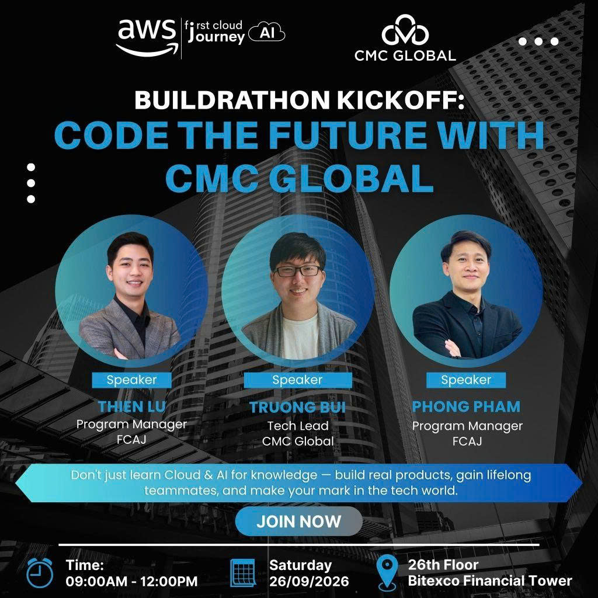
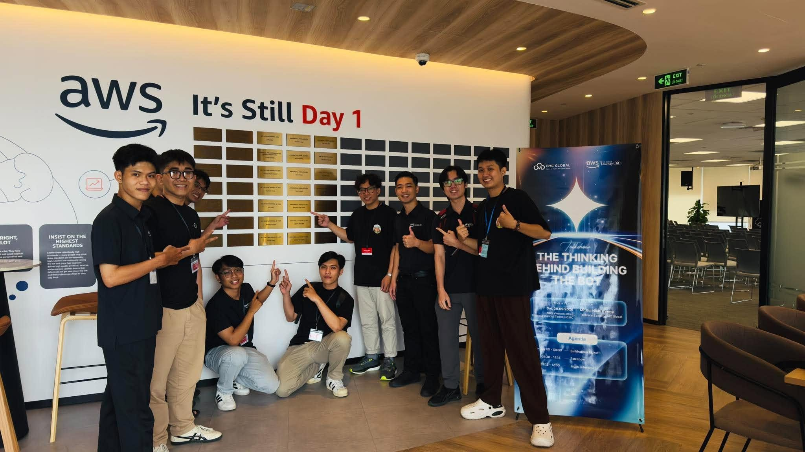
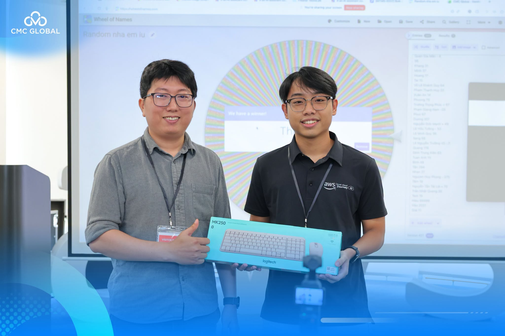

# Event report: “Buildrathon Kickoff: Code the Future with CMC Global”

**Date:** Saturday 26/09/2026, 09:00–12:00 · **Location:** AWS office, Level 26 Bitexco, Ho Chi Minh City · **Role:** Attendee

### Event objectives

Organized by AWS First Cloud Journey AI (FCAJ) together with CMC Global to open the Buildrathon round for interns. The poster's main message: learn Cloud and AI not just to know them, but to build real products.

### Speakers

- Thien Lu — Program Manager, FCAJ
- Truong Bui (Bùi Nhật Trường) — Technical Leader, CMC Global
- Phong Pham — Program Manager, FCAJ

### Highlights

| Time | Session |
|---|---|
| 09:00–09:30 | Buildrathon Kickoff |
| 09:30–11:15 | Talkshow “The Thinking Behind Building the Bot” |
| 11:15–12:00 | Mock interview |

The event ended with a lucky draw on Wheel of Names; the prize was a Logitech MK250 keyboard and mouse set.

<!-- draft: the two sections below were written by Claude from the agenda session titles, not from my own notes. Edit them. -->
### What I learned

- The talkshow on how to think about building a bot: before picking a model, decide what problem the bot solves, for whom, and what it does when it is not sure.
- An AI product that runs for real needs the "non-AI" parts too: queues, error handling, monitoring and cost.
- The mock interview made me practice explaining my project briefly and answering technical questions under time pressure.

### Applying it to my work / the Ask First project

Ask First is also a bot (on Telegram) that checks messages for scams, so these points map straight onto the team's work: keep the bot's scope to scoring message risk, have a fast path and an LLM kill switch, and always return a safe answer when the pipeline fails.

### Check-in photo

