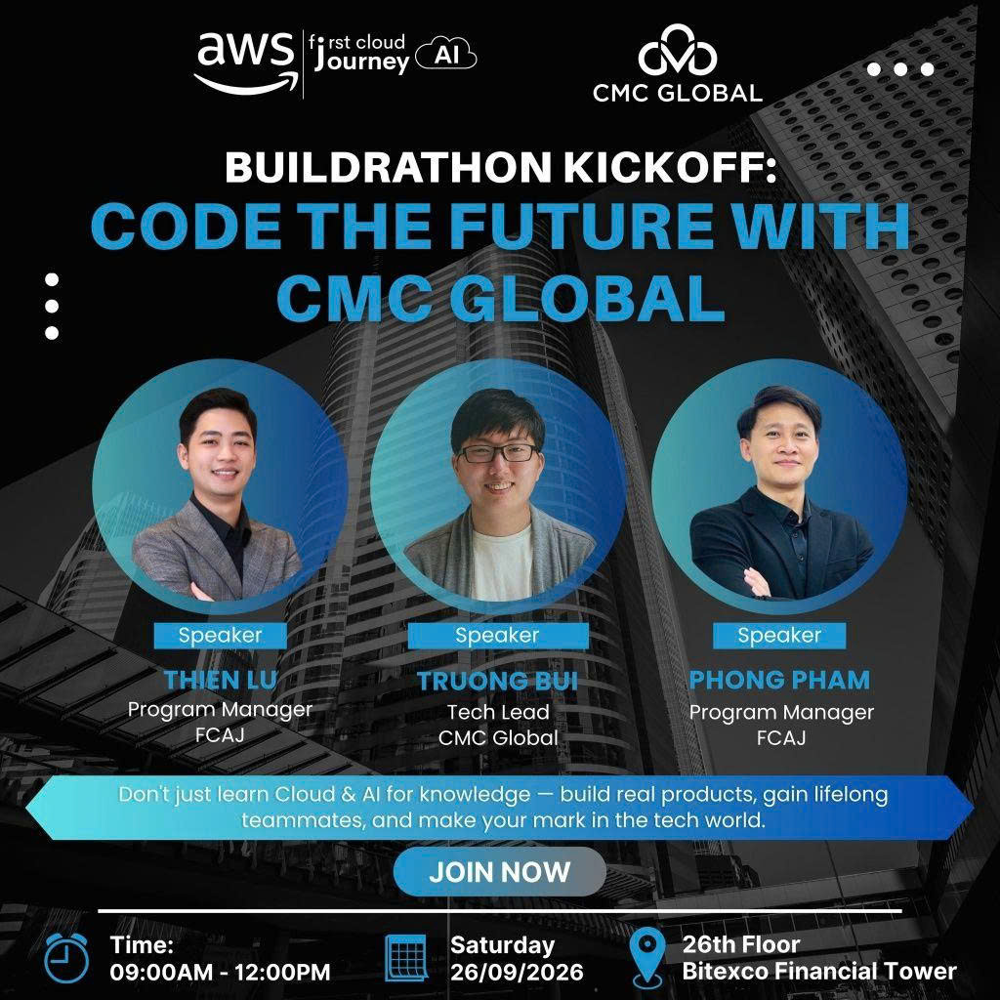
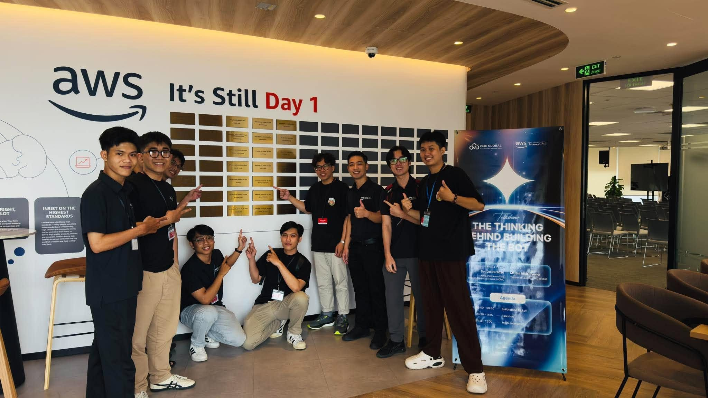
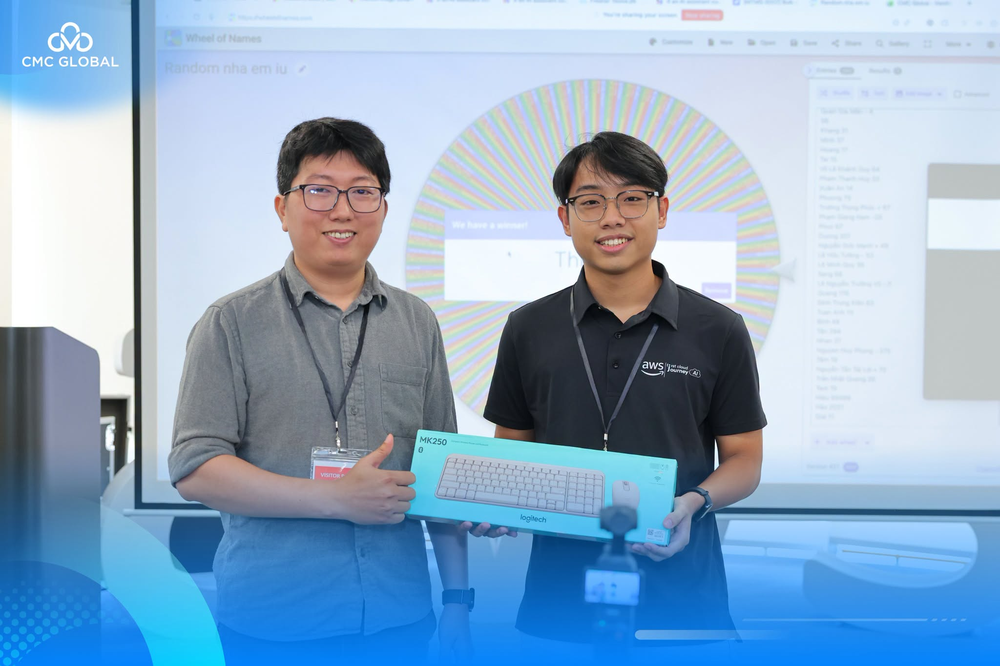

# Bài thu hoạch “Buildrathon Kickoff: Code the Future with CMC Global”

**Thời gian:** Thứ Bảy 26/09/2026, 09:00–12:00 · **Địa điểm:** Văn phòng AWS, Tầng 26 Bitexco, TP.HCM · **Vai trò:** Người tham dự

### Mục đích của sự kiện

Sự kiện do AWS First Cloud Journey AI (FCAJ) phối hợp với CMC Global tổ chức, mở màn đợt Buildrathon cho thực tập sinh. Thông điệp chính trên poster: học Cloud và AI không chỉ để biết, mà để làm ra sản phẩm thật.

### Diễn giả

- Thien Lu — Program Manager, FCAJ
- Truong Bui (Bùi Nhật Trường) — Technical Leader, CMC Global
- Phong Pham — Program Manager, FCAJ

### Nội dung nổi bật

| Giờ | Phần |
|---|---|
| 09:00–09:30 | Buildrathon Kickoff |
| 09:30–11:15 | Talkshow “The Thinking Behind Building the Bot” |
| 11:15–12:00 | Mock interview (phỏng vấn thử) |

Cuối buổi có bốc thăm trúng thưởng bằng Wheel of Names, quà là bộ bàn phím và chuột Logitech MK250.

### Những gì tôi học được

- Talkshow về cách nghĩ khi làm bot: trước khi chọn model phải xác định bot giải bài toán gì, cho ai, và khi bot không chắc thì xử lý thế nào.
- Một sản phẩm AI chạy thật cần cả phần “không phải AI”: hàng đợi, xử lý lỗi, giám sát và chi phí.
- Mock interview giúp tôi tập trình bày ngắn gọn dự án mình đang làm và trả lời câu hỏi kỹ thuật dưới áp lực thời gian.

### Áp dụng vào công việc / dự án Ask First

Ask First cũng là một bot (Telegram) kiểm tra tin nhắn lừa đảo, nên các ý trên khớp trực tiếp với việc của nhóm: giới hạn phạm vi bot ở việc chấm rủi ro tin nhắn, có fast path và kill switch cho LLM, và luôn trả về câu trả lời an toàn khi pipeline lỗi.

### Ảnh check-in

