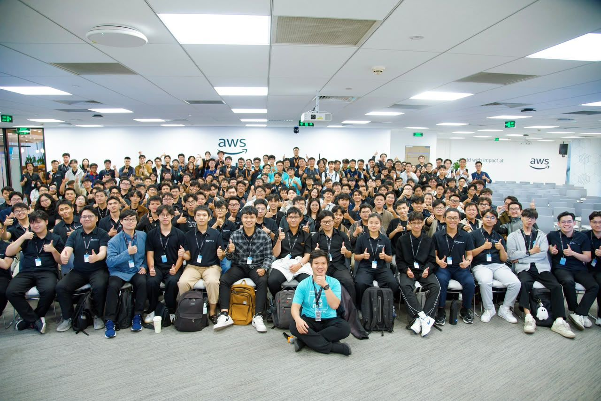
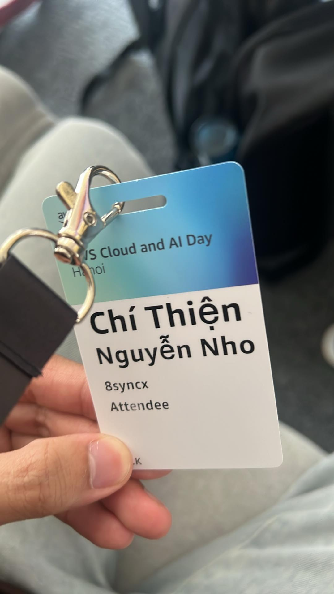

# Event report: “AWS Cloud & AI Day Vietnam 2026 — Watch Party in Ho Chi Minh City”

**Date:** Tuesday 29/09/2026 · **Location:** AWS office in Ho Chi Minh City (main stage at JW Marriott Hanoi, streamed live to HCMC) · **Role:** Attendee

<!-- draft: the badge says "AWS Cloud and AI Day Hanoi"; this page assumes I attended the Watch Party at the AWS office in HCMC. If I went to Hanoi, fix the location line. -->

### Event objectives

AWS Cloud & AI Day Vietnam is AWS's main Cloud and AI event of the year in Vietnam. In 2026 the main stage was in Hanoi, and the AWS office in HCMC hosted a free Watch Party so people in the South could watch live and meet the community in person. The common theme was Agentic AI.

### Speakers

The keynotes were given by AWS leaders and AWS customers, streamed live from Hanoi. <!-- TODO(not verified): my saved material has no speaker names; add them if I remember. -->

### Highlights

- **Live keynotes:** customer stories on using Agentic AI systems to modernize, scale and innovate.
- **Technical deep dives:** selected sessions from the “Builders x AI” track.
- **Local networking:** meeting cloud engineers and tech people in HCMC.

<!-- draft: the two sections below were written by Claude from the event's topics, not from my own notes. Edit them. -->
### What I learned

- Agentic AI differs from a chatbot in that the model calls tools and takes several steps on its own, so control (guardrails, step limits, logging each step) matters as much as model quality.
- Companies running AI in production all talked about the same things: data, security and cost, not just which model to pick.

### Applying it to my work / the Ask First project

Ask First's `ai` pipeline deliberately does not let the model call tools: the steps (fast path, KB lookup, LLM call, escalation to the fallback model) are decided by code, Bedrock Guardrails block prompt attacks, and a `trace_id` lets us follow each request. The event made it clearer to me why the team chose this simpler design for a scam-checking bot.

### Check-in photo

