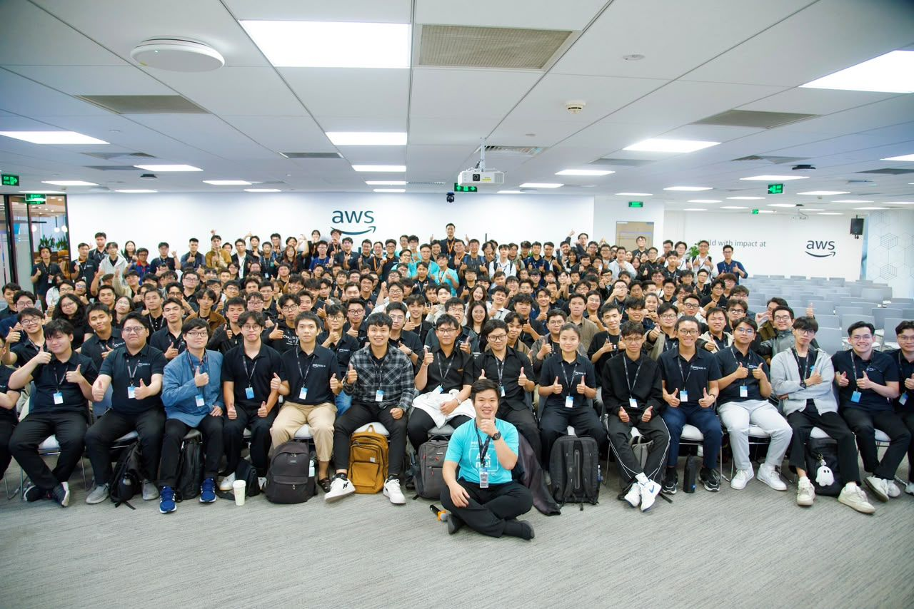
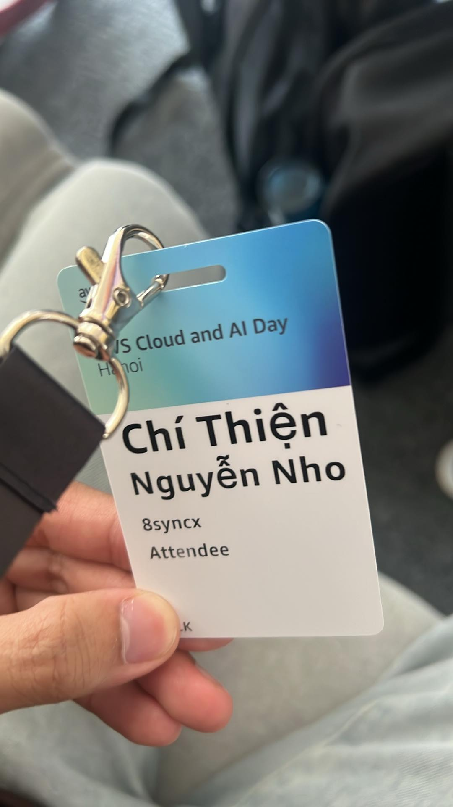

# Bài thu hoạch “AWS Cloud & AI Day Vietnam 2026 — Watch Party tại TP.HCM”

**Thời gian:** Thứ Ba 29/09/2026 · **Địa điểm:** văn phòng AWS tại TP.HCM (sân khấu chính ở JW Marriott Hà Nội, phát trực tiếp vào TP.HCM) · **Vai trò:** Người tham dự

<!-- nháp: badge ghi "AWS Cloud and AI Day Hanoi"; trang này giả định mình dự buổi Watch Party ở văn phòng AWS TP.HCM. Nếu mình ra Hà Nội thì sửa dòng địa điểm. -->

### Mục đích của sự kiện

AWS Cloud & AI Day Vietnam là sự kiện Cloud và AI lớn trong năm của AWS tại Việt Nam. Năm 2026 sân khấu chính đặt ở Hà Nội, còn văn phòng AWS TP.HCM tổ chức Watch Party miễn phí để người ở phía Nam xem trực tiếp và gặp gỡ cộng đồng tại chỗ. Chủ đề xuyên suốt là Agentic AI.

### Diễn giả

Keynote do lãnh đạo AWS và khách hàng của AWS trình bày, phát trực tiếp từ Hà Nội. <!-- TODO(not verified): tài liệu mình lưu không có tên diễn giả; bổ sung nếu còn nhớ. -->

### Nội dung nổi bật

- **Keynote trực tiếp:** câu chuyện của khách hàng dùng hệ thống Agentic AI để hiện đại hoá, mở rộng và đổi mới.
- **Technical deep dive:** các phiên chọn lọc từ track “Builders x AI”.
- **Networking tại chỗ:** gặp các kỹ sư cloud và người làm công nghệ ở TP.HCM.

<!-- nháp: hai mục dưới do Claude viết dựa trên chủ đề sự kiện, chưa có ghi chép thật của mình. Sửa lại theo ý mình. -->
### Những gì tôi học được

- Agentic AI khác chatbot ở chỗ model được gọi công cụ và tự đi nhiều bước; vì vậy kiểm soát (guardrail, giới hạn số bước, log từng bước) quan trọng không kém chất lượng model.
- Các doanh nghiệp đưa AI vào chạy thật đều nói về cùng mấy chuyện: dữ liệu, bảo mật và chi phí, chứ không chỉ chọn model nào.

### Áp dụng vào công việc / dự án Ask First

Pipeline `ai` của Ask First cố ý không để model tự gọi công cụ: các bước (fast path, tra KB, gọi LLM, leo thang sang model dự phòng) do code quyết định, có Bedrock Guardrails chặn prompt attack và có `trace_id` để lần lại từng lượt. Sự kiện giúp tôi thấy rõ hơn vì sao nhóm chọn cách đơn giản này cho một bot kiểm tra lừa đảo.

### Ảnh check-in

