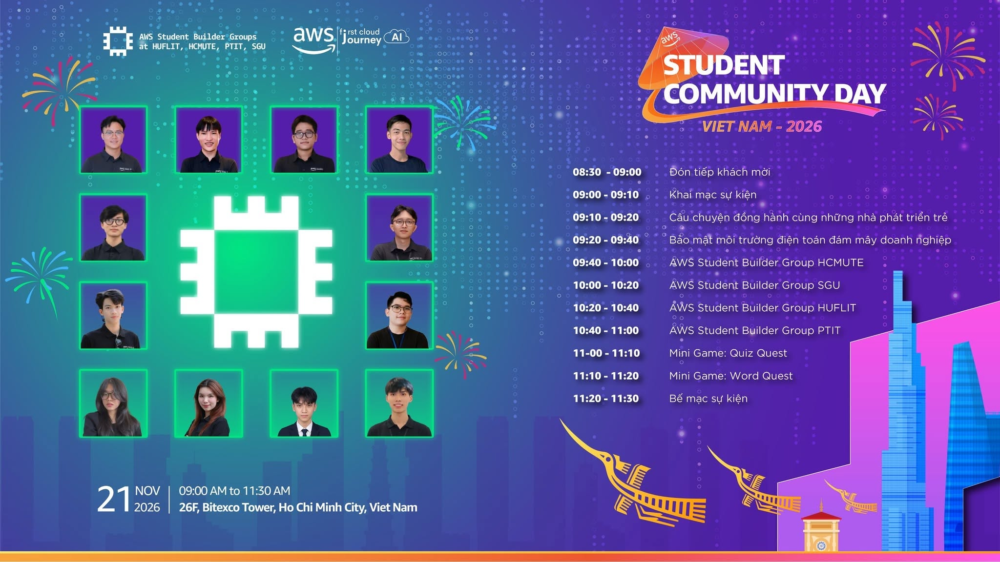
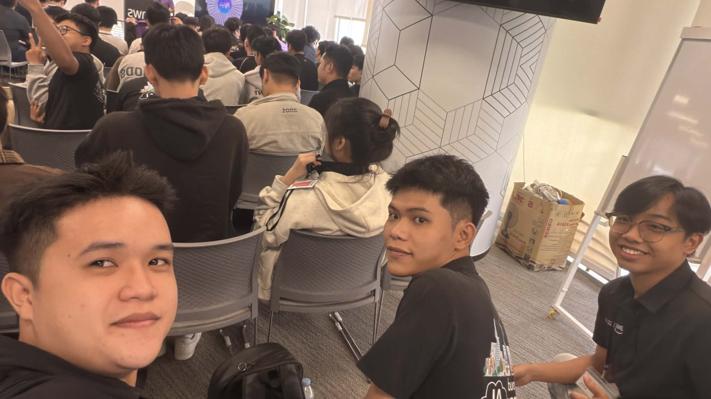
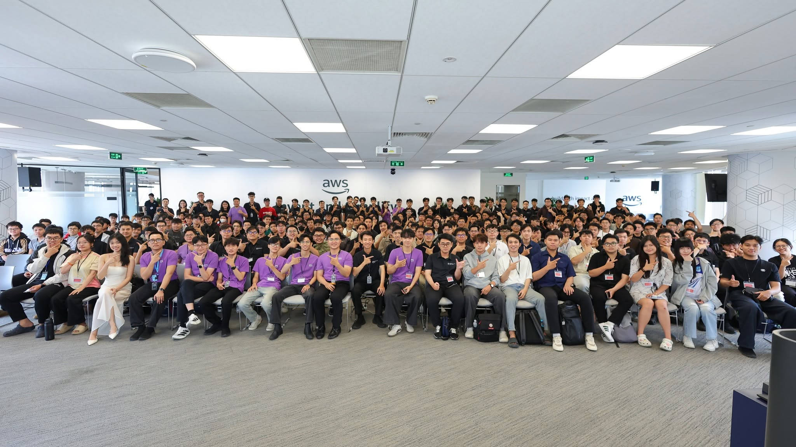

# Event report: “AWS Student Community Day Vietnam 2026”

**Date:** Saturday 21/11/2026, 08:30–11:30 · **Location:** AWS office, Level 26 Bitexco, Ho Chi Minh City · **Role:** Attendee

### Event objectives

A Cloud and AI day built by students for students, co-organized by 4 AWS Student Builder Groups (HUFLIT, HCMUTE, PTIT HCM, SGU) as part of FCAJ. Goals: hear practical talks from experts, let student groups present on stage, and connect Builders across universities.

### Speakers

- Two expert sessions: “Journeying with Young Builders” and “Enterprise Cloud Environment Security”. <!-- TODO(not verified): my saved material has no speaker names. -->
- Representatives of 4 AWS Student Builder Groups: HCMUTE, SGU, HUFLIT, PTIT.

### Highlights

| Time | Session |
|---|---|
| 08:30–09:00 | Check-in |
| 09:00–09:10 | Opening |
| 09:10–09:20 | Journeying with Young Builders |
| 09:20–09:40 | Enterprise Cloud Environment Security |
| 09:40–11:00 | 4 talks by SBG HCMUTE, SGU, HUFLIT, PTIT (20 minutes each) |
| 11:00–11:20 | Mini games Quiz Quest and Word Quest (questions on Cloud and AWS services) |
| 11:20–11:30 | Closing |

<!-- draft: the two sections below were written by Claude from the agenda and the recap post, not from my own notes. Edit them. -->
### What I learned

- Enterprise cloud security starts with the basics: least-privilege IAM, no secrets in code, and being able to see who did what in the account.
- Watching other student groups present let me compare their architecture choices with my team's, and showed me how to tell a technical project in 20 minutes.
- The mini games reminded me how many AWS services I know only by name.

### Applying it to my work / the Ask First project

The security talk matches what the team already does: the bot token and webhook secret are SSM Parameter Store SecureStrings, GitHub Actions deploys through OIDC instead of access keys, and each Lambda has its own role. My next step is to review permissions set outside the template (for example the `ai` function's `BEDROCK_ROLE_ARN` variable) so everything lives in IaC.

### Check-in photo

