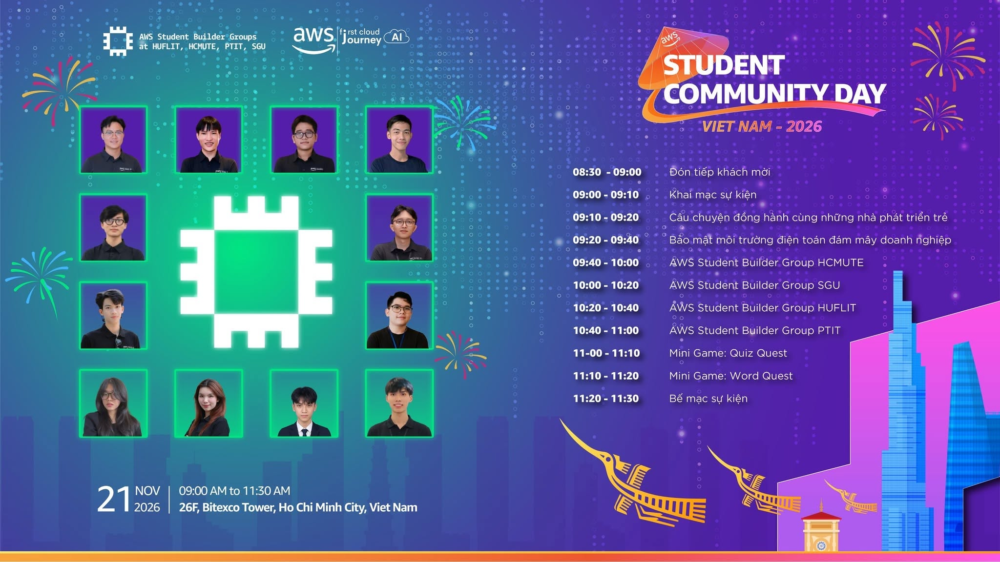
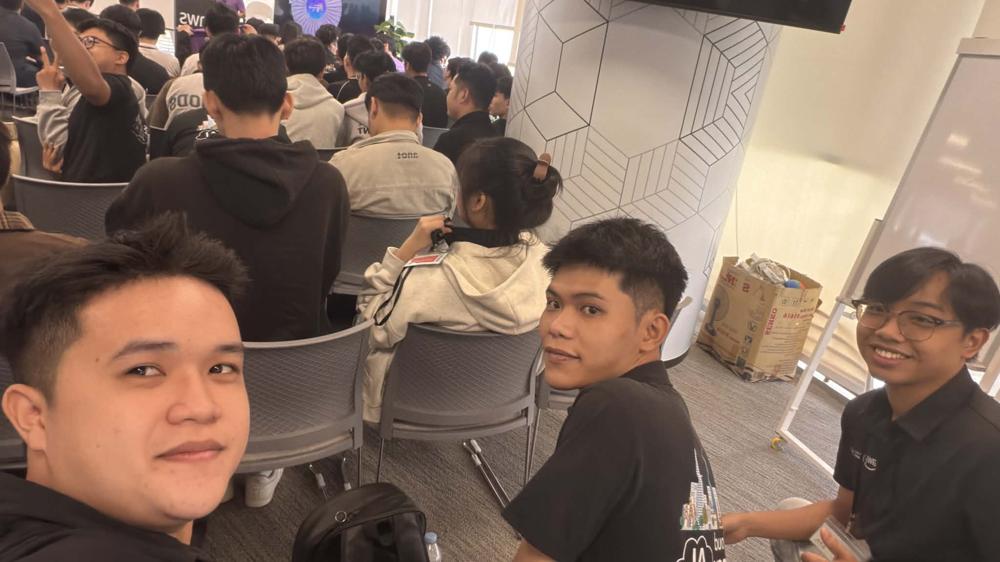
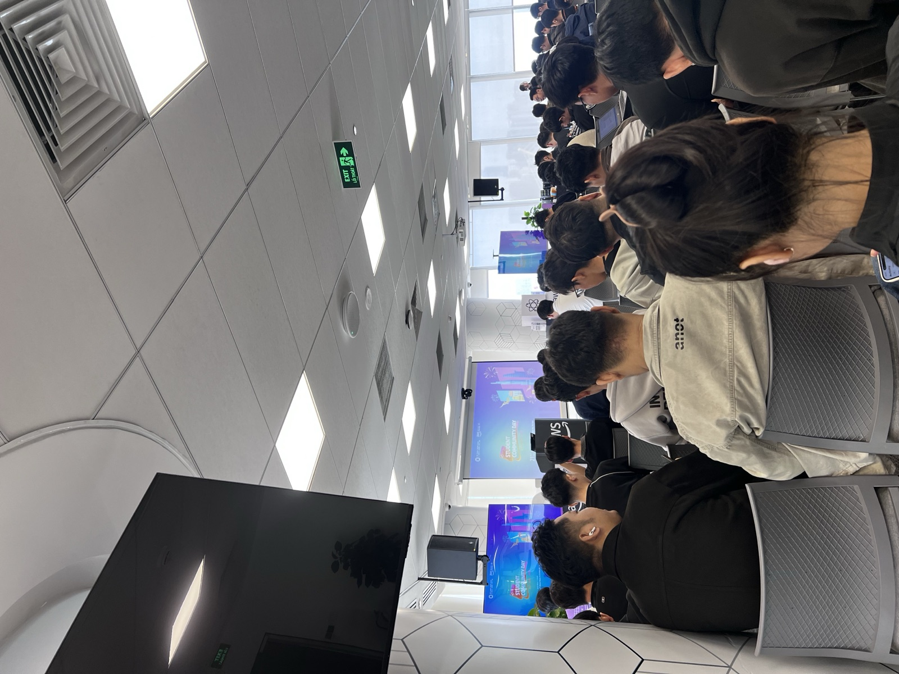
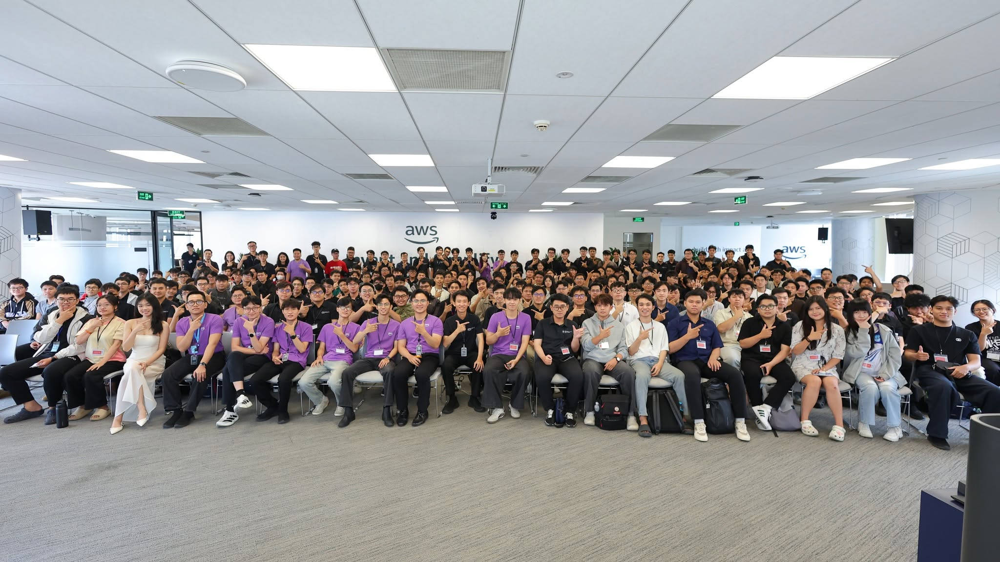

# Bài thu hoạch “AWS Student Community Day Vietnam 2026”

**Thời gian:** Thứ Bảy 21/11/2026, 08:30–11:30 · **Địa điểm:** Văn phòng AWS, Tầng 26 Bitexco, TP.HCM · **Vai trò:** Người tham dự

### Mục đích của sự kiện

Ngày hội Cloud và AI do sinh viên tổ chức cho sinh viên, đồng tổ chức bởi 4 AWS Student Builder Group (HUFLIT, HCMUTE, PTIT HCM, SGU) trong khuôn khổ FCAJ. Mục tiêu: nghe chia sẻ thực tế từ chuyên gia, để các nhóm sinh viên tự lên trình bày, và kết nối Builders giữa các trường.

### Diễn giả

- Hai phiên chuyên gia: “Câu chuyện đồng hành cùng những nhà phát triển trẻ” và “Bảo mật môi trường điện toán đám mây doanh nghiệp”.
- Đại diện 4 AWS Student Builder Group: HCMUTE, SGU, HUFLIT, PTIT.

### Nội dung nổi bật

| Giờ | Phần |
|---|---|
| 08:30–09:00 | Đón khách |
| 09:00–09:10 | Khai mạc |
| 09:10–09:20 | Câu chuyện đồng hành cùng những nhà phát triển trẻ |
| 09:20–09:40 | Bảo mật môi trường điện toán đám mây doanh nghiệp |
| 09:40–11:00 | 4 phần chia sẻ của SBG HCMUTE, SGU, HUFLIT, PTIT (mỗi nhóm 20 phút) |
| 11:00–11:20 | Mini game Quiz Quest và Word Quest (câu hỏi về Cloud và dịch vụ AWS) |
| 11:20–11:30 | Bế mạc |

### Những gì tôi học được

- Bảo mật cloud trong doanh nghiệp bắt đầu từ những thứ cơ bản: quyền IAM tối thiểu, không để secret trong code, và theo dõi được ai làm gì trên tài khoản.
- Xem các nhóm sinh viên khác trình bày giúp tôi so cách họ chọn kiến trúc với cách nhóm mình đang làm, và học cách kể một dự án kỹ thuật trong 20 phút.
- Mini game nhắc tôi còn nhiều dịch vụ AWS mình chỉ biết tên mà chưa dùng.

### Áp dụng vào công việc / dự án Ask First

Phần bảo mật khớp với những gì nhóm đã làm: token bot và webhook secret nằm trong SSM Parameter Store dạng SecureString, GitHub Actions deploy bằng OIDC thay vì access key, và mỗi Lambda có role riêng. Việc tôi cần làm tiếp là rà lại các quyền đang đặt ngoài template (ví dụ biến `BEDROCK_ROLE_ARN` của function `ai`) để mọi thứ nằm trong IaC.

### Ảnh check-in

