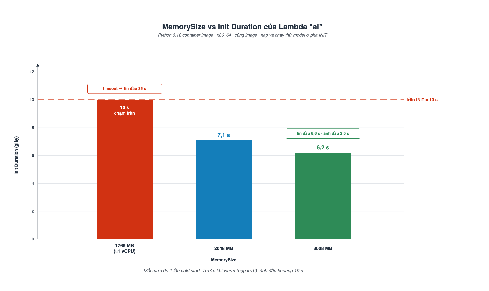
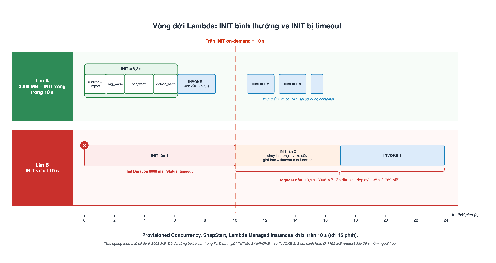

#### 5.10.1 Demo

The demo follows the flow tested in 5.6:

1. Send a suspected scam text message to the bot and receive the verdict with its warning signs.
2. Send a screenshot of a scam message and receive the verdict after OCR.
3. Send a normal message and see that the bot does not raise a false alarm.
4. Show the trace in CloudWatch Logs (`ai_invoke` in the worker, the matching `trace_id` in `ai`) and the check item in DynamoDB, which stores the result but not the message text.

#### 5.10.2 Lessons learned

##### 1. The Lambda INIT phase has a hard 10-second limit

The `ai` function loads the OCR models and the RAG index. At first they were loaded lazily, so the first image after every cold start took about 19 s inside `ai`. The team moved the loading and one dummy inference into the INIT phase (module import). That worked at 3008 MB, but at lower memory the INIT phase got slower because Lambda gives CPU in proportion to memory:

| MemorySize | Init Duration | First request after a cold start |
|---|---|---|
| lazy load (before) | | image ≈ 19 s |
| 3008 MB + warm-up | 6.2 s | text 6.6 s, image 2.5 s |
| 2048 MB + warm-up | 7.1 s | |
| 1769 MB + warm-up | hits 10 s, timeout | ≈ 35 s |

For on-demand functions the INIT phase may run for at most 10 seconds. When it goes over, Lambda drops the work and runs INIT again inside the first invoke, so that request pays for INIT twice. At 1769 MB the "optimization" was worse than lazy loading.

Even at 3008 MB, INIT time is not constant. Over 17 cold starts `ai` init had p50 6.24 s and max 8.49 s, and the `ocr_warm` step alone ranged from 2.3 s to 7.3 s. Right after deploying a new version the log showed `Init Duration: 9999.35 ms ... Status: timeout`, and that first request took 13.9 s.

What we took from it:

- Watch the p95 and max of `@initDuration`, not the average. If they get close to 8–9 s, a timeout will happen in production (query in 5.7.2).
- Do not cut memory below 2048 MB for this workload; 3008 MB was kept for headroom.
- INIT time has been billed for all function types since 01/08/2025, so long INIT costs money as well as latency.
- Provisioned Concurrency, SnapStart and Lambda Managed Instances are not bound by the 10 s limit (up to 15 minutes), at extra cost.
- int8 quantization would make the model smaller, but it hurt OCR on URLs, so fp32 was kept (ADR-003).

Source: team blog draft `thien/bai-viet-aws/bai-viet-lambda-init-10s.md` and `docs/results/lambda-p95.md`.

##### 2. Cold starts add up across functions

A message passes through three functions. On a cold path the worker (Java 21, init p50 2.21 s) waits for `ai` (init p50 6.24 s); the slowest worker-to-`ai` call measured was 12.3 s. Pull request #185 (still open) adds `scripts/warmup.py`, which invokes the three functions with no-op events. On a cold run it measured webhook 3.9–4.1 s, `worker:live` 2.4–2.8 s and `ai:live` 8.8–9.0 s; a second run took 0.2 s with no INIT.

##### 3. Docker 29 pushes an image Lambda does not accept

Docker 29 pushed the `ai` image as an OCI index with an attestation manifest, and Lambda rejected it. The workaround was to point Lambda to the digest of the amd64 manifest, or to push with `docker push --platform linux/amd64`. Building on GitHub Actions with a fixed platform avoids this.

##### 4. Fail-open hides missing permissions

The judge never raises: if Bedrock fails it falls back to rules only (`path = rules_only`), and the Guardrail is fail-open. This keeps the bot answering, but it also hides configuration errors. When the `ai` role could not call `bedrock:InvokeModel` in the Bedrock account, every check quietly became `rules_only`, and the Guardrail call failed with `guard_failed` without any error reaching the user.

Lesson: after every deploy, check `path` in the `ai` logs or in the check item. `llm` or `escalated` means Bedrock ran; a run of `rules_only` with the kill switch on means permissions or configuration are wrong.

##### 5. Image latency versus the 15-second target

Text checks meet the target easily (warm p95 3.51 s). Images do not: from webhook start to worker end, p50 is 11.28 s and p95 is 17.02 s on 21 images, of which about 3.5 s is the 3-second SQS debounce. The team accepted 17 s because the bot is asynchronous and an elderly user can wait about 30 s for an image result (ADR-003). The target in the docs stays 15 s.

##### 6. Secrets belong in SSM, never in environment variables

The security review (`docs/results/security-lane-a.md`, pull request #187) found the Telegram bot token as plaintext in the environment of `worker` and `worker-dlq`, passed through a CloudFormation parameter. Anyone who can read the function configuration can read it, and it had been exposed once. The fix is to read it from the SSM SecureString parameter, as `webhook` and `ai` already do, and to rotate the token. Never print a token in logs, screenshots or reports.

##### 7. Manual deploys drift from the template

While `AiImageUri` was not wired into the pipeline, `ai` on dev was deployed by hand with a role that could write to the whole table, while the template limits it to `CACHE#` and `URL#` items (Medium in the same review). Manual resources are also missed by `sam delete` (see 5.9). Deploy through the template, even for a quick test.

##### 8. Know the state of the kill switch before you test

On dev, `llm_enabled` was `false`, so the first test image went `rules_only` and the bot replied with the maintenance note. The flag was switched on only for the measurement window and set back afterwards. Read `CONFIG#global / FLAGS` before any test, or results look like failures (5.6.4).

##### 9. Know the limits of the evaluation set

Recall was 100% on 90 scam messages and false alarms were 0–5% depending on the group, but the set has only 134 samples and none from real users. Scenario accuracy is only 67–69%, and the N5 group has an F1 of about 12% (`docs/eval-report-final.md`). These numbers show the pipeline works; they do not prove how it does on real traffic.

#### 5.10.3 Future work

- Set CloudWatch log retention (7 days) on all functions.
- Move the bot token of `worker` and `worker-dlq` to SSM and rotate it.
- Add a resource policy on `ai` so only `worker` can invoke it.
- Measure SnapStart for the Java worker before deciding (ADR-008, parameter `WorkerSnapStart` defaults to off).
- Add custom metrics, more alarms and a dashboard (issues #71 and #85).
- Run the load test and measure how long containers stay warm.
- Improve scenario classification and the N5 group; add anonymized real samples to the evaluation set.
- Consider Provisioned Concurrency for `ai` if image latency must meet 15 s, after weighing its cost against the estimate in 5.8.
