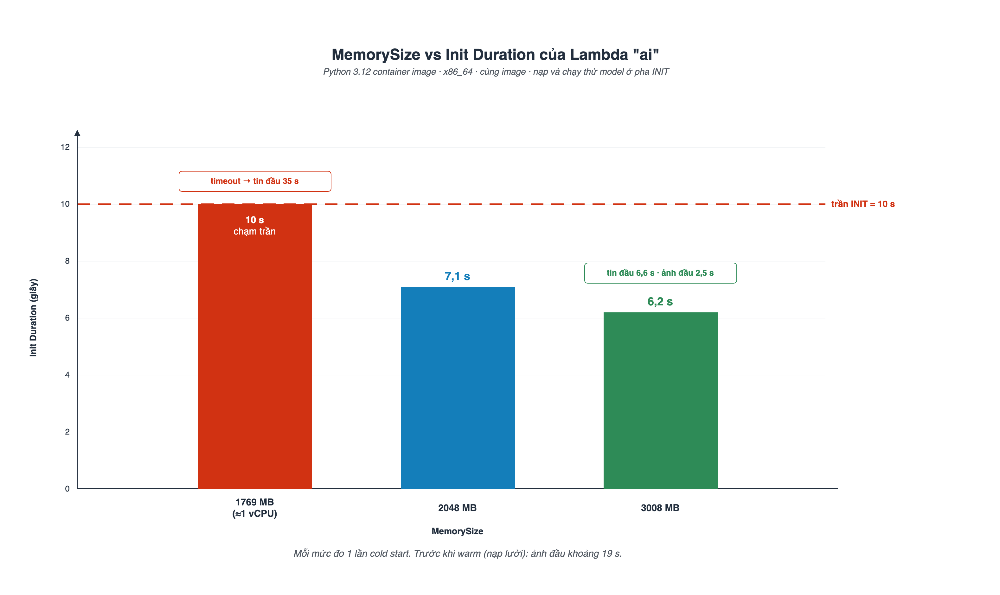
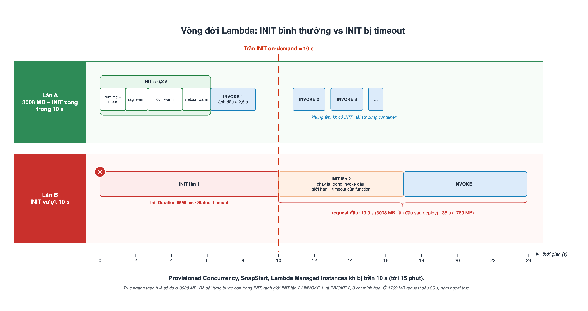

#### 5.10.1 Demo

<!-- TODO: link/video demo (ngày demo 27/11/2026) -->

Demo đi theo luồng đã kiểm ở 5.6:

1. Gửi một tin nhắn văn bản nghi lừa đảo cho bot và nhận kết luận kèm các dấu hiệu cảnh báo.
2. Gửi ảnh chụp một tin lừa đảo và nhận kết luận sau bước OCR.
3. Gửi một tin bình thường và thấy bot không báo nhầm.
4. Mở trace trên CloudWatch Logs (`ai_invoke` ở worker, `trace_id` khớp ở `ai`) và item lượt kiểm tra trong DynamoDB, nơi lưu kết quả nhưng không lưu nội dung tin nhắn.

<!-- TODO screenshot: các khung hình demo (kết luận tin văn bản, kết luận tin ảnh, trace CloudWatch) -->

#### 5.10.2 Bài học

##### 1. Pha INIT của Lambda bị giới hạn cứng 10 giây

Function `ai` nạp model OCR và chỉ mục RAG. Ban đầu các thứ này nạp lười (lazy load), nên ảnh đầu tiên sau mỗi lần cold start mất khoảng 19 s trong `ai`. Team chuyển việc nạp và một lượt inference thử vào pha INIT (lúc import module). Cách này chạy tốt ở 3008 MB, nhưng hạ memory thì INIT chậm đi vì Lambda cấp CPU theo tỉ lệ memory:

| MemorySize | Init Duration | Request đầu tiên sau cold start |
|---|---|---|
| lazy load (trước đây) | | ảnh ≈ 19 s |
| 3008 MB + warm-up | 6,2 s | văn bản 6,6 s, ảnh 2,5 s |
| 2048 MB + warm-up | 7,1 s | |
| 1769 MB + warm-up | chạm 10 s, timeout | ≈ 35 s |

Với function on-demand, pha INIT chạy tối đa 10 giây. Vượt mốc này thì Lambda bỏ phần đã làm và chạy lại INIT ngay trong lần invoke đầu tiên, nên request đó trả giá INIT hai lần. Ở 1769 MB, việc "tối ưu" còn tệ hơn lazy load.

Kể cả ở 3008 MB, thời gian INIT cũng không cố định. Qua 17 lần cold start, init của `ai` có p50 6,24 s và max 8,49 s, riêng bước `ocr_warm` dao động từ 2,3 s đến 7,3 s. Ngay sau khi deploy bản mới, log ghi `Init Duration: 9999.35 ms ... Status: timeout`, và request đầu tiên mất 13,9 s.

Rút ra:

- Theo dõi p95 và max của `@initDuration`, không nhìn trung bình. Nếu chúng tiến gần 8–9 s thì sớm muộn production sẽ timeout (câu truy vấn ở 5.7.2).
- Với workload này không hạ memory dưới 2048 MB; giữ 3008 MB để có khoảng dư.
- Từ 01/08/2025 thời gian INIT bị tính phí với mọi loại function, nên INIT dài vừa chậm vừa tốn tiền.
- Provisioned Concurrency, SnapStart và Lambda Managed Instances không bị giới hạn 10 s (tối đa 15 phút), đổi lại tốn thêm chi phí.
- Lượng tử hoá int8 làm model nhỏ hơn nhưng làm OCR đọc URL kém đi, nên giữ fp32 (ADR-003).

Nguồn: bài blog nháp của team `thien/bai-viet-aws/bai-viet-lambda-init-10s.md` và `docs/results/lambda-p95.md`.

##### 2. Cold start cộng dồn qua các function

Một tin nhắn đi qua ba function. Trên đường cold, worker (Java 21, init p50 2,21 s) phải chờ `ai` (init p50 6,24 s); lần worker gọi `ai` chậm nhất đo được là 12,3 s. Pull request #185 (đang mở) thêm `scripts/warmup.py`, gọi ba function bằng event no-op. Lần chạy cold đo được webhook 3,9–4,1 s, `worker:live` 2,4–2,8 s, `ai:live` 8,8–9,0 s; lần chạy thứ hai mất 0,2 s và không có INIT.

<!-- TODO(not verified): chưa đo container giữ ấm được bao lâu sau warmup.py, và chưa làm load test (50 và 10 tin). -->

##### 3. Docker 29 đẩy image Lambda không nhận

<!-- TODO(not verified): chỉ có trong ghi chép làm việc của team, chưa tái hiện trong lần chạy nào có tài liệu. -->

Docker 29 đẩy image `ai` dưới dạng OCI index kèm manifest attestation, và Lambda từ chối. Cách xử lý là trỏ Lambda tới digest của manifest amd64, hoặc push bằng `docker push --platform linux/amd64`. Build trên GitHub Actions với platform cố định thì tránh được lỗi này.

##### 4. Fail-open che mất lỗi thiếu quyền

Judge không bao giờ ném lỗi: Bedrock lỗi thì rơi về chỉ dùng luật (`path = rules_only`), còn Guardrail thì fail-open. Nhờ vậy bot luôn trả lời, nhưng lỗi cấu hình cũng bị che. Khi role của `ai` không có quyền `bedrock:InvokeModel` ở tài khoản Bedrock, mọi lượt kiểm tra lặng lẽ thành `rules_only`, và lời gọi Guardrail lỗi `guard_failed` mà người dùng không thấy lỗi nào. <!-- TODO(not verified): sự cố này lấy từ ghi chép làm việc của team (24/11), không phải từ báo cáo chính thức. -->

Bài học: sau mỗi lần deploy, xem `path` trong log `ai` hoặc trong item lượt kiểm tra. `llm` hoặc `escalated` nghĩa là Bedrock đã chạy; toàn `rules_only` trong khi kill switch đang bật LLM nghĩa là sai quyền hoặc sai cấu hình.

##### 5. Độ trễ tin ảnh so với mục tiêu 15 giây

Tin văn bản đạt mục tiêu dễ dàng (warm p95 3,51 s). Tin ảnh thì không: tính từ lúc webhook bắt đầu đến lúc worker xong, p50 là 11,28 s và p95 là 17,02 s trên 21 ảnh, trong đó khoảng 3,5 s là debounce SQS 3 giây. Team chấp nhận 17 s vì bot chạy bất đồng bộ và người cao tuổi chờ được khoảng 30 s cho kết quả ảnh (ADR-003). Mục tiêu ghi trong docs vẫn là 15 s.

##### 6. Secret phải nằm trong SSM, không nằm trong biến môi trường

Bản review bảo mật (`docs/results/security-lane-a.md`, pull request #187) phát hiện token bot Telegram nằm dạng plaintext trong biến môi trường của `worker` và `worker-dlq`, truyền qua một tham số CloudFormation. Ai đọc được cấu hình function là đọc được token, và token đã từng bị lộ một lần. Cách sửa là đọc từ SSM SecureString như `webhook` và `ai` đang làm, và rotate token. Không bao giờ in token ra log, ảnh chụp màn hình hay báo cáo.

##### 7. Deploy tay làm lệch khỏi template

Khi `AiImageUri` chưa nối vào pipeline, `ai` trên dev được deploy tay với role ghi được toàn bộ bảng, trong khi template chỉ cho ghi item `CACHE#` và `URL#` (mức Medium trong cùng bản review). Tài nguyên tạo tay cũng bị `sam delete` bỏ sót (xem 5.9). Kể cả test nhanh cũng nên deploy qua template.

##### 8. Biết trạng thái kill switch trước khi test

Trên dev, `llm_enabled` đang là `false`, nên ảnh test đầu tiên đi `rules_only` và bot trả lời thông báo bảo trì. Flag chỉ được bật trong khoảng thời gian đo rồi trả về như cũ. Đọc `CONFIG#global / FLAGS` trước mỗi lần test, nếu không kết quả trông như lỗi (5.6.4).

##### 9. Hiểu giới hạn của bộ eval

Recall đạt 100% trên 90 tin lừa đảo và báo nhầm 0–5% tuỳ nhóm, nhưng bộ dữ liệu chỉ có 134 mẫu và không mẫu nào từ người dùng thật. Độ chính xác kịch bản chỉ 67–69%, nhóm N5 có F1 khoảng 12% (`docs/eval-report-final.md`). Các số này cho thấy pipeline chạy đúng; chúng chưa chứng minh được chất lượng trên lưu lượng thật.

#### 5.10.3 Hướng phát triển

- Đặt thời gian giữ log CloudWatch (7 ngày) cho mọi function.
- Chuyển token bot của `worker` và `worker-dlq` sang SSM và rotate token.
- Thêm resource policy cho `ai` để chỉ `worker` được gọi.
- Đo SnapStart cho worker Java trước khi quyết định (ADR-008, tham số `WorkerSnapStart` mặc định tắt).
- Thêm custom metric, thêm alarm và dashboard (issue #71 và #85).
- Chạy load test và đo container giữ ấm được bao lâu.
- Cải thiện phân loại kịch bản và nhóm N5; bổ sung mẫu thật đã ẩn danh vào bộ eval.
- Cân nhắc Provisioned Concurrency cho `ai` nếu tin ảnh bắt buộc đạt 15 s, sau khi so chi phí với dự toán ở 5.8.
