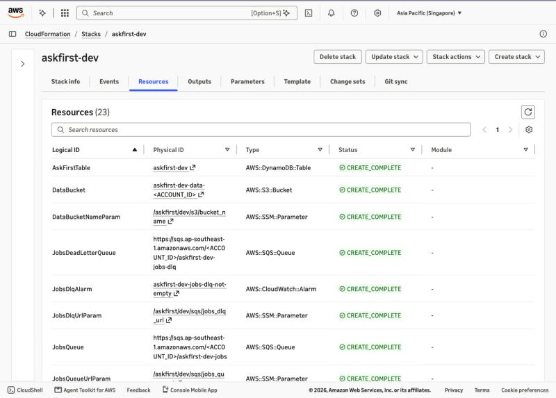
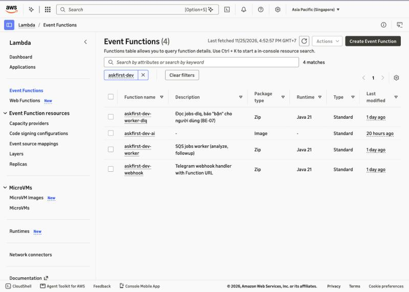
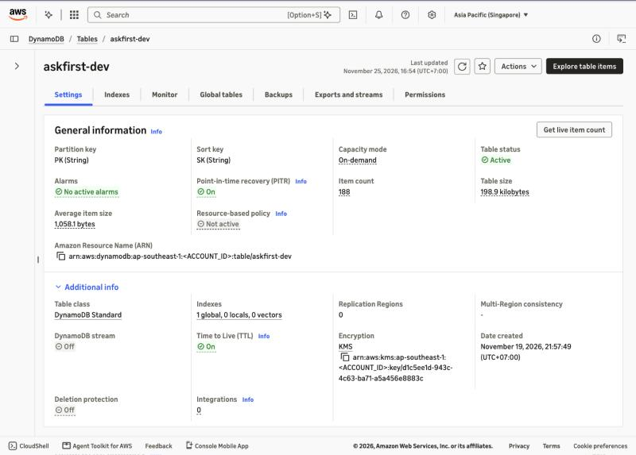
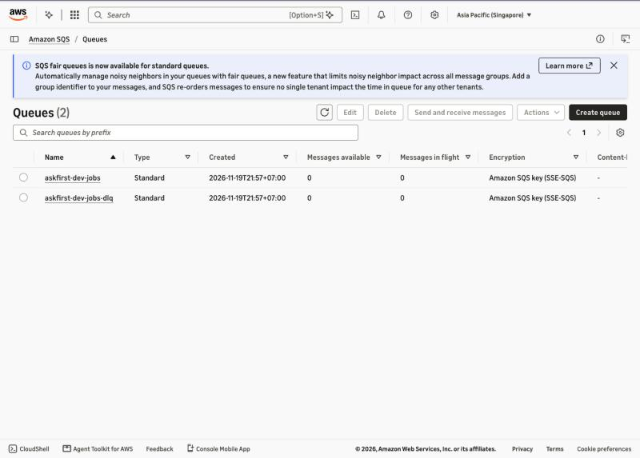

In this step you build the Java backend and deploy the SAM stack `askfirst-dev`. At the end you will have the `webhook`, `worker` and `worker-dlq` functions, the DynamoDB table, the SQS queue and DLQ, the S3 bucket, the SSM configuration parameters and the DLQ alarm. The `ai` function is added in 5.4.

#### What the stack creates

| Resource | Logical ID in `infra/template.yaml` | Name on AWS |
|---|---|---|
| Lambda webhook (Java 21, public Function URL) | `WebhookFunction` | `askfirst-dev-webhook` |
| Lambda worker (Java 21, SQS trigger, alias `live`) | `WorkerFunction` | `askfirst-dev-worker` |
| Lambda for DLQ messages | `WorkerDlqFunction` | `askfirst-dev-worker-dlq` |
| DynamoDB single table (PK/SK, GSI1, TTL `ttl`, PITR, on-demand) | `AskFirstTable` | `askfirst-dev` |
| SQS queue (visibility 720 s, DLQ after 5 receives) | `JobsQueue` | `askfirst-dev-jobs` |
| SQS dead-letter queue (14-day retention) | `JobsDeadLetterQueue` | `askfirst-dev-jobs-dlq` |
| CloudWatch alarm on the DLQ | `JobsDlqAlarm` | `askfirst-dev-jobs-dlq-not-empty` |
| S3 bucket (Block Public Access, SSE, `donated/` expires after 30 days) | `DataBucket` | `askfirst-dev-data-<ACCOUNT_ID>` |
| SSM parameters (stage, table name, queue URLs, bucket name) | `StageParam`, `TableNameParam`, `JobsQueueUrlParam`, `JobsDlqUrlParam`, `DataBucketNameParam` | `/askfirst/dev/...` |
| Lambda `ai` (container image) | `AiFunction` | `askfirst-dev-ai`, **only created when `AiImageUri` is set** (5.4) |

There is no VPC and no NAT Gateway: Lambda reaches DynamoDB, SQS, S3 and the Internet without them.

#### Step 1: Set common shell variables

Run from the repository root:

```bash
export AWS_REGION=ap-southeast-1
export STAGE=dev
```

#### Step 2: Build the Java backend

`sam build` builds each function directory on its own, so the shared module `common` must first be installed into your local Maven repository:

```bash
cd backend/ScamProtection
./mvnw clean install -DskipTests
cd ../..
```

On Windows PowerShell use `.\mvnw.cmd clean install -DskipTests`.

The output should end with `BUILD SUCCESS`.

#### Step 3: Create the privacy-policy hash parameter

The template reads `/askfirst/<stage>/config/policy_sha256` **at deploy time** (`{{resolve:ssm:...}}` in `POLICY_SHA256`), so this parameter must exist before the first `sam deploy`. It is not a secret: it is the version of the privacy policy that users accept in the bot. When the policy file changes, the hash changes and users are asked to accept again.

```bash
POLICY_SHA=$(shasum -a 256 docs/privacy-policy.md | cut -d' ' -f1)   # or: sha256sum
aws ssm put-parameter --region "$AWS_REGION" \
  --name "/askfirst/$STAGE/config/policy_sha256" \
  --value "$POLICY_SHA" --type String --overwrite
```

#### Step 4: Build the SAM application

```bash
cd infra
sam build
```

SAM reads `infra/template.yaml`, builds the Java 21 functions from `backend/ScamProtection/webhook-handler/` and `backend/ScamProtection/worker/`, and writes the result to `infra/.aws-sam/build`. The output should end with `Build Succeeded`.

#### Step 5: Deploy the stack

`infra/samconfig.toml` already contains the deploy settings for `dev`: `stack_name = "askfirst-dev"`, `region = "ap-southeast-1"`, `capabilities = "CAPABILITY_IAM"`, `resolve_s3 = true`, `confirm_changeset = false`.

The `worker` and `worker-dlq` functions receive the bot token through the `NoEcho` template parameter `TelegramBotToken`. Read it into a shell variable without echoing it, so it does not land in your shell history:

```bash
read -rs TELEGRAM_BOT_TOKEN     # paste <TELEGRAM_BOT_TOKEN>, then press Enter
export TELEGRAM_BOT_TOKEN
```

Deploy (still inside `infra/`):

```bash
sam deploy --parameter-overrides \
  Stage="$STAGE" \
  TelegramBotToken="$TELEGRAM_BOT_TOKEN" \
  TelegramBotUsername="<BOT_USERNAME>"
```

- `TelegramBotUsername` is the bot username **without** `@`. It is optional and only used to build invitation deep links for relatives.
- Do **not** write the token into `samconfig.toml`.

{}
`--parameter-overrides` on the command line replaces the `parameter_overrides` line of `samconfig.toml`, so always pass `Stage` too. Pass the **same full set** of parameters on every later deploy (after 5.4 this includes `AiImageUri`): if `AiImageUri` ends up empty, the template condition `HasAiImage` is false and CloudFormation removes the `ai` function.
{}

If you prefer to review each setting, run `sam deploy --guided` instead and answer: Stack Name `askfirst-dev`, Region `ap-southeast-1`, Parameter Stage `dev`, Allow SAM CLI IAM role creation `Y`, **"WebhookFunction has no authentication. Is this okay?" `Y`** (the Function URL must be public; the secret header is checked inside the function), Save arguments to configuration file `Y`.



#### Step 6: Read the stack outputs

```bash
aws cloudformation describe-stacks --region "$AWS_REGION" --stack-name askfirst-dev \
  --query "Stacks[0].Outputs[].[OutputKey,OutputValue]" --output table
```

Keep these values for the next steps: `WebhookFunctionUrl` (5.5), `DataBucketName` (5.4), `JobsQueueUrl`, `JobsDlqUrl`, `WorkerRoleArn`.

```bash
export FUNCTION_URL=$(aws cloudformation describe-stacks --region "$AWS_REGION" --stack-name askfirst-dev \
  --query "Stacks[0].Outputs[?OutputKey=='WebhookFunctionUrl'].OutputValue" --output text)
export DATA_BUCKET=$(aws cloudformation describe-stacks --region "$AWS_REGION" --stack-name askfirst-dev \
  --query "Stacks[0].Outputs[?OutputKey=='DataBucketName'].OutputValue" --output text)
echo "$FUNCTION_URL" "$DATA_BUCKET"
```

#### Step 7: Check the resources

These commands only read. They come from `infra/README.md` §4.

```bash
# DynamoDB: on-demand, PK/SK, GSI1, ACTIVE
aws dynamodb describe-table --table-name askfirst-dev --region "$AWS_REGION" \
  --query "Table.[TableName,BillingModeSummary.BillingMode,KeySchema,GlobalSecondaryIndexes[0].IndexName,TableStatus]"

# TTL on attribute "ttl" and PITR enabled
aws dynamodb describe-time-to-live --table-name askfirst-dev --region "$AWS_REGION"
aws dynamodb describe-continuous-backups --table-name askfirst-dev --region "$AWS_REGION"

# S3: all four Block Public Access flags true, lifecycle on donated/
aws s3api get-public-access-block --bucket "$DATA_BUCKET" --region "$AWS_REGION"
aws s3api get-bucket-lifecycle-configuration --bucket "$DATA_BUCKET" --region "$AWS_REGION"

# SQS: VisibilityTimeout 720 and RedrivePolicy to the DLQ with maxReceiveCount 5
aws sqs get-queue-attributes --region "$AWS_REGION" \
  --queue-url "$(aws ssm get-parameter --region "$AWS_REGION" --name "/askfirst/$STAGE/sqs/jobs_queue_url" --query Parameter.Value --output text)" \
  --attribute-names VisibilityTimeout RedrivePolicy

# SSM: configuration parameters written by the stack
aws ssm get-parameters-by-path --region "$AWS_REGION" --path "/askfirst/$STAGE" --recursive \
  --query "Parameters[*].[Name,Type]" --output table
```





The webhook itself is checked in 5.5, after the bot token and webhook secret are stored in SSM; until then the `webhook` function cannot start.

#### Troubleshooting

| Symptom | Cause and fix |
|---|---|
| Deploy fails on `POLICY_SHA256` / parameter not found | Step 3 was skipped or used another Region. Create `/askfirst/dev/config/policy_sha256` in `ap-southeast-1` and deploy again. |
| Stack is in `ROLLBACK_COMPLETE` after the first deploy | CloudFormation cannot update it. Run `sam delete --stack-name askfirst-dev`, fix the cause, deploy again. |
| `S3 Bucket already exists` | Bucket names are global; the name contains your account ID, so check that you are deploying to the right account (`aws sts get-caller-identity`). |
| `AccessDenied` on IAM actions | The deploying identity is missing permissions from 5.2. |

To see why a resource failed:

```bash
aws cloudformation describe-stack-events --region "$AWS_REGION" --stack-name askfirst-dev \
  --query "StackEvents[?ResourceStatus=='CREATE_FAILED'].[LogicalResourceId,ResourceStatusReason]" \
  --output table
```

Next: [5.4 Deploy the AI function](../5.4-deploy-ai-function/).
