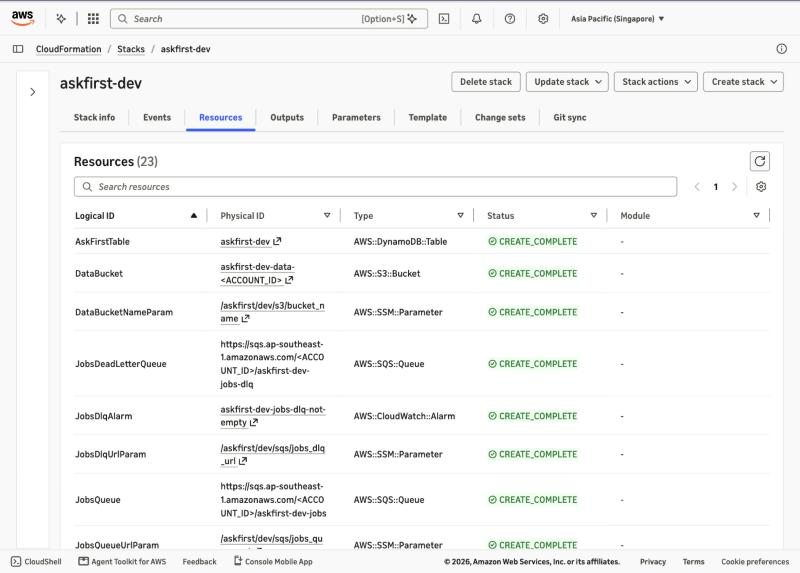
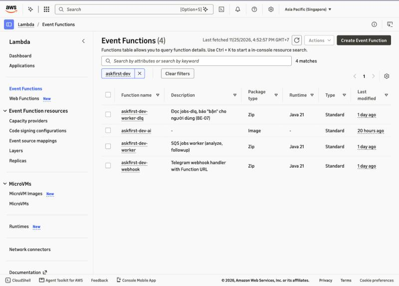
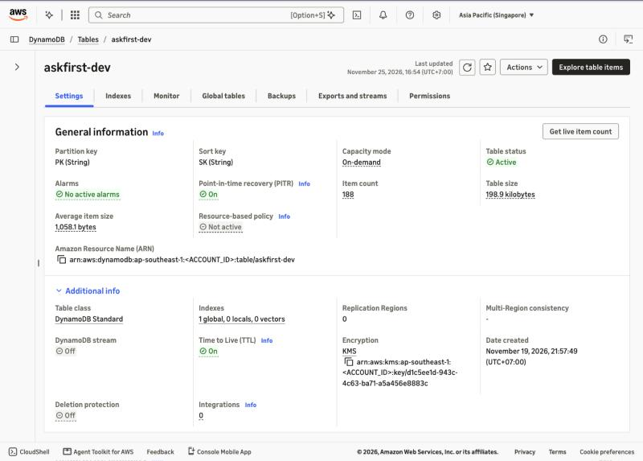
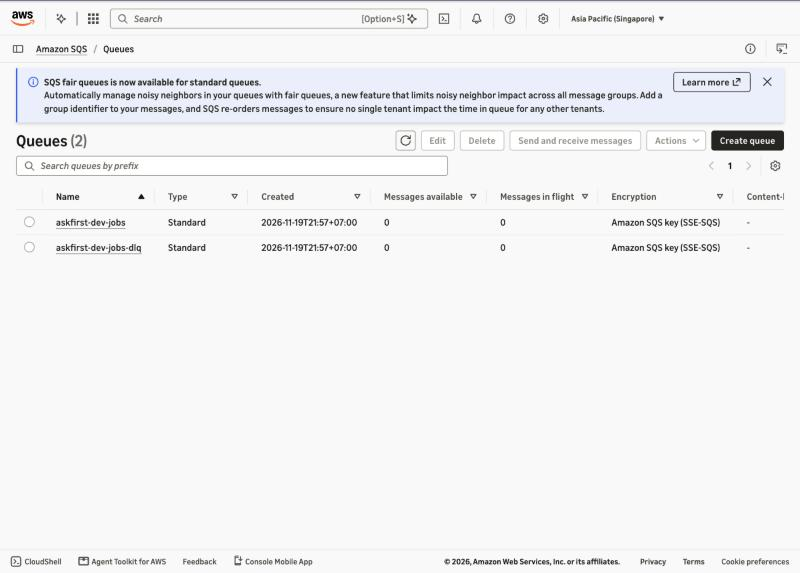

Ở bước này bạn build backend Java và deploy SAM stack `askfirst-dev`. Kết thúc bước, bạn có các function `webhook`, `worker`, `worker-dlq`, bảng DynamoDB, SQS queue và DLQ, S3 bucket, các tham số cấu hình SSM và alarm cho DLQ. Function `ai` được thêm ở 5.4.

#### Stack tạo ra những gì

| Tài nguyên | Logical ID trong `infra/template.yaml` | Tên trên AWS |
|---|---|---|
| Lambda webhook (Java 21, Function URL công khai) | `WebhookFunction` | `askfirst-dev-webhook` |
| Lambda worker (Java 21, trigger SQS, alias `live`) | `WorkerFunction` | `askfirst-dev-worker` |
| Lambda xử lý message trong DLQ | `WorkerDlqFunction` | `askfirst-dev-worker-dlq` |
| Bảng DynamoDB single-table (PK/SK, GSI1, TTL `ttl`, PITR, on-demand) | `AskFirstTable` | `askfirst-dev` |
| SQS queue (visibility 720 giây, vào DLQ sau 5 lần nhận) | `JobsQueue` | `askfirst-dev-jobs` |
| SQS dead-letter queue (giữ 14 ngày) | `JobsDeadLetterQueue` | `askfirst-dev-jobs-dlq` |
| CloudWatch alarm cho DLQ | `JobsDlqAlarm` | `askfirst-dev-jobs-dlq-not-empty` |
| S3 bucket (Block Public Access, SSE, `donated/` hết hạn sau 30 ngày) | `DataBucket` | `askfirst-dev-data-<ACCOUNT_ID>` |
| Tham số SSM (stage, tên bảng, URL queue, tên bucket) | `StageParam`, `TableNameParam`, `JobsQueueUrlParam`, `JobsDlqUrlParam`, `DataBucketNameParam` | `/askfirst/dev/...` |
| Lambda `ai` (container image) | `AiFunction` | `askfirst-dev-ai`, **chỉ được tạo khi có `AiImageUri`** (5.4) |

Không có VPC và không có NAT Gateway: Lambda vẫn kết nối được DynamoDB, SQS, S3 và Internet mà không cần chúng.

#### Bước 1: Đặt biến môi trường dùng chung

Chạy từ thư mục gốc repo:

```bash
export AWS_REGION=ap-southeast-1
export STAGE=dev
```

#### Bước 2: Build backend Java

`sam build` build từng thư mục function riêng lẻ, nên module dùng chung `common` phải được cài vào Maven repository local trước:

```bash
cd backend/ScamProtection
./mvnw clean install -DskipTests
cd ../..
```

Trên Windows PowerShell dùng `.\mvnw.cmd clean install -DskipTests`.

Output phải kết thúc bằng `BUILD SUCCESS`.

#### Bước 3: Tạo tham số hash của chính sách quyền riêng tư

Template đọc `/askfirst/<stage>/config/policy_sha256` **ngay lúc deploy** (`{{resolve:ssm:...}}` ở biến `POLICY_SHA256`), nên tham số này phải có trước lần `sam deploy` đầu tiên. Đây không phải secret: nó là phiên bản chính sách quyền riêng tư mà người dùng đồng ý trong bot. Khi file chính sách thay đổi, hash đổi theo và người dùng sẽ được yêu cầu đồng ý lại.

```bash
POLICY_SHA=$(shasum -a 256 docs/privacy-policy.md | cut -d' ' -f1)   # hoặc: sha256sum
aws ssm put-parameter --region "$AWS_REGION" \
  --name "/askfirst/$STAGE/config/policy_sha256" \
  --value "$POLICY_SHA" --type String --overwrite
```

#### Bước 4: Build ứng dụng SAM

```bash
cd infra
sam build
```

SAM đọc `infra/template.yaml`, build các function Java 21 từ `backend/ScamProtection/webhook-handler/` và `backend/ScamProtection/worker/`, rồi ghi kết quả vào `infra/.aws-sam/build`. Output phải kết thúc bằng `Build Succeeded`.

<!-- TODO screenshot: output terminal của `sam build` kết thúc bằng "Build Succeeded" -->

#### Bước 5: Deploy stack

`infra/samconfig.toml` đã có sẵn cấu hình deploy cho `dev`: `stack_name = "askfirst-dev"`, `region = "ap-southeast-1"`, `capabilities = "CAPABILITY_IAM"`, `resolve_s3 = true`, `confirm_changeset = false`.

Function `worker` và `worker-dlq` nhận bot token qua tham số template `TelegramBotToken` (kiểu `NoEcho`). Đọc token vào biến shell mà không hiện ra màn hình, để token không nằm trong lịch sử lệnh:

```bash
read -rs TELEGRAM_BOT_TOKEN     # dán <TELEGRAM_BOT_TOKEN> rồi nhấn Enter
export TELEGRAM_BOT_TOKEN
```

Deploy (vẫn ở trong `infra/`):

```bash
sam deploy --parameter-overrides \
  Stage="$STAGE" \
  TelegramBotToken="$TELEGRAM_BOT_TOKEN" \
  TelegramBotUsername="<BOT_USERNAME>"
```

- `TelegramBotUsername` là username của bot, **không** có `@`. Tham số này tuỳ chọn, chỉ dùng để tạo deep link mời người thân.
- **Không** ghi token vào `samconfig.toml`.

{}
`--parameter-overrides` trên dòng lệnh thay thế dòng `parameter_overrides` trong `samconfig.toml`, nên luôn phải truyền cả `Stage`. Ở mọi lần deploy sau, hãy truyền **đủ cùng một bộ** tham số (sau 5.4 có thêm `AiImageUri`): nếu `AiImageUri` bị rỗng, điều kiện `HasAiImage` của template là false và CloudFormation sẽ xoá function `ai`.
{}

Nếu muốn xem lại từng thiết lập, chạy `sam deploy --guided` và trả lời: Stack Name `askfirst-dev`, Region `ap-southeast-1`, Parameter Stage `dev`, Allow SAM CLI IAM role creation `Y`, **"WebhookFunction has no authentication. Is this okay?" `Y`** (Function URL bắt buộc công khai; header secret được kiểm tra bên trong function), Save arguments to configuration file `Y`.

<!-- TODO screenshot: output terminal của `sam deploy` với các CloudFormation event và dòng "Successfully created/updated stack - askfirst-dev" -->


#### Bước 6: Lấy output của stack

```bash
aws cloudformation describe-stacks --region "$AWS_REGION" --stack-name askfirst-dev \
  --query "Stacks[0].Outputs[].[OutputKey,OutputValue]" --output table
```

Giữ lại các giá trị này cho các bước sau: `WebhookFunctionUrl` (5.5), `DataBucketName` (5.4), `JobsQueueUrl`, `JobsDlqUrl`, `WorkerRoleArn`.

```bash
export FUNCTION_URL=$(aws cloudformation describe-stacks --region "$AWS_REGION" --stack-name askfirst-dev \
  --query "Stacks[0].Outputs[?OutputKey=='WebhookFunctionUrl'].OutputValue" --output text)
export DATA_BUCKET=$(aws cloudformation describe-stacks --region "$AWS_REGION" --stack-name askfirst-dev \
  --query "Stacks[0].Outputs[?OutputKey=='DataBucketName'].OutputValue" --output text)
echo "$FUNCTION_URL" "$DATA_BUCKET"
```

#### Bước 7: Kiểm tra tài nguyên

Các lệnh dưới đây chỉ đọc, lấy từ `infra/README.md` §4.

```bash
# DynamoDB: on-demand, PK/SK, GSI1, ACTIVE
aws dynamodb describe-table --table-name askfirst-dev --region "$AWS_REGION" \
  --query "Table.[TableName,BillingModeSummary.BillingMode,KeySchema,GlobalSecondaryIndexes[0].IndexName,TableStatus]"

# TTL trên thuộc tính "ttl" và PITR đã bật
aws dynamodb describe-time-to-live --table-name askfirst-dev --region "$AWS_REGION"
aws dynamodb describe-continuous-backups --table-name askfirst-dev --region "$AWS_REGION"

# S3: cả 4 cờ Block Public Access là true, lifecycle cho donated/
aws s3api get-public-access-block --bucket "$DATA_BUCKET" --region "$AWS_REGION"
aws s3api get-bucket-lifecycle-configuration --bucket "$DATA_BUCKET" --region "$AWS_REGION"

# SQS: VisibilityTimeout 720 và RedrivePolicy sang DLQ với maxReceiveCount 5
aws sqs get-queue-attributes --region "$AWS_REGION" \
  --queue-url "$(aws ssm get-parameter --region "$AWS_REGION" --name "/askfirst/$STAGE/sqs/jobs_queue_url" --query Parameter.Value --output text)" \
  --attribute-names VisibilityTimeout RedrivePolicy

# SSM: các tham số cấu hình do stack tạo
aws ssm get-parameters-by-path --region "$AWS_REGION" --path "/askfirst/$STAGE" --recursive \
  --query "Parameters[*].[Name,Type]" --output table
```





Bản thân webhook được kiểm tra ở 5.5, sau khi bot token và webhook secret đã nằm trong SSM; trước đó function `webhook` chưa khởi động được.

#### Xử lý sự cố

| Hiện tượng | Nguyên nhân và cách xử lý |
|---|---|
| Deploy lỗi ở `POLICY_SHA256` / không tìm thấy tham số | Bỏ qua bước 3 hoặc tạo ở Region khác. Tạo `/askfirst/dev/config/policy_sha256` ở `ap-southeast-1` rồi deploy lại. |
| Stack rơi vào `ROLLBACK_COMPLETE` sau lần deploy đầu | CloudFormation không cho cập nhật stack này. Chạy `sam delete --stack-name askfirst-dev`, sửa nguyên nhân, rồi deploy lại. |
| `S3 Bucket already exists` | Tên bucket là duy nhất toàn cầu; tên có chứa account ID nên hãy kiểm tra đang deploy đúng tài khoản (`aws sts get-caller-identity`). |
| `AccessDenied` ở các action IAM | Danh tính deploy thiếu quyền trong 5.2. |

Xem lý do một tài nguyên tạo lỗi:

```bash
aws cloudformation describe-stack-events --region "$AWS_REGION" --stack-name askfirst-dev \
  --query "StackEvents[?ResourceStatus=='CREATE_FAILED'].[LogicalResourceId,ResourceStatusReason]" \
  --output table
```

Tiếp theo: [5.4 Deploy AI function](../5.4-deploy-ai-function/).
