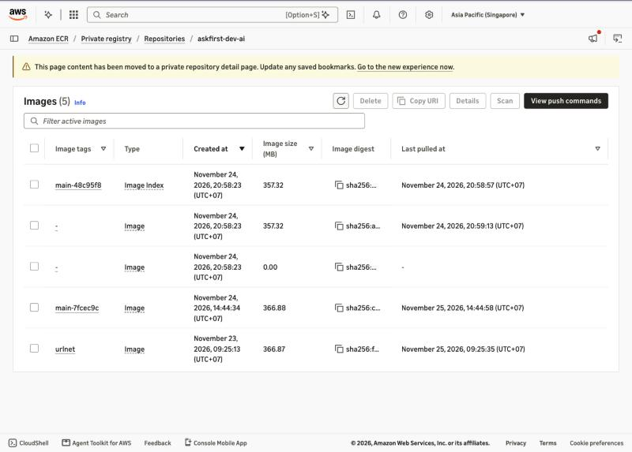
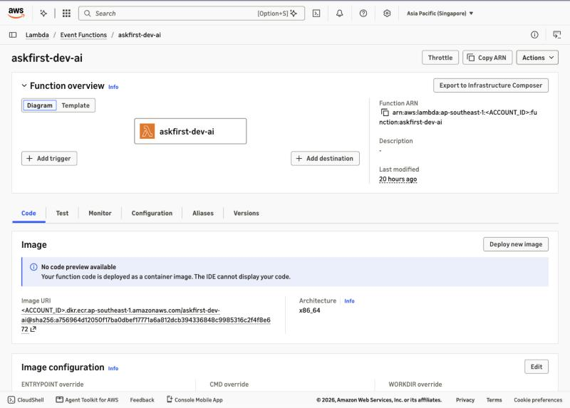
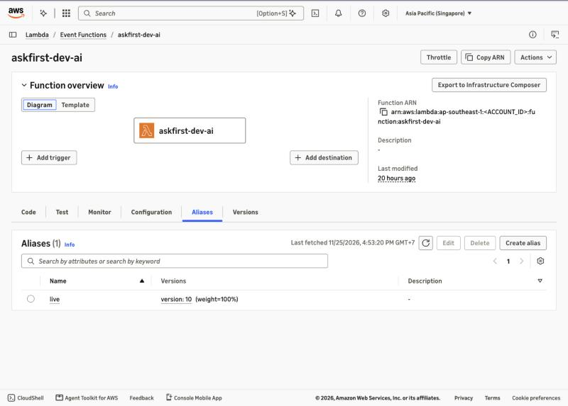
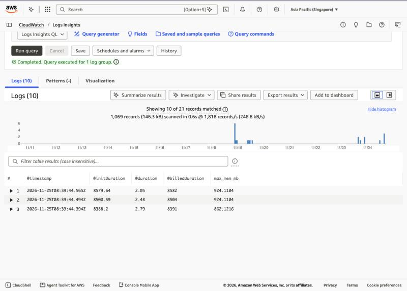

The `ai` function is a Python **container image** Lambda (3008 MB, timeout 90 s, 1 GB `/tmp`, x86_64, alias `live`). It runs OCR, PII masking, rules, retrieval from the knowledge base, Bedrock Guardrails and the Bedrock judge. In this step you:

1. create an ECR repository and a GitHub OIDC role (once per account),
2. (optional) create your own Bedrock Guardrail,
3. upload the model weights and the knowledge-base index to S3,
4. build and push the image with GitHub Actions,
5. deploy the stack again with `AiImageUri`, and test the function.

Model files are **not** inside the image. On cold start the function downloads them from the data bucket into `/tmp` and checks their SHA-256 against `ai/config/artifacts.yaml`.

Run every command from the repository root unless stated otherwise, with the variables from 5.3 set (`AWS_REGION`, `STAGE`, `DATA_BUCKET`, `TELEGRAM_BOT_TOKEN`).

#### Step 1: Create the ECR repository and the GitHub OIDC role

`infra/github-oidc.yaml` creates:

- the ECR repository `askfirst-ai` (keeps the 5 newest images),
- the IAM role `askfirst-github-ai-image`, which GitHub Actions assumes through OIDC to push images. It can only push to that repository, and only from the repository named in the `GitHubRepo` parameter,
- the GitHub OIDC identity provider (skip it with `CreateOidcProvider=false` if your account already has one).

The `GitHubRepo` parameter defaults to the team repository. On your fork, pass your own `<GITHUB_OWNER>/<REPO>`, otherwise your workflow cannot assume the role:

```bash
aws cloudformation deploy --region ap-southeast-1 --stack-name askfirst-github-oidc \
  --template-file infra/github-oidc.yaml --capabilities CAPABILITY_NAMED_IAM \
  --parameter-overrides GitHubRepo=<GITHUB_OWNER>/<REPO>
# add CreateOidcProvider=false to --parameter-overrides if the GitHub OIDC provider already exists
```

Store the role ARN as a repository variable of your fork (a variable, not a secret: the ARN alone grants nothing):

```bash
gh variable set AWS_AI_IMAGE_ROLE_ARN --body "$(aws cloudformation describe-stacks --region ap-southeast-1 \
  --stack-name askfirst-github-oidc \
  --query "Stacks[0].Outputs[?OutputKey=='AiImagePushRoleArn'].OutputValue" --output text)"
```

`gh` uses the repository of the current clone. Add `--repo <GITHUB_OWNER>/<REPO>` if it points elsewhere.

<!-- TODO screenshot: CloudFormation stack askfirst-github-oidc in CREATE_COMPLETE, Outputs tab with AiImagePushRoleArn and AiImageRepoUri (account ID blurred) -->
<!-- TODO screenshot: GitHub fork → Settings → Secrets and variables → Actions → Variables, showing AWS_AI_IMAGE_ROLE_ARN (value blurred) -->

#### Step 2 (optional): Create your own Bedrock Guardrail

The `guardrail.id` in `ai/config/models.yaml` belongs to the team's Bedrock account, so it will not work in yours. Without a working guardrail the pipeline **skips** the guardrail check and still runs. To enable it in your account (Region `ap-southeast-2`):

```bash
cd ai
uv run python scripts/create_guardrail.py --dry-run   # print the request only
uv run python scripts/create_guardrail.py             # create guardrail "askfirst-guard"
cd ..
```

The script prints a line of the form `guardrail: {id: "<GUARDRAIL_ID>", version: "<VERSION>", ...}`. Put `<GUARDRAIL_ID>` and `<VERSION>` into the `guardrail:` line of `ai/config/models.yaml`. This file is baked into the image, so this edit must be committed **before** step 4.

<!-- TODO screenshot: Bedrock console (ap-southeast-2) → Guardrails, showing askfirst-guard with its version -->

#### Step 3: Upload model files and the knowledge-base index to S3

The function reads four artifacts. Their versions, S3 prefixes and SHA-256 are fixed in `ai/config/artifacts.yaml`:

| Artifact | S3 prefix | How to get it |
|---|---|---|
| `ocr` | `ocr/ppocrv6-small-rapidocr3.10.0/` | `scripts/fetch_ocr_models.py` (RapidOCR PP-OCRv6 small, ONNX fp32) |
| `embedder` | `embedder/e5-small-qint8-614241f/` | `scripts/fetch_embedder.py` (multilingual-e5-small, int8 ONNX) |
| `kb_index` | `kb_index/kb-2026.11.11/` | `scripts/build_index.py` from `kb/scenarios.yaml` and `kb/alerts.yaml` |
| `vietocr` | `vietocr/vgg-seq2seq-0.3.13-fp32/` | **Optional.** `scripts/export_vietocr_onnx.py` needs a separate PyTorch environment (see the script header). |

Download and build them (inside `ai/`):

```bash
cd ai
uv run python scripts/fetch_ocr_models.py out/ocr
uv run python scripts/fetch_embedder.py out/embedder
uv run python scripts/build_index.py out/embedder out/kb_index --version kb-2026.11.11
```

`fetch_*` stop if a downloaded file does not match `artifacts.yaml`. `build_index.py` prints the SHA-256 of `index.npy` and `meta.json`. According to `ai/MODELS.md`, a different machine can produce slightly different floats. If the printed SHA-256 differ from the `kb_index` entry in `ai/config/artifacts.yaml`, write your values there (and commit before step 4), because the function checks them on load.

Upload (still inside `ai/`):

```bash
export ARTIFACT_BUCKET="$DATA_BUCKET"
uv run python scripts/upload_artifacts.py ocr out/ocr
uv run python scripts/upload_artifacts.py embedder out/embedder
uv run python scripts/upload_artifacts.py kb_index out/kb_index
cd ..
```

`upload_artifacts.py` checks every file against `artifacts.yaml` first and uploads nothing if one does not match. Each uploaded key is printed as `đã upload s3://<bucket>/<key>`.

If you skip `vietocr`, OCR still works with RapidOCR alone: the function logs `ocr_reread_failed` once and continues.

<!-- TODO screenshot: S3 console, bucket askfirst-dev-data-<ACCOUNT_ID>, showing the ocr/, embedder/ and kb_index/ prefixes -->

#### Step 4: Build and push the image with GitHub Actions

The image is built on GitHub Actions, not on your laptop (`.github/workflows/ai-image.yml`). Commit and push any change from steps 2 and 3 to `main` of your fork first.

{}
GitHub disables workflows on a new fork. Open the **Actions** tab of your fork once and enable them.
{}

Start the workflow from the UI (**Actions → AI image → Run workflow**, branch `main`) or from the CLI:

```bash
gh workflow run ai-image.yml --ref main
gh run watch
```

The workflow builds `ai/Dockerfile` from the repository root, checks that the image is at most 2 GB, imports all libraries on a read-only root filesystem, calls the handler once in `stub` mode through the Lambda Runtime Interface Emulator, and then (only on a manual run) assumes the OIDC role and pushes:

```text
<ACCOUNT_ID>.dkr.ecr.ap-southeast-1.amazonaws.com/askfirst-ai:<GIT_SHA>
```

The run summary prints the full URI in a line `Deploy: sam deploy --parameter-overrides AiImageUri=<URI> ...`. You can also list the images:

```bash
aws ecr describe-images --region ap-southeast-1 --repository-name askfirst-ai \
  --query "sort_by(imageDetails,&imagePushedAt)[-1].imageTags" --output text
```

```bash
export AI_IMAGE_URI="<ACCOUNT_ID>.dkr.ecr.ap-southeast-1.amazonaws.com/askfirst-ai:<GIT_SHA>"
```

<!-- TODO screenshot: GitHub Actions run "AI image" (workflow_dispatch) all steps green, with the summary showing the image size and the Deploy line (account ID blurred) -->


<!-- TODO(not verified): building locally with `docker build -f ai/Dockerfile -t askfirst-ai .` (add `--platform linux/amd64` on Apple Silicon) and pushing with docker login/tag/push like the workflow's Push step. The Dockerfile says to build on GitHub Actions; the team has not used the local path. -->

#### Step 5: Deploy the stack with the AI image

Go back to `infra/` and deploy with the **full** parameter set from 5.3 plus `AiImageUri`:

```bash
cd infra
sam deploy --parameter-overrides \
  Stage="$STAGE" \
  TelegramBotToken="$TELEGRAM_BOT_TOKEN" \
  TelegramBotUsername="<BOT_USERNAME>" \
  AiImageUri="$AI_IMAGE_URI"
cd ..
```

CloudFormation now creates `askfirst-dev-ai` with alias `live`. The `worker` already calls `askfirst-dev-ai:live`.

{}
If the real pipeline fails and you need the bot running end to end first, deploy again with `AiPipelineImpl=stub` added. The stub answers from fixed keyword rules, with no media download and no network calls (no OCR, no Bedrock). It is meant for the `dev` bot only. Remove it (or set `AiPipelineImpl=real`) when the real pipeline works.
{}





#### Step 6: Test the AI function

Invoke the alias with the analyze fixture used by CI (text "Chào bạn"):

```bash
python3 -c "import json; print(json.dumps(json.load(open('contracts/fixtures/analyze/default.json'))['request']))" > req.json
aws lambda invoke --region ap-southeast-1 --function-name askfirst-dev-ai:live \
  --payload fileb://req.json out.json
python3 -c "import json,sys; r=json.load(open('out.json')); sys.exit(0 if r.get('op')=='analyze' and not r.get('error') and r.get('analyze') else 1)" \
  && echo OK || cat out.json
rm -f req.json
```

`aws lambda invoke` should print `"StatusCode": 200`, and the check prints `OK` when the response has `op` = `analyze`, no `error`, and an `analyze` object. The first call is a cold start: the team measured an init time of about 6.2 s at p50 for this function (source: `docs/results/lambda-p95.md`), plus model downloads from S3.

Read the logs if it fails:

```bash
aws logs tail /aws/lambda/askfirst-dev-ai --region ap-southeast-1 --since 10m
```



#### Optional: Bedrock in another AWS account

Skip this if Bedrock is enabled in the same account as the Lambda functions (the normal case for this guide). The team ran Lambda in one account and Bedrock in another. If the `ai` function has the environment variable `BEDROCK_ROLE_ARN`, it assumes that role before calling Bedrock (`ai/src/askfirst/llm/bedrock.py`). Otherwise it calls Bedrock in its own account.

Find the name of the `ai` function's execution role (the last part of the ARN):

```bash
aws lambda get-function-configuration --region ap-southeast-1 \
  --function-name askfirst-dev-ai --query Role --output text
```

In the **Bedrock account**:

```bash
aws iam create-role --role-name askfirst-bedrock-from-team --assume-role-policy-document '{"Version":"2012-10-17","Statement":[{"Effect":"Allow","Principal":{"AWS":"arn:aws:iam::<TEAM_ACCOUNT>:role/<AI_LAMBDA_ROLE>"},"Action":"sts:AssumeRole"}]}'
aws iam put-role-policy --role-name askfirst-bedrock-from-team --policy-name bedrock --policy-document '{"Version":"2012-10-17","Statement":[{"Effect":"Allow","Action":["bedrock:InvokeModel","bedrock:ApplyGuardrail"],"Resource":"*"}]}'
```

In the **Lambda account**:

```bash
aws iam put-role-policy --role-name <AI_LAMBDA_ROLE> --policy-name assume-bedrock --policy-document '{"Version":"2012-10-17","Statement":[{"Effect":"Allow","Action":"sts:AssumeRole","Resource":"arn:aws:iam::<BEDROCK_ACCOUNT>:role/askfirst-bedrock-from-team"}]}'
```

Then set `BEDROCK_ROLE_ARN=arn:aws:iam::<BEDROCK_ACCOUNT>:role/askfirst-bedrock-from-team` on the `ai` function.

<!-- TODO(not verified): how BEDROCK_ROLE_ARN was set on the function. The template does not define this variable, so the next `sam deploy` overwrites it, and alias `live` points to a published version, so a change to $LATEST also needs a new version and an alias update. The inline policy on the SAM-generated role may also be lost if CloudFormation replaces the role. -->

Next: [5.5 Connect Telegram](../5.5-connect-telegram/).
