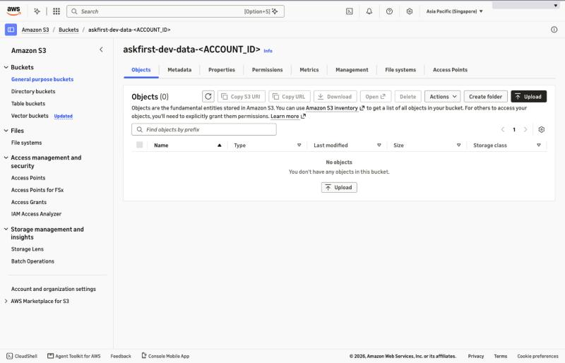
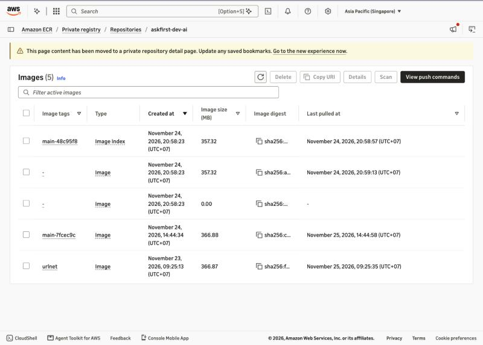
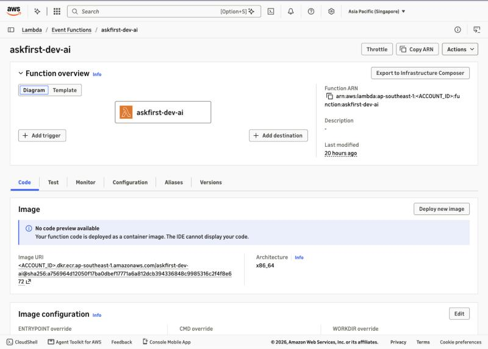
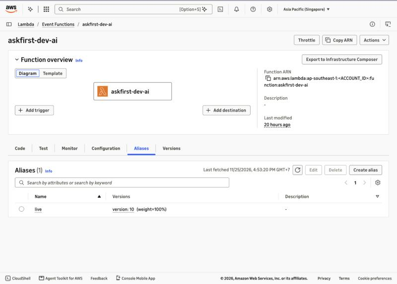
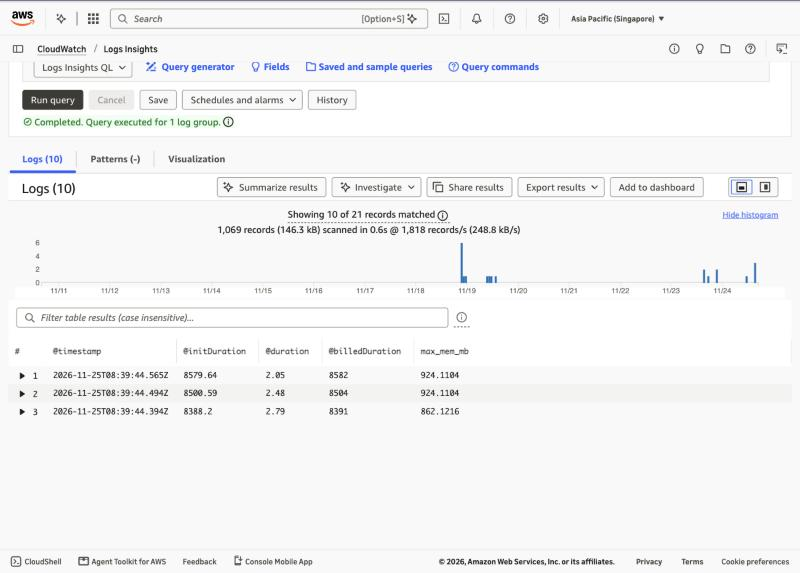

Function `ai` là Lambda dạng **container image** viết bằng Python (3008 MB, timeout 90 giây, `/tmp` 1 GB, x86_64, alias `live`). Function này chạy OCR, mask PII, bộ luật, truy xuất knowledge base, Bedrock Guardrails và Bedrock judge. Ở bước này bạn sẽ:

1. tạo ECR repository và GitHub OIDC role (một lần cho mỗi tài khoản),
2. (tuỳ chọn) tạo Bedrock Guardrail của riêng bạn,
3. upload trọng số model và index của knowledge base lên S3,
4. build và đẩy image bằng GitHub Actions,
5. deploy lại stack với `AiImageUri` và kiểm tra function.

File model **không** nằm trong image. Khi cold start, function tải chúng từ data bucket về `/tmp` và kiểm SHA-256 theo `ai/config/artifacts.yaml`.

Mọi lệnh chạy từ thư mục gốc repo (trừ khi ghi khác), với các biến đã đặt ở 5.3 (`AWS_REGION`, `STAGE`, `DATA_BUCKET`, `TELEGRAM_BOT_TOKEN`).

#### Bước 1: Tạo ECR repository và GitHub OIDC role

`infra/github-oidc.yaml` tạo:

- ECR repository `askfirst-ai` (giữ 5 image mới nhất),
- IAM role `askfirst-github-ai-image` để GitHub Actions assume qua OIDC khi đẩy image. Role chỉ được push vào đúng repository đó, và chỉ từ repo GitHub ghi trong tham số `GitHubRepo`,
- GitHub OIDC identity provider (bỏ qua bằng `CreateOidcProvider=false` nếu tài khoản đã có).

Tham số `GitHubRepo` mặc định là repo của team. Với bản fork, hãy truyền `<GITHUB_OWNER>/<REPO>` của bạn, nếu không workflow sẽ không assume được role:

```bash
aws cloudformation deploy --region ap-southeast-1 --stack-name askfirst-github-oidc \
  --template-file infra/github-oidc.yaml --capabilities CAPABILITY_NAMED_IAM \
  --parameter-overrides GitHubRepo=<GITHUB_OWNER>/<REPO>
# thêm CreateOidcProvider=false vào --parameter-overrides nếu tài khoản đã có GitHub OIDC provider
```

Lưu ARN của role thành repository variable của bản fork (là variable, không phải secret: riêng ARN không cấp quyền gì):

```bash
gh variable set AWS_AI_IMAGE_ROLE_ARN --body "$(aws cloudformation describe-stacks --region ap-southeast-1 \
  --stack-name askfirst-github-oidc \
  --query "Stacks[0].Outputs[?OutputKey=='AiImagePushRoleArn'].OutputValue" --output text)"
```

`gh` dùng repo của bản clone hiện tại. Thêm `--repo <GITHUB_OWNER>/<REPO>` nếu nó trỏ sang repo khác.

<!-- TODO screenshot: stack CloudFormation askfirst-github-oidc ở trạng thái CREATE_COMPLETE, tab Outputs có AiImagePushRoleArn và AiImageRepoUri (làm mờ account ID) -->
<!-- TODO screenshot: GitHub fork → Settings → Secrets and variables → Actions → Variables, có AWS_AI_IMAGE_ROLE_ARN (làm mờ giá trị) -->

#### Bước 2 (tuỳ chọn): Tạo Bedrock Guardrail riêng

`guardrail.id` trong `ai/config/models.yaml` thuộc tài khoản Bedrock của team nên sẽ không dùng được trong tài khoản của bạn. Khi guardrail gọi lỗi, pipeline **bỏ qua** bước guardrail và vẫn chạy tiếp. Để bật guardrail trong tài khoản của bạn (Region `ap-southeast-2`):

```bash
cd ai
uv run python scripts/create_guardrail.py --dry-run   # chỉ in request
uv run python scripts/create_guardrail.py             # tạo guardrail "askfirst-guard"
cd ..
```

Script in ra một dòng dạng `guardrail: {id: "<GUARDRAIL_ID>", version: "<VERSION>", ...}`. Điền `<GUARDRAIL_ID>` và `<VERSION>` vào dòng `guardrail:` trong `ai/config/models.yaml`. File này được đóng vào image, nên phải commit thay đổi **trước** bước 4.

<!-- TODO screenshot: Bedrock console (ap-southeast-2) → Guardrails, thấy askfirst-guard và version -->

#### Bước 3: Upload file model và index knowledge base lên S3

Function đọc bốn artifact. Version, S3 prefix và SHA-256 của chúng đã cố định trong `ai/config/artifacts.yaml`:

| Artifact | S3 prefix | Cách lấy |
|---|---|---|
| `ocr` | `ocr/ppocrv6-small-rapidocr3.10.0/` | `scripts/fetch_ocr_models.py` (RapidOCR PP-OCRv6 small, ONNX fp32) |
| `embedder` | `embedder/e5-small-qint8-614241f/` | `scripts/fetch_embedder.py` (multilingual-e5-small, ONNX int8) |
| `kb_index` | `kb_index/kb-2026.11.11/` | `scripts/build_index.py` từ `kb/scenarios.yaml` và `kb/alerts.yaml` |
| `vietocr` | `vietocr/vgg-seq2seq-0.3.13-fp32/` | **Tuỳ chọn.** `scripts/export_vietocr_onnx.py` cần một môi trường PyTorch riêng (xem đầu script). |

Tải và dựng (trong `ai/`):

```bash
cd ai
uv run python scripts/fetch_ocr_models.py out/ocr
uv run python scripts/fetch_embedder.py out/embedder
uv run python scripts/build_index.py out/embedder out/kb_index --version kb-2026.11.11
```

Các script `fetch_*` dừng nếu file tải về không khớp `artifacts.yaml`. `build_index.py` in SHA-256 của `index.npy` và `meta.json`. Theo `ai/MODELS.md`, máy khác có thể cho ra số thực lệch một chút. Nếu SHA-256 in ra khác mục `kb_index` trong `ai/config/artifacts.yaml`, hãy ghi giá trị của bạn vào đó (và commit trước bước 4), vì function kiểm SHA-256 khi nạp.

Upload (vẫn trong `ai/`):

```bash
export ARTIFACT_BUCKET="$DATA_BUCKET"
uv run python scripts/upload_artifacts.py ocr out/ocr
uv run python scripts/upload_artifacts.py embedder out/embedder
uv run python scripts/upload_artifacts.py kb_index out/kb_index
cd ..
```

`upload_artifacts.py` kiểm từng file theo `artifacts.yaml` trước, chỉ cần một file lệch là không upload gì. Mỗi key upload xong được in dạng `đã upload s3://<bucket>/<key>`.

Nếu bỏ qua `vietocr`, OCR vẫn chạy với riêng RapidOCR: function ghi log `ocr_reread_failed` một lần rồi chạy tiếp.



#### Bước 4: Build và đẩy image bằng GitHub Actions

Image được build trên GitHub Actions, không build trên laptop (`.github/workflows/ai-image.yml`). Trước tiên, commit và push mọi thay đổi ở bước 2 và 3 lên `main` của bản fork.

{}
GitHub tắt workflow trên fork mới. Mở tab **Actions** của bản fork một lần và bật workflow lên.
{}

Chạy workflow từ giao diện (**Actions → AI image → Run workflow**, branch `main`) hoặc từ CLI:

```bash
gh workflow run ai-image.yml --ref main
gh run watch
```

Workflow build `ai/Dockerfile` từ gốc repo, kiểm image không quá 2 GB, import đủ thư viện trên root filesystem chỉ đọc, gọi thử handler ở chế độ `stub` qua Lambda Runtime Interface Emulator, rồi (chỉ khi chạy tay) assume OIDC role và đẩy:

```text
<ACCOUNT_ID>.dkr.ecr.ap-southeast-1.amazonaws.com/askfirst-ai:<GIT_SHA>
```

Summary của lần chạy in URI đầy đủ trong dòng `Deploy: sam deploy --parameter-overrides AiImageUri=<URI> ...`. Cũng có thể liệt kê image:

```bash
aws ecr describe-images --region ap-southeast-1 --repository-name askfirst-ai \
  --query "sort_by(imageDetails,&imagePushedAt)[-1].imageTags" --output text
```

```bash
export AI_IMAGE_URI="<ACCOUNT_ID>.dkr.ecr.ap-southeast-1.amazonaws.com/askfirst-ai:<GIT_SHA>"
```




<!-- TODO(not verified): build trên máy bằng `docker build -f ai/Dockerfile -t askfirst-ai .` (thêm `--platform linux/amd64` trên Apple Silicon) rồi docker login/tag/push như bước Push của workflow. Dockerfile ghi là build trên GitHub Actions; team chưa dùng cách build trên máy. -->

#### Bước 5: Deploy stack kèm AI image

Quay về `infra/` và deploy với **đủ** bộ tham số ở 5.3, thêm `AiImageUri`:

```bash
cd infra
sam deploy --parameter-overrides \
  Stage="$STAGE" \
  TelegramBotToken="$TELEGRAM_BOT_TOKEN" \
  TelegramBotUsername="<BOT_USERNAME>" \
  AiImageUri="$AI_IMAGE_URI"
cd ..
```

Lúc này CloudFormation tạo `askfirst-dev-ai` với alias `live`. `worker` vốn đã gọi `askfirst-dev-ai:live`.

{}
Nếu pipeline thật lỗi mà bạn cần bot chạy thông từ đầu đến cuối trước, hãy deploy lại và thêm `AiPipelineImpl=stub`. Bản stub trả lời theo bộ luật từ khoá cố định, không tải media và không gọi mạng (không OCR, không Bedrock), chỉ dành cho bot `dev`. Bỏ tham số này (hoặc đặt `AiPipelineImpl=real`) khi pipeline thật đã chạy.
{}





#### Bước 6: Kiểm tra AI function

Invoke alias với fixture analyze mà CI dùng (văn bản "Chào bạn"):

```bash
python3 -c "import json; print(json.dumps(json.load(open('contracts/fixtures/analyze/default.json'))['request']))" > req.json
aws lambda invoke --region ap-southeast-1 --function-name askfirst-dev-ai:live \
  --payload fileb://req.json out.json
python3 -c "import json,sys; r=json.load(open('out.json')); sys.exit(0 if r.get('op')=='analyze' and not r.get('error') and r.get('analyze') else 1)" \
  && echo OK || cat out.json
rm -f req.json
```

`aws lambda invoke` phải in `"StatusCode": 200`, và lệnh kiểm in `OK` khi response có `op` = `analyze`, không có `error` và có object `analyze`. Lần gọi đầu là cold start: team đo được thời gian init khoảng 6,2 giây ở p50 cho function này (nguồn: `docs/results/lambda-p95.md`), chưa kể thời gian tải model từ S3.

Đọc log nếu lỗi:

```bash
aws logs tail /aws/lambda/askfirst-dev-ai --region ap-southeast-1 --since 10m
```



#### Tuỳ chọn: Bedrock ở tài khoản AWS khác

Bỏ qua phần này nếu Bedrock đã bật trong cùng tài khoản với các Lambda (trường hợp bình thường của hướng dẫn này). Team chạy Lambda ở một tài khoản và Bedrock ở tài khoản khác. Nếu function `ai` có biến môi trường `BEDROCK_ROLE_ARN`, function sẽ assume role đó trước khi gọi Bedrock (`ai/src/askfirst/llm/bedrock.py`). Không có biến này thì function gọi Bedrock trong chính tài khoản của nó.

Lấy tên execution role của function `ai` (phần cuối của ARN):

```bash
aws lambda get-function-configuration --region ap-southeast-1 \
  --function-name askfirst-dev-ai --query Role --output text
```

Ở **tài khoản Bedrock**:

```bash
aws iam create-role --role-name askfirst-bedrock-from-team --assume-role-policy-document '{"Version":"2012-10-17","Statement":[{"Effect":"Allow","Principal":{"AWS":"arn:aws:iam::<TEAM_ACCOUNT>:role/<AI_LAMBDA_ROLE>"},"Action":"sts:AssumeRole"}]}'
aws iam put-role-policy --role-name askfirst-bedrock-from-team --policy-name bedrock --policy-document '{"Version":"2012-10-17","Statement":[{"Effect":"Allow","Action":["bedrock:InvokeModel","bedrock:ApplyGuardrail"],"Resource":"*"}]}'
```

Ở **tài khoản chạy Lambda**:

```bash
aws iam put-role-policy --role-name <AI_LAMBDA_ROLE> --policy-name assume-bedrock --policy-document '{"Version":"2012-10-17","Statement":[{"Effect":"Allow","Action":"sts:AssumeRole","Resource":"arn:aws:iam::<BEDROCK_ACCOUNT>:role/askfirst-bedrock-from-team"}]}'
```

Sau đó đặt `BEDROCK_ROLE_ARN=arn:aws:iam::<BEDROCK_ACCOUNT>:role/askfirst-bedrock-from-team` cho function `ai`.

{}
Ở môi trường dev của nhóm, `BEDROCK_ROLE_ARN` có trên cả `$LATEST` và alias `live` của function `ai` (kiểm 25/11/2026), nhưng template và workflow CI đều không khai báo biến này, tức là nó được đặt ngoài repo. Lần `sam deploy` sau có thể ghi đè mất biến. Alias `live` trỏ vào một version đã publish, nên sửa `$LATEST` xong phải publish version mới rồi cập nhật alias. Inline policy gắn vào role do SAM sinh ra cũng có thể mất nếu CloudFormation thay role. Kiểm lại biến và policy sau mỗi lần deploy.
{}

Tiếp theo: [5.5 Kết nối Telegram](../5.5-connect-telegram/).
