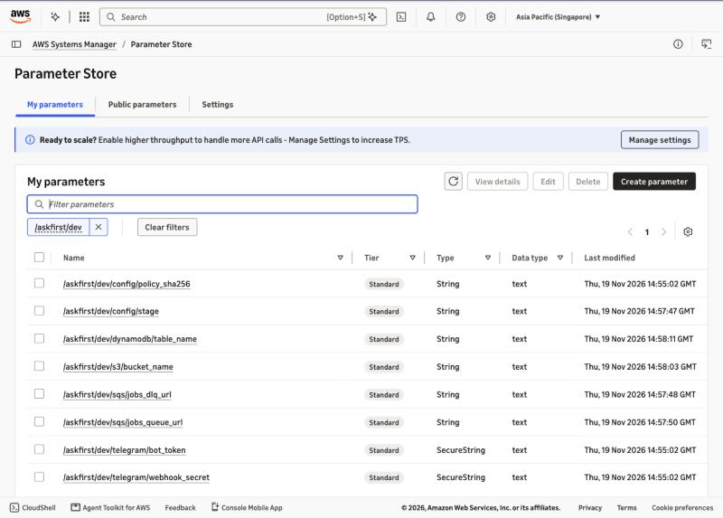
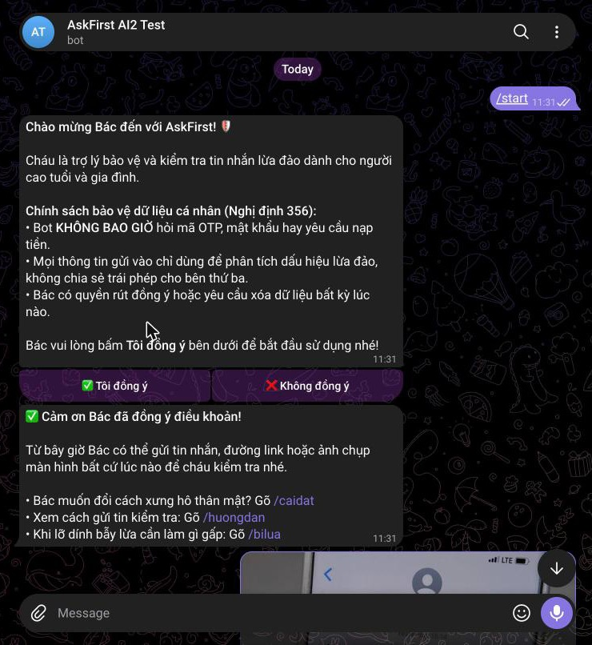
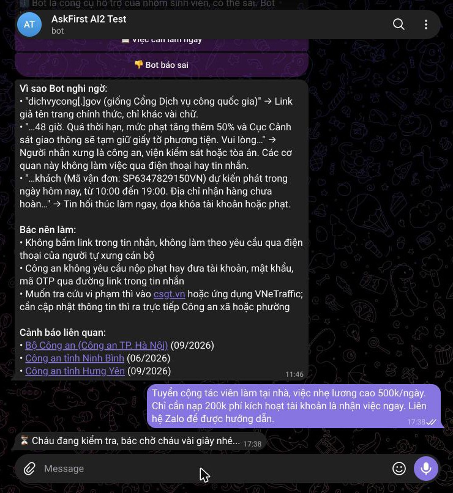
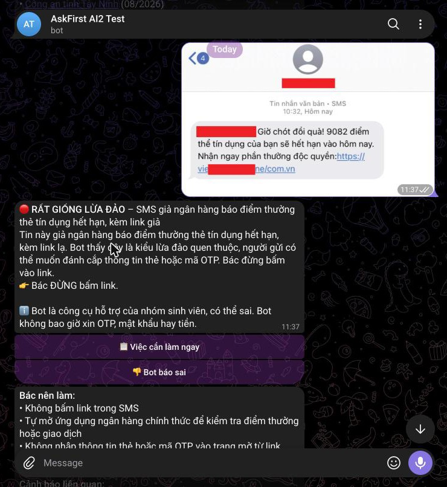

In this last deployment step you store the bot secrets in SSM Parameter Store, check that the webhook rejects requests without the secret, register the webhook with Telegram, set the bot menu and send the first message.

Run every command from the repository root with the variables from 5.3 set (`AWS_REGION`, `STAGE`, `FUNCTION_URL`, `TELEGRAM_BOT_TOKEN`).

#### Step 1: Store the bot token and webhook secret in SSM

The `webhook` and `ai` functions read two `SecureString` parameters from SSM (`webhook` at init, `ai` on first use), so no redeploy is needed after you create them:

| SSM parameter | Type | Read by | Notes |
|---|---|---|---|
| `/askfirst/dev/telegram/bot_token` | `SecureString` | `webhook` (`TELEGRAM_BOT_TOKEN_PARAM`), `ai` (`BOT_TOKEN_PARAM`) | The token from BotFather |
| `/askfirst/dev/telegram/webhook_secret` | `SecureString` | `webhook` (`TELEGRAM_WEBHOOK_SECRET_PARAM`) | Only `A-Za-z0-9_-`, at most 256 characters |
| `/askfirst/dev/config/policy_sha256` | `String` | CloudFormation at deploy time | Already created in 5.3 |

Generate a random webhook secret and store both values. The values never appear on screen or in your shell history:

```bash
# Bot token: reuses $TELEGRAM_BOT_TOKEN from 5.3 (otherwise: read -rs TELEGRAM_BOT_TOKEN)
aws ssm put-parameter --region "$AWS_REGION" --name "/askfirst/$STAGE/telegram/bot_token" \
  --value "$TELEGRAM_BOT_TOKEN" --type SecureString --overwrite

# Webhook secret: 64 hex characters
TELEGRAM_WEBHOOK_SECRET=$(openssl rand -hex 32)
aws ssm put-parameter --region "$AWS_REGION" --name "/askfirst/$STAGE/telegram/webhook_secret" \
  --value "$TELEGRAM_WEBHOOK_SECRET" --type SecureString --overwrite
export TELEGRAM_WEBHOOK_SECRET
```

PowerShell versions of these commands (with `Read-Host`) are in `infra/README.md` §5.

Check the types: both Telegram parameters must be `SecureString`, `policy_sha256` must be `String`:

```bash
aws ssm get-parameters-by-path --region "$AWS_REGION" --path "/askfirst/$STAGE" --recursive \
  --query "Parameters[*].[Name,Type]" --output table
```



{}
Never print these values, put them in screenshots or commit them. `--with-decryption` shows the plaintext, so use it only inside a command substitution as below. If a token or secret leaks, revoke the token with BotFather (`/revoke`), store the new values and repeat steps 1 and 3.
{}

#### Step 2: Check the webhook authentication

The Function URL is public (`AuthType: NONE`), so the function itself must reject any request without the correct `X-Telegram-Bot-Api-Secret-Token` header.

```bash
# No secret: expect 401
curl -s -o /dev/null -w "%{http_code}\n" -X POST "$FUNCTION_URL" \
  -H "Content-Type: application/json" -d '{}'

# Correct secret, empty update: expect "IGNORED" then 200
curl -s -w "\n%{http_code}\n" -X POST "$FUNCTION_URL" \
  -H "Content-Type: application/json" \
  -H "X-Telegram-Bot-Api-Secret-Token: $TELEGRAM_WEBHOOK_SECRET" -d '{}'
```

You can also run the read-only check script, which tests both cases and the resources from 5.3. It prints `[PASS]` or `[FAIL]` per item and exits with code 1 on any failure:

```bash
./infra/verify-dev.sh ap-southeast-1 dev
```

<!-- TODO screenshot: terminal output of the two curl commands (401, then IGNORED / 200) or of verify-dev.sh with all [PASS] -->

#### Step 3: Register the webhook with Telegram

`scripts/set_webhook.py` calls the Telegram Bot API `setWebhook` with the Function URL and the secret, subscribes to the updates `message`, `callback_query` and `my_chat_member`, then prints `getWebhookInfo`. It reads `TELEGRAM_BOT_TOKEN` and `TELEGRAM_WEBHOOK_SECRET` from the environment (exported above). It refuses to register a webhook without a secret.

```bash
python3 scripts/set_webhook.py --url "$FUNCTION_URL"
```

Check the printed block: `URL` must equal your `WebhookFunctionUrl`, `Allowed updates` must list the three update types, and there must be no `Lỗi gần nhất từ Telegram` (last error from Telegram) line.

Other options: `--drop-pending` discards updates Telegram queued while the webhook was down; `--delete` removes the webhook.

<!-- TODO screenshot: terminal output of set_webhook.py with the getWebhookInfo block (URL partly blurred) -->

#### Step 4: Set the bot menu

```bash
python3 scripts/set_commands.py
```

This sets the Telegram menu commands `/batdau`, `/huongdan`, `/caidat`, `/nguoithan`, `/lichsu` and `/bilua`. It is safe to run again.

#### Step 5: Send the first message

1. Open the chat with your bot in Telegram (search for `<BOT_USERNAME>`) and press **Start** (or send `/batdau`).
2. The bot replies with a welcome and privacy-consent message and a **✅ Đồng ý** button. Press it. Until you agree, the bot does not check any message.
3. Send or forward a suspicious text, for example a fake prize message with a link.
4. The bot answers at once with a message starting with "⏳". A few seconds later the same message is edited into the result: risk level, the matching scam scenario, the reasons, and what to do now.
5. Send a screenshot of a suspicious message to test OCR. The first image after a deploy is slower because the `ai` function downloads its models from S3.







Feature flags live in the DynamoDB item `CONFIG#global` / `FLAGS`. If the item does not exist, the defaults are `llm_enabled=true`, `feature_image=true`, `feature_voice=false`, `feature_rag=true`, so nothing has to be created for this test.

#### Troubleshooting

Follow the logs of each function while you send a message:

```bash
sam logs -n WebhookFunction --stack-name askfirst-dev --region "$AWS_REGION" --tail
sam logs -n WorkerFunction  --stack-name askfirst-dev --region "$AWS_REGION" --tail
sam logs -n AiFunction      --stack-name askfirst-dev --region "$AWS_REGION" --tail
```

| Symptom | Where to look |
|---|---|
| Bot does not answer at all | Run `set_webhook.py` again and read `Lỗi gần nhất từ Telegram`. A `401` there means the secret in SSM differs from the one registered: repeat step 3 with the value stored in SSM. |
| `webhook` logs show an SSM error | A parameter from step 1 is missing, has the wrong name or the wrong Region. |
| "⏳" appears but is never edited | The job reached SQS but the `worker` or `ai` failed: read the `worker` and `ai` logs. After 5 failed attempts the job goes to `askfirst-dev-jobs-dlq`, `worker-dlq` tells the user the bot is busy, and the alarm `askfirst-dev-jobs-dlq-not-empty` goes to ALARM. |
| `ai` errors about artifacts or SHA-256 | A file in S3 does not match `ai/config/artifacts.yaml` (see 5.4, step 3). |
| `ai` errors from Bedrock | Model access in `ap-southeast-2` (5.2) or the guardrail ID (5.4, step 2). |

To read the secret back from SSM without printing it, for example in a new shell:

```bash
export TELEGRAM_WEBHOOK_SECRET=$(aws ssm get-parameter --region "$AWS_REGION" \
  --name "/askfirst/$STAGE/telegram/webhook_secret" --with-decryption \
  --query Parameter.Value --output text)
```

{}
The `worker` and `worker-dlq` functions get the token from the deploy parameter `TelegramBotToken` (5.3), not from SSM. When you change the token, update SSM **and** deploy again with the new `TelegramBotToken` and the full parameter set, including `AiImageUri`.
{}

<!-- TODO(not verified): after a token or secret change in SSM, how long warm `webhook` and `ai` execution environments keep the old value (they read SSM once, at init or first use). If the bot still uses the old value, publish a configuration change or wait for new environments. -->

The bot is now running end to end on AWS.
