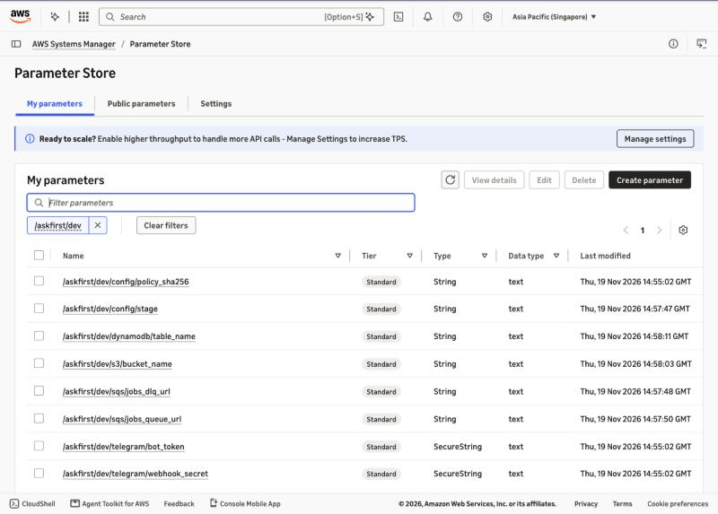
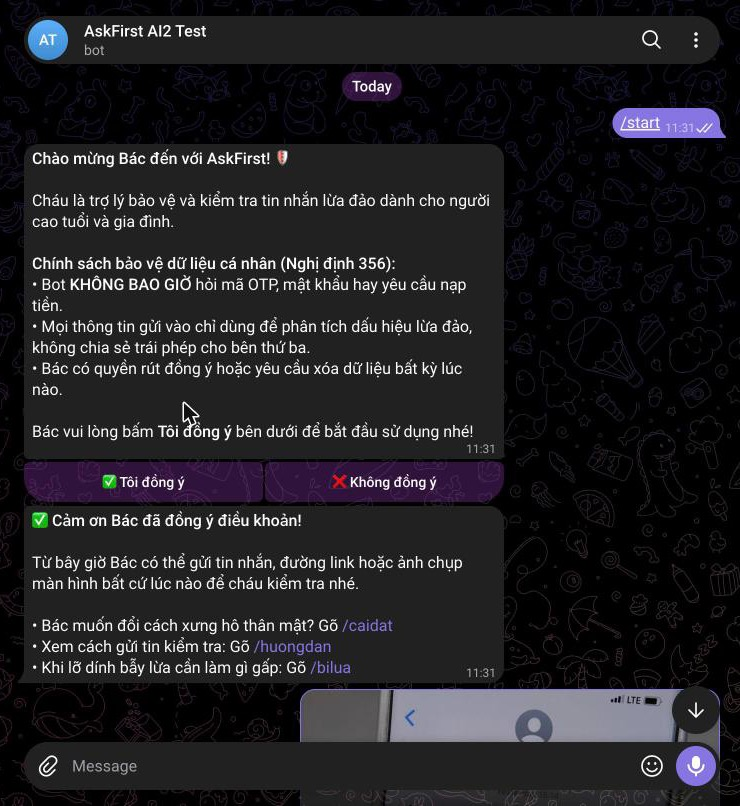
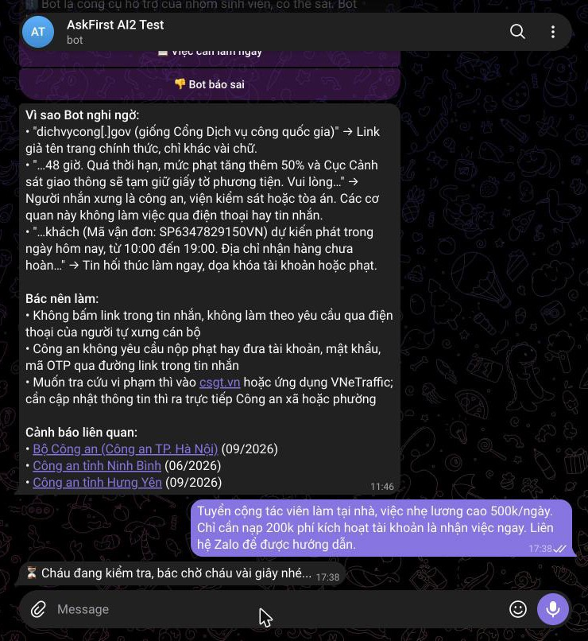
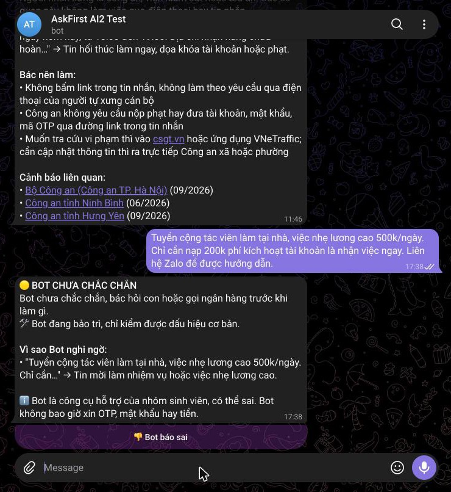
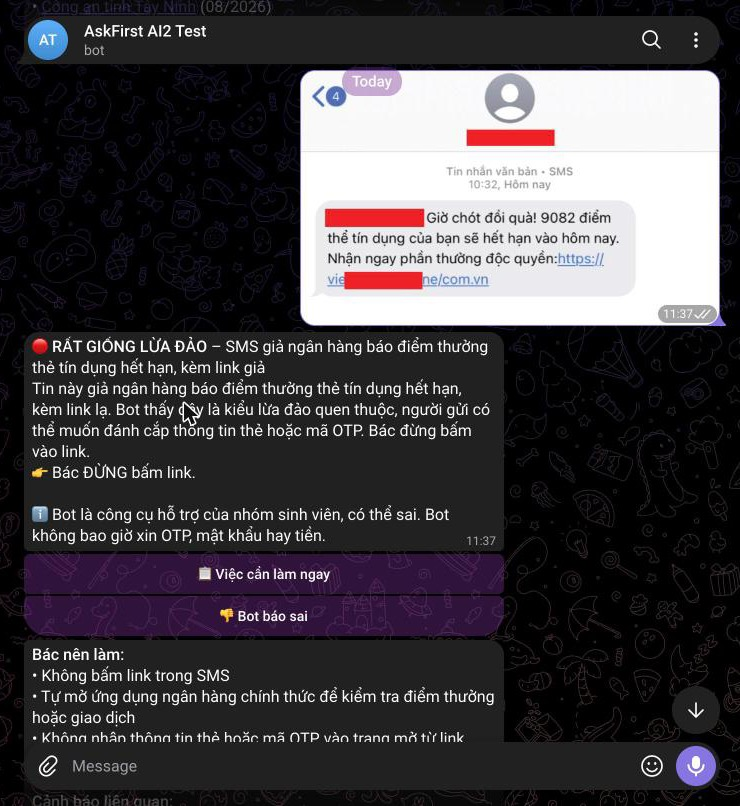

Ở bước deploy cuối cùng này, bạn lưu secret của bot vào SSM Parameter Store, kiểm tra webhook từ chối request không có secret, đăng ký webhook với Telegram, cài menu cho bot và gửi tin nhắn đầu tiên.

Mọi lệnh chạy từ thư mục gốc repo, với các biến đã đặt ở 5.3 (`AWS_REGION`, `STAGE`, `FUNCTION_URL`, `TELEGRAM_BOT_TOKEN`).

#### Bước 1: Lưu bot token và webhook secret vào SSM

Function `webhook` và `ai` đọc hai tham số `SecureString` từ SSM (`webhook` lúc init, `ai` ở lần dùng đầu tiên), nên tạo xong không cần deploy lại:

| Tham số SSM | Kiểu | Function đọc | Ghi chú |
|---|---|---|---|
| `/askfirst/dev/telegram/bot_token` | `SecureString` | `webhook` (`TELEGRAM_BOT_TOKEN_PARAM`), `ai` (`BOT_TOKEN_PARAM`) | Token lấy từ BotFather |
| `/askfirst/dev/telegram/webhook_secret` | `SecureString` | `webhook` (`TELEGRAM_WEBHOOK_SECRET_PARAM`) | Chỉ dùng `A-Za-z0-9_-`, tối đa 256 ký tự |
| `/askfirst/dev/config/policy_sha256` | `String` | CloudFormation lúc deploy | Đã tạo ở 5.3 |

Sinh webhook secret ngẫu nhiên và lưu cả hai giá trị. Giá trị không hiện ra màn hình và không vào lịch sử lệnh:

```bash
# Bot token: dùng lại $TELEGRAM_BOT_TOKEN từ 5.3 (nếu chưa có: read -rs TELEGRAM_BOT_TOKEN)
aws ssm put-parameter --region "$AWS_REGION" --name "/askfirst/$STAGE/telegram/bot_token" \
  --value "$TELEGRAM_BOT_TOKEN" --type SecureString --overwrite

# Webhook secret: 64 ký tự hex
TELEGRAM_WEBHOOK_SECRET=$(openssl rand -hex 32)
aws ssm put-parameter --region "$AWS_REGION" --name "/askfirst/$STAGE/telegram/webhook_secret" \
  --value "$TELEGRAM_WEBHOOK_SECRET" --type SecureString --overwrite
export TELEGRAM_WEBHOOK_SECRET
```

Bản PowerShell của các lệnh này (dùng `Read-Host`) có trong `infra/README.md` §5.

Kiểm tra kiểu: hai tham số Telegram phải là `SecureString`, `policy_sha256` là `String`:

```bash
aws ssm get-parameters-by-path --region "$AWS_REGION" --path "/askfirst/$STAGE" --recursive \
  --query "Parameters[*].[Name,Type]" --output table
```



{}
Không bao giờ in các giá trị này ra, đưa vào ảnh chụp màn hình hay commit. `--with-decryption` sẽ hiện giá trị gốc, nên chỉ dùng nó bên trong command substitution như bên dưới. Nếu token hoặc secret bị lộ, thu hồi token với BotFather (`/revoke`), lưu giá trị mới và làm lại bước 1 và bước 3.
{}

#### Bước 2: Kiểm tra xác thực của webhook

Function URL là công khai (`AuthType: NONE`), nên chính function phải từ chối mọi request không có header `X-Telegram-Bot-Api-Secret-Token` đúng.

```bash
# Không có secret: phải ra 401
curl -s -o /dev/null -w "%{http_code}\n" -X POST "$FUNCTION_URL" \
  -H "Content-Type: application/json" -d '{}'

# Secret đúng, update rỗng: phải ra "IGNORED" rồi 200
curl -s -w "\n%{http_code}\n" -X POST "$FUNCTION_URL" \
  -H "Content-Type: application/json" \
  -H "X-Telegram-Bot-Api-Secret-Token: $TELEGRAM_WEBHOOK_SECRET" -d '{}'
```

Bạn cũng có thể chạy script kiểm tra chỉ đọc, script này thử cả hai trường hợp trên và các tài nguyên ở 5.3. Script in `[PASS]` hoặc `[FAIL]` cho từng mục và thoát với mã 1 nếu có mục sai:

```bash
./infra/verify-dev.sh ap-southeast-1 dev
```

Output thật trên môi trường dev (25/11/2026), ca không có secret:

```text
$ curl -s -w "\n%{http_code}\n" -X POST "$FUNCTION_URL" -H "Content-Type: application/json" -d '{}'
UNAUTHORIZED
401
```

<!-- TODO screenshot: ca có secret (IGNORED / 200) hoặc verify-dev.sh với toàn bộ [PASS] -->

#### Bước 3: Đăng ký webhook với Telegram

`scripts/set_webhook.py` gọi `setWebhook` của Telegram Bot API với Function URL và secret, đăng ký nhận các update `message`, `callback_query` và `my_chat_member`, rồi in kết quả `getWebhookInfo`. Script đọc `TELEGRAM_BOT_TOKEN` và `TELEGRAM_WEBHOOK_SECRET` từ biến môi trường (đã export ở trên), và từ chối đăng ký webhook nếu thiếu secret.

```bash
python3 scripts/set_webhook.py --url "$FUNCTION_URL"
```

Kiểm tra khối được in ra: `URL` phải trùng `WebhookFunctionUrl`, `Allowed updates` phải có đủ ba loại update, và không có dòng `Lỗi gần nhất từ Telegram`.

Tuỳ chọn khác: `--drop-pending` bỏ các update Telegram đang giữ trong lúc webhook không hoạt động; `--delete` gỡ webhook.

<!-- TODO screenshot: output terminal của set_webhook.py với khối getWebhookInfo (làm mờ một phần URL) -->

#### Bước 4: Cài menu cho bot

```bash
python3 scripts/set_commands.py
```

Lệnh này đặt các lệnh trong menu Telegram: `/batdau`, `/huongdan`, `/caidat`, `/nguoithan`, `/lichsu` và `/bilua`. Chạy lại nhiều lần không sao.

#### Bước 5: Gửi tin nhắn đầu tiên

1. Mở chat với bot của bạn trong Telegram (tìm `<BOT_USERNAME>`) và bấm **Start** (hoặc gửi `/batdau`).
2. Bot trả lời bằng tin chào mừng kèm phần đồng ý về quyền riêng tư và nút **✅ Đồng ý**. Bấm nút này. Khi chưa đồng ý, bot không kiểm tra tin nào.
3. Gửi hoặc chuyển tiếp một tin đáng ngờ, ví dụ tin báo trúng thưởng giả có kèm link.
4. Bot trả lời ngay bằng một tin bắt đầu bằng "⏳". Vài giây sau, chính tin đó được sửa thành kết quả: mức rủi ro, kịch bản lừa đảo khớp, lý do và việc cần làm ngay.
5. Gửi ảnh chụp màn hình một tin đáng ngờ để thử OCR. Ảnh đầu tiên sau khi deploy sẽ chậm hơn vì function `ai` phải tải model từ S3.







Cờ tính năng nằm ở item DynamoDB `CONFIG#global` / `FLAGS`. Nếu item chưa tồn tại thì giá trị mặc định là `llm_enabled=true`, `feature_image=true`, `feature_voice=false`, `feature_rag=true`, nên không cần tạo gì thêm cho lần thử này.

#### Xử lý sự cố

Theo dõi log từng function trong lúc gửi tin:

```bash
sam logs -n WebhookFunction --stack-name askfirst-dev --region "$AWS_REGION" --tail
sam logs -n WorkerFunction  --stack-name askfirst-dev --region "$AWS_REGION" --tail
sam logs -n AiFunction      --stack-name askfirst-dev --region "$AWS_REGION" --tail
```

| Hiện tượng | Xem ở đâu |
|---|---|
| Bot không trả lời gì | Chạy lại `set_webhook.py` và đọc dòng `Lỗi gần nhất từ Telegram`. Nếu là `401` thì secret trong SSM khác secret đã đăng ký: làm lại bước 3 với giá trị đang lưu trong SSM. |
| Log `webhook` báo lỗi SSM | Thiếu tham số ở bước 1, sai tên hoặc sai Region. |
| Có "⏳" nhưng không bao giờ được sửa | Job đã vào SQS nhưng `worker` hoặc `ai` lỗi: đọc log của `worker` và `ai`. Sau 5 lần lỗi, job vào `askfirst-dev-jobs-dlq`, `worker-dlq` báo người dùng là bot đang bận, và alarm `askfirst-dev-jobs-dlq-not-empty` chuyển sang ALARM. |
| `ai` báo lỗi artifact hoặc SHA-256 | Một file trên S3 không khớp `ai/config/artifacts.yaml` (xem 5.4, bước 3). |
| `ai` báo lỗi từ Bedrock | Quyền dùng model ở `ap-southeast-2` (5.2) hoặc guardrail ID (5.4, bước 2). |

Đọc lại secret từ SSM mà không in ra, ví dụ khi mở shell mới:

```bash
export TELEGRAM_WEBHOOK_SECRET=$(aws ssm get-parameter --region "$AWS_REGION" \
  --name "/askfirst/$STAGE/telegram/webhook_secret" --with-decryption \
  --query Parameter.Value --output text)
```

{}
Function `worker` và `worker-dlq` lấy token từ tham số deploy `TelegramBotToken` (5.3), không lấy từ SSM. Khi đổi token, hãy cập nhật SSM **và** deploy lại với `TelegramBotToken` mới cùng đủ bộ tham số, kể cả `AiImageUri`.
{}

<!-- TODO(not verified): sau khi đổi token hoặc secret trong SSM, các execution environment `webhook` và `ai` đang ấm còn giữ giá trị cũ bao lâu (chúng chỉ đọc SSM một lần, lúc init hoặc lần dùng đầu). Nếu bot vẫn dùng giá trị cũ, hãy đổi cấu hình function để Lambda tạo environment mới, hoặc chờ environment mới. -->

Đến đây bot đã chạy thông từ đầu đến cuối trên AWS.
