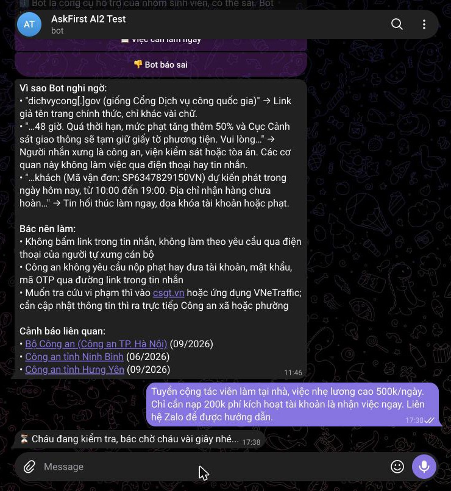
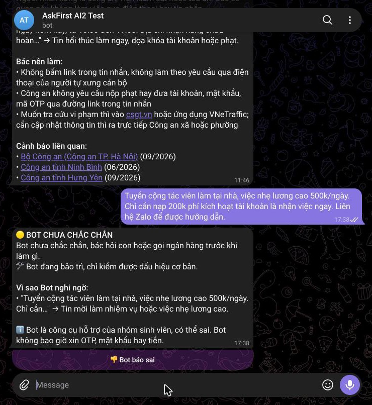
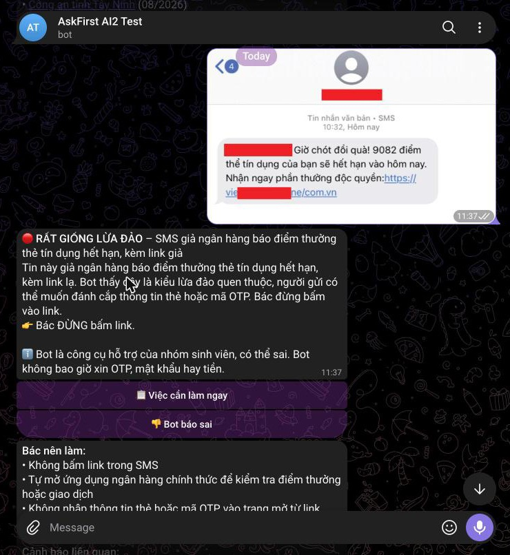
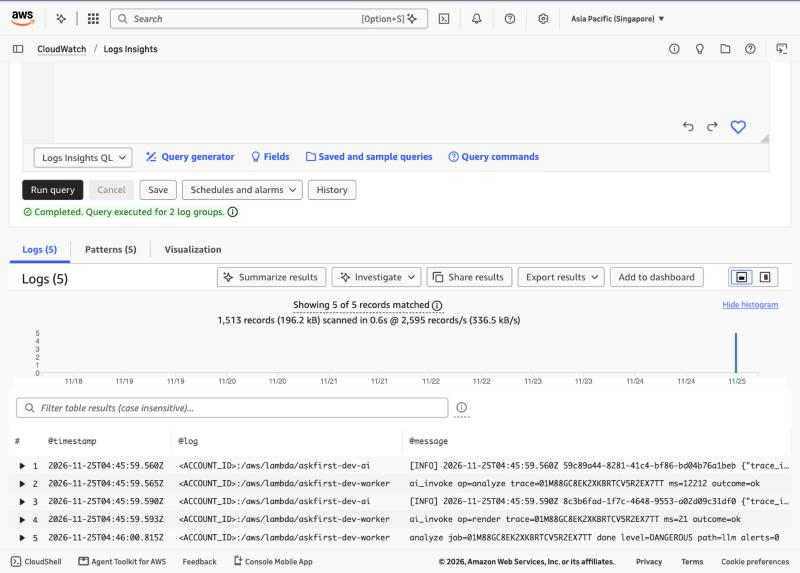
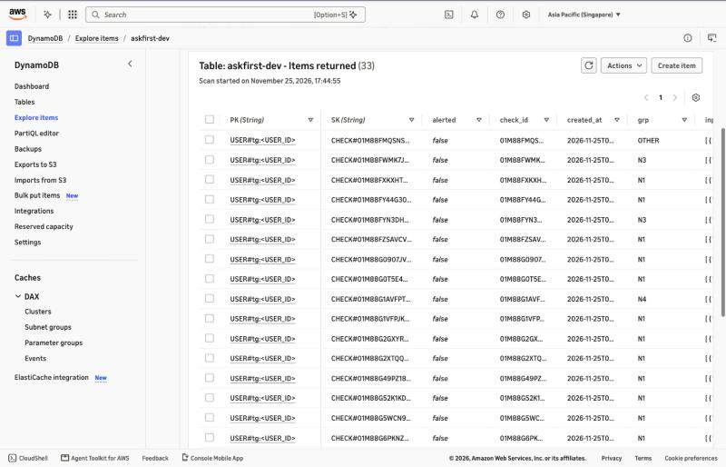
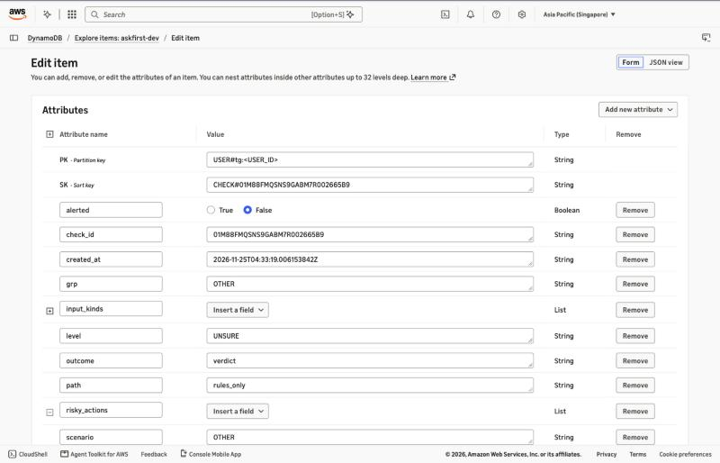
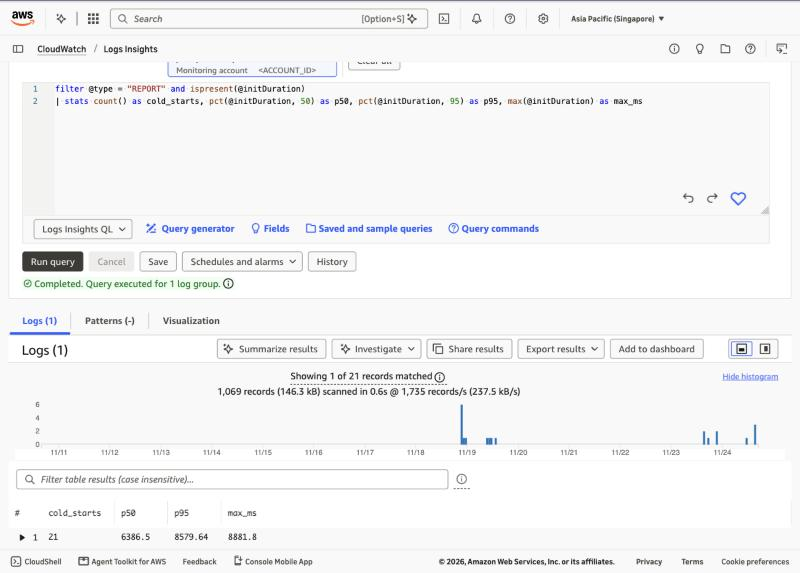

In this step you check that the deployed bot works end to end, that it rejects bad input, and that it degrades safely when a dependency fails. At the end you compare your results with the numbers the team measured.

All commands assume stage `dev`, Region `ap-southeast-1`, and a shell at the repository root. Lambda function names follow the pattern `askfirst-<stage>-<function>`.

```bash
STAGE=dev
export AWS_REGION=ap-southeast-1
```

#### 5.6.1 Happy path: send a message from Telegram

1. Open your test bot in Telegram, send `/start` and accept the privacy policy.
2. Send a short **made-up** suspicious text, for example a message that claims to be from a bank and asks for an OTP. Never use real messages from real people.
3. Expected behaviour:
   - The bot replies with a "⏳" message almost immediately (the `webhook` function accepted the update and put an `AnalyzeJob` on SQS).
   - A few seconds later the "⏳" message is edited into the verdict with a risk level and a short explanation (the `worker` called the `ai` function and rendered the reply).
4. Send a screenshot of a made-up scam message (an image) and repeat. Images take longer because of OCR (see 5.6.5).






#### 5.6.2 Test the webhook directly with curl

The webhook is a public Lambda Function URL (`AuthType: NONE`). The only authentication is the `X-Telegram-Bot-Api-Secret-Token` header, so the function **must** reject any request without the right secret. Get the URL from the SAM output `WebhookFunctionUrl` and read the secret from SSM into a shell variable (do not print it or paste it anywhere):

```bash
FUNCTION_URL="<WebhookFunctionUrl from the SAM outputs>"
SECRET=$(aws ssm get-parameter --name "/askfirst/$STAGE/telegram/webhook_secret" \
  --with-decryption --query Parameter.Value --output text)
```

| Test | Command | Expected |
|---|---|---|
| No secret | `curl -s -w "\n%{http_code}\n" -X POST "$FUNCTION_URL" -H "Content-Type: application/json" -d '{}'` | `UNAUTHORIZED`, `401` |
| Wrong secret | same, plus `-H "X-Telegram-Bot-Api-Secret-Token: wrong"` | `UNAUTHORIZED`, `401` |
| Right secret, empty update | same, plus `-H "X-Telegram-Bot-Api-Secret-Token: $SECRET"` | `IGNORED`, `200` |
| Right secret, malformed JSON | `curl -s -w "\n%{http_code}\n" -X POST "$FUNCTION_URL" -H "X-Telegram-Bot-Api-Secret-Token: $SECRET" -d 'not-json'` | `INVALID_JSON`, `400` |

The expected codes come from `WebhookHandler.handleRequest` in `backend/ScamProtection/webhook-handler`. The repository also ships a script that runs the secret checks plus the DynamoDB, S3, SQS and SSM checks in one go:

```bash
./infra/verify-dev.sh        # Windows: .\infra\verify-dev.ps1
```

Other edge cases the webhook handles (each returns `200` so Telegram does not retry): the same `update_id` delivered twice (`DUPLICATE`), unsupported media such as documents or audio (`UNSUPPORTED_*`), a user who has not accepted the policy (`CONSENT_REQUIRED`), and a user over the rate limit (`RATE_LIMITED`). Test these from the Telegram app rather than with hand-made JSON, because a fake update with a real chat ID makes the bot send real messages.

Actual output on the dev environment (25/11/2026) for the two cases that need no secret:

```text
$ curl -s -w "\n%{http_code}\n" -X POST "$FUNCTION_URL" -H "Content-Type: application/json" -d '{}'
UNAUTHORIZED
401
$ curl -s -w "\n%{http_code}\n" -X POST "$FUNCTION_URL" -H "Content-Type: application/json" -H "X-Telegram-Bot-Api-Secret-Token: wrong" -d '{}'
UNAUTHORIZED
401
```

<!-- TODO screenshot: output of the two correct-secret cases (IGNORED 200, INVALID_JSON 400), no secret value visible -->
<!-- TODO screenshot: output of ./infra/verify-dev.sh -->

#### 5.6.3 Check the result in CloudWatch Logs and DynamoDB

**Logs.** Each function writes to `/aws/lambda/askfirst-<stage>-<function>`. Follow the worker while you send a message:

```bash
aws logs tail /aws/lambda/askfirst-$STAGE-worker --since 10m --follow
```

Look for a line like `ai_invoke op=analyze trace=<id> ms=<ms> outcome=<outcome>`. The `ai` function logs one JSON line per call with the same `trace_id`, so you can follow one job across both functions:

```bash
aws logs tail /aws/lambda/askfirst-$STAGE-ai --since 10m --filter-pattern '"analyze"'
```

Logs contain IDs, operation names, timings, risk level and processing path only. They never contain the message text, the image, or the Telegram file URL (checked over 30 days of logs, `docs/results/lambda-p95.md`, section Log).

**DynamoDB.** The worker stores one item per check in the single table `askfirst-<stage>`, with `PK = USER#tg:<telegram_user_id>` and `SK = CHECK#<check_id>`. The item holds the outcome, not the message: `level`, `score`, `grp`, `scenario`, `path`, `signal_codes`, `created_at`, `ttl`. On a small dev table a scan is fine:

```bash
aws dynamodb scan --table-name askfirst-$STAGE \
  --filter-expression "begins_with(SK, :sk)" \
  --expression-attribute-values '{":sk":{"S":"CHECK#"}}' \
  --expression-attribute-names '{"#l":"level","#p":"path","#s":"score"}' \
  --projection-expression "SK, #l, #s, #p, created_at" --max-items 5
```

`path` tells you how the verdict was produced: `fast` (rules were enough), `cache`, `llm` (Qwen3 32B judge), `escalated` (backup model `gpt-oss-120b` also called) or `rules_only` (no LLM, see 5.6.4).






#### 5.6.4 Failure scenarios

**1. The LLM is down or slow: rules-only fallback.** The judge never raises on an LLM error. It returns no judgement and the fuse step scores the message with rules only (`ai/src/askfirst/pipeline/judge.py`). If the primary model fails, the backup model is tried while time remains. If Bedrock Guardrails cannot be called, the pipeline skips the guard and continues (fail-open). The reply is still sent; the stored `path` is `rules_only`.

**2. Kill switch.** Operators can switch the LLM off without a deploy. The worker reads the item `PK = CONFIG#global`, `SK = FLAGS` and caches it for 30 seconds. Check the current value first, because the team's dev table has had it set to `false`:

```bash
aws dynamodb get-item --table-name askfirst-$STAGE \
  --key '{"PK":{"S":"CONFIG#global"},"SK":{"S":"FLAGS"}}'

# Turn the LLM off (rules only, the bot shows a maintenance note)
aws dynamodb update-item --table-name askfirst-$STAGE \
  --key '{"PK":{"S":"CONFIG#global"},"SK":{"S":"FLAGS"}}' \
  --update-expression "SET llm_enabled = :v" \
  --expression-attribute-values '{":v":{"BOOL":false}}'
```

Wait about 30 seconds, send a message, and check that `path` is `rules_only`. Set the value back to `true` (or to what it was before) when you are done. Other flags in the same item: `feature_image`, `feature_voice`, `feature_rag`.


**3. Job fails repeatedly: DLQ.** The `jobs` queue redrives a message to `jobs-dlq` after 5 failed receives. The `worker-dlq` function then edits the "⏳" message into a "busy, please try again" message and the alarm `askfirst-<stage>-jobs-dlq-not-empty` fires (see 5.7). The procedure in `infra/WORKER.md` forces the failure by throttling the `ai` function:

```bash
QUEUE_URL=$(aws ssm get-parameter --name "/askfirst/$STAGE/sqs/jobs_queue_url" --query Parameter.Value --output text)
DLQ_URL=$(aws ssm get-parameter --name "/askfirst/$STAGE/sqs/jobs_dlq_url" --query Parameter.Value --output text)

aws sqs set-queue-attributes --queue-url "$QUEUE_URL" --attributes VisibilityTimeout=20   # speed up retries
aws lambda put-function-concurrency --function-name askfirst-$STAGE-ai --reserved-concurrent-executions 0
# send one text message to the bot, wait 2-3 minutes
aws sqs get-queue-attributes --queue-url "$DLQ_URL" --attribute-names ApproximateNumberOfMessages
```

Clean up afterwards:

```bash
aws lambda delete-function-concurrency --function-name askfirst-$STAGE-ai
aws sqs purge-queue --queue-url "$DLQ_URL"
sam deploy ...   # puts VisibilityTimeout back to 720
```

<!-- TODO(not verified): infra/WORKER.md says these DLQ commands had not been run on a real account when it was written (08/11/2026); record your own result here. -->
<!-- TODO screenshot: "busy" reply in Telegram and DLQ message count = 1 -->

{}
Do not leave the `ai` function at reserved concurrency 0 or the visibility timeout at 20 seconds. Both break normal traffic.
{}

#### 5.6.5 Measured results

The team measured accuracy offline on a labelled dataset and latency on the deployed Lambda functions.

**Accuracy** (`docs/eval-report-final.md`, 24/11/2026, prompt `judge_v3`, 3 independent runs, 134 labelled samples):

| Metric | Result | Target |
|---|---|---|
| Recall on scam messages (n = 90) | 100% in all 3 runs | ≥ 90% |
| False alarm on benign but suspicious-looking messages (n = 20) | 5% in all 3 runs | ≤ 10% |
| False alarm on normal benign messages | 0% | |
| Correct risk level | 99.3% | |
| LLM token cost per check | 0.000792 USD | |

The dataset was written or rewritten by the team; it has **0 real anonymized samples**, and 1 sample equals 5 percentage points of false alarm. Treat these numbers as an upper bound. To reproduce (needs Bedrock access, run from `ai/`):

```bash
AWS_PROFILE=<your-bedrock-profile> uv run --with "botocore[crt]" python ../eval/run_eval.py \
  ../eval/datasets/{benign_normal,benign_suspicious,hard,real_scam}.ai1.jsonl ../eval/datasets/hard.jsonl \
  --pipeline real --out ../eval/out/run1 --cache ../eval/out/run1/cache
```

**Latency on Lambda** (`docs/results/lambda-p95.md`, `ai` at 3008 MB, `ap-southeast-1`):

| Measurement | p50 | p95 | Notes |
|---|---|---|---|
| Text, warm container, client side (100 messages, 0 errors) | 1.85 s | 3.51 s | judge LLM p95 2.92 s |
| RAG retrieval | 20 ms | 45 ms | target < 100 ms |
| Image, warm, end to end (webhook `START` → worker `REPORT`, 21 images) | 11.28 s | **17.02 s** | target 15 s, not met; accepted |
| Image, inside `ai` (download, OCR, VietOCR, guard, RAG, judge) | 6.81 s | 12.19 s | |
| Cold start, `ai` init (17 cold starts) | 6.24 s | max 8.49 s | |
| Cold start, `worker` init (18 cold starts) | 2.21 s | 2.30 s | |

About 3.5 s of the image end-to-end time is the 3-second SQS debounce (`DelaySeconds = 3` on `AnalyzeJob`) plus polling. The image target was relaxed to about 30 seconds because replies are asynchronous (`docs/decisions/ADR-003-ocr-rapidocr.md`). See 5.10 for the cold-start lessons.


