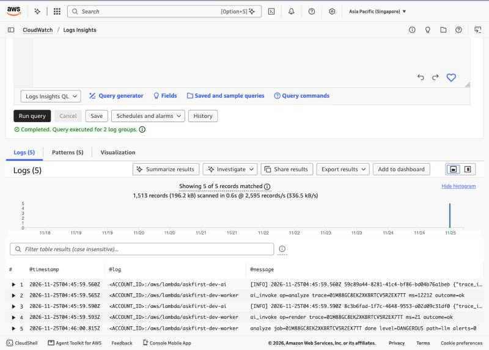
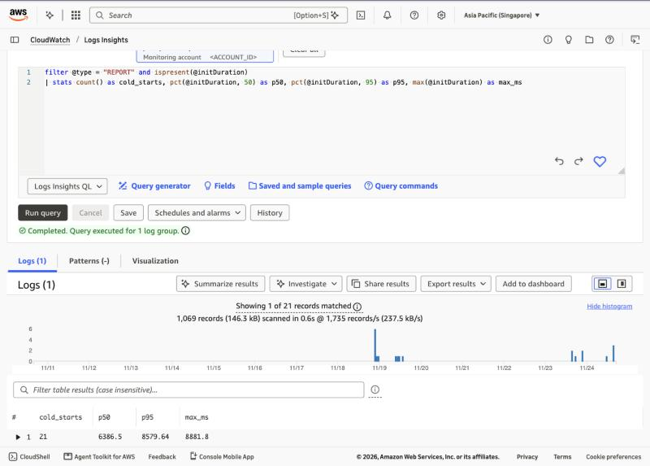

Ở bước này bạn kiểm tra bot đã deploy chạy được từ đầu đến cuối, từ chối input sai, và vẫn trả lời an toàn khi một thành phần phía sau bị lỗi. Cuối cùng bạn so kết quả của mình với số liệu team đã đo.

Mọi lệnh giả định stage `dev`, Region `ap-southeast-1`, chạy ở thư mục gốc repo. Tên Lambda function theo mẫu `askfirst-<stage>-<function>`.

```bash
STAGE=dev
export AWS_REGION=ap-southeast-1
```

#### 5.6.1 Luồng chuẩn: gửi tin từ Telegram

1. Mở bot test trong Telegram, gửi `/start` và đồng ý chính sách bảo mật.
2. Gửi một tin nghi lừa đảo **tự soạn**, ví dụ tin xưng là ngân hàng và đòi mã OTP. Không dùng tin nhắn thật của người thật.
3. Kết quả mong đợi:
   - Bot trả tin "⏳" gần như ngay lập tức (function `webhook` đã nhận update và đẩy `AnalyzeJob` vào SQS).
   - Vài giây sau, tin "⏳" được sửa thành kết quả gồm mức rủi ro và lời giải thích ngắn (`worker` đã gọi function `ai` rồi dựng câu trả lời).
4. Gửi thêm một ảnh chụp màn hình tin lừa đảo tự soạn và làm lại. Tin ảnh chậm hơn vì phải chạy OCR (xem 5.6.5).

<!-- TODO screenshot: khung chat Telegram có tin "⏳" và kết quả cuối cho tin văn bản -->
<!-- TODO screenshot: khung chat Telegram có kết quả cho tin ảnh -->

#### 5.6.2 Gọi thẳng webhook bằng curl

Webhook là Lambda Function URL công khai (`AuthType: NONE`). Lớp xác thực duy nhất là header `X-Telegram-Bot-Api-Secret-Token`, nên function **bắt buộc** từ chối mọi request không có secret đúng. Lấy URL từ output `WebhookFunctionUrl` của SAM, đọc secret từ SSM vào biến shell (không in ra, không dán vào đâu):

```bash
FUNCTION_URL="<WebhookFunctionUrl trong output của SAM>"
SECRET=$(aws ssm get-parameter --name "/askfirst/$STAGE/telegram/webhook_secret" \
  --with-decryption --query Parameter.Value --output text)
```

| Ca kiểm thử | Lệnh | Mong đợi |
|---|---|---|
| Không có secret | `curl -s -w "\n%{http_code}\n" -X POST "$FUNCTION_URL" -H "Content-Type: application/json" -d '{}'` | `UNAUTHORIZED`, `401` |
| Sai secret | như trên, thêm `-H "X-Telegram-Bot-Api-Secret-Token: wrong"` | `UNAUTHORIZED`, `401` |
| Đúng secret, update rỗng | như trên, thêm `-H "X-Telegram-Bot-Api-Secret-Token: $SECRET"` | `IGNORED`, `200` |
| Đúng secret, JSON hỏng | `curl -s -w "\n%{http_code}\n" -X POST "$FUNCTION_URL" -H "X-Telegram-Bot-Api-Secret-Token: $SECRET" -d 'not-json'` | `INVALID_JSON`, `400` |

Mã trả về lấy từ `WebhookHandler.handleRequest` trong `backend/ScamProtection/webhook-handler`. Repo có sẵn script chạy các ca secret ở trên cùng phần kiểm tra DynamoDB, S3, SQS, SSM trong một lệnh:

```bash
./infra/verify-dev.sh        # Windows: .\infra\verify-dev.ps1
```

Các ca biên khác webhook xử lý (đều trả `200` để Telegram không gửi lại): cùng `update_id` tới hai lần (`DUPLICATE`), file không hỗ trợ như tài liệu, âm thanh (`UNSUPPORTED_*`), người dùng chưa đồng ý chính sách (`CONSENT_REQUIRED`), người dùng vượt rate limit (`RATE_LIMITED`). Hãy thử các ca này từ app Telegram thay vì tự dựng JSON, vì update giả mang chat ID thật sẽ khiến bot gửi tin thật.

<!-- TODO screenshot: output terminal của 4 lệnh curl (không lộ giá trị secret) -->
<!-- TODO screenshot: output của ./infra/verify-dev.sh -->

#### 5.6.3 Xem kết quả trong CloudWatch Logs và DynamoDB

**Log.** Mỗi function ghi vào `/aws/lambda/askfirst-<stage>-<function>`. Theo dõi log của worker trong lúc gửi tin:

```bash
aws logs tail /aws/lambda/askfirst-$STAGE-worker --since 10m --follow
```

Tìm dòng dạng `ai_invoke op=analyze trace=<id> ms=<ms> outcome=<outcome>`. Function `ai` ghi một dòng JSON cho mỗi lần gọi, mang cùng `trace_id`, nên bạn lần theo được một job qua cả hai function:

```bash
aws logs tail /aws/lambda/askfirst-$STAGE-ai --since 10m --filter-pattern '"analyze"'
```

Log chỉ có ID, tên thao tác, thời gian, mức rủi ro và đường xử lý. Log không bao giờ chứa nội dung tin, ảnh hay URL file Telegram (đã quét log 30 ngày, `docs/results/lambda-p95.md`, mục Log).

**DynamoDB.** Worker lưu mỗi lượt kiểm tra thành một item trong bảng đơn `askfirst-<stage>`, với `PK = USER#tg:<telegram_user_id>` và `SK = CHECK#<check_id>`. Item chỉ lưu kết quả, không lưu nội dung tin: `level`, `score`, `grp`, `scenario`, `path`, `signal_codes`, `created_at`, `ttl`. Bảng dev nhỏ nên scan được:

```bash
aws dynamodb scan --table-name askfirst-$STAGE \
  --filter-expression "begins_with(SK, :sk)" \
  --expression-attribute-values '{":sk":{"S":"CHECK#"}}' \
  --expression-attribute-names '{"#l":"level","#p":"path","#s":"score"}' \
  --projection-expression "SK, #l, #s, #p, created_at" --max-items 5
```

`path` cho biết kết quả được tạo ra theo đường nào: `fast` (luật là đủ), `cache`, `llm` (judge Qwen3 32B), `escalated` (gọi thêm model dự phòng `gpt-oss-120b`) hoặc `rules_only` (không có LLM, xem 5.6.4).


<!-- TODO screenshot: DynamoDB Explore items với một item CHECK# (che user ID) -->

#### 5.6.4 Kịch bản lỗi

**1. LLM lỗi hoặc chậm: lùi về chỉ chạy luật.** Judge không bao giờ raise khi LLM lỗi. Nó trả về "không có judgement" và bước fuse chấm điểm tin chỉ bằng luật (`ai/src/askfirst/pipeline/judge.py`). Model chính lỗi thì gọi model dự phòng nếu còn thời gian. Không gọi được Bedrock Guardrails thì pipeline bỏ qua bước guard và chạy tiếp (fail-open). Người dùng vẫn nhận được câu trả lời; `path` được lưu là `rules_only`.

**2. Kill switch.** Người vận hành tắt được LLM mà không cần deploy. Worker đọc item `PK = CONFIG#global`, `SK = FLAGS` và cache 30 giây. Kiểm giá trị hiện tại trước, vì bảng dev của team từng để cờ này là `false`:

```bash
aws dynamodb get-item --table-name askfirst-$STAGE \
  --key '{"PK":{"S":"CONFIG#global"},"SK":{"S":"FLAGS"}}'

# Tắt LLM (chỉ chạy luật, bot báo đang bảo trì)
aws dynamodb update-item --table-name askfirst-$STAGE \
  --key '{"PK":{"S":"CONFIG#global"},"SK":{"S":"FLAGS"}}' \
  --update-expression "SET llm_enabled = :v" \
  --expression-attribute-values '{":v":{"BOOL":false}}'
```

Chờ khoảng 30 giây, gửi một tin rồi kiểm `path` là `rules_only`. Xong thì đặt lại `true` (hoặc giá trị cũ). Các cờ khác trong cùng item: `feature_image`, `feature_voice`, `feature_rag`.

<!-- TODO screenshot: câu trả lời của bot ở chế độ bảo trì / chỉ chạy luật -->

**3. Job lỗi lặp lại: DLQ.** Hàng đợi `jobs` chuyển message sang `jobs-dlq` sau 5 lần nhận lỗi. Function `worker-dlq` khi đó sửa tin "⏳" thành tin "hệ thống đang bận, vui lòng thử lại", và alarm `askfirst-<stage>-jobs-dlq-not-empty` bật (xem 5.7). Quy trình trong `infra/WORKER.md` ép lỗi bằng cách throttle function `ai`:

```bash
QUEUE_URL=$(aws ssm get-parameter --name "/askfirst/$STAGE/sqs/jobs_queue_url" --query Parameter.Value --output text)
DLQ_URL=$(aws ssm get-parameter --name "/askfirst/$STAGE/sqs/jobs_dlq_url" --query Parameter.Value --output text)

aws sqs set-queue-attributes --queue-url "$QUEUE_URL" --attributes VisibilityTimeout=20   # retry nhanh hơn
aws lambda put-function-concurrency --function-name askfirst-$STAGE-ai --reserved-concurrent-executions 0
# gửi một tin văn bản vào bot, chờ 2-3 phút
aws sqs get-queue-attributes --queue-url "$DLQ_URL" --attribute-names ApproximateNumberOfMessages
```

Dọn lại sau khi thử:

```bash
aws lambda delete-function-concurrency --function-name askfirst-$STAGE-ai
aws sqs purge-queue --queue-url "$DLQ_URL"
sam deploy ...   # trả VisibilityTimeout về 720
```

<!-- TODO(not verified): infra/WORKER.md ghi các lệnh DLQ này chưa chạy trên tài khoản thật lúc viết (08/11/2026); ghi kết quả bạn chạy được vào đây. -->
<!-- TODO screenshot: tin "đang bận" trong Telegram và số message trong DLQ = 1 -->

{}
Đừng để function `ai` ở reserved concurrency 0 hay visibility timeout 20 giây. Cả hai đều làm hỏng luồng bình thường.
{}

#### 5.6.5 Kết quả đo

Team đo độ chính xác offline trên bộ dữ liệu có nhãn và đo độ trễ trên các Lambda function đã deploy.

**Độ chính xác** (`docs/eval-report-final.md`, 24/11/2026, prompt `judge_v3`, 3 lượt độc lập, 134 mẫu có nhãn):

| Chỉ số | Kết quả | Mục tiêu |
|---|---|---|
| Recall trên tin lừa đảo (n = 90) | 100% cả 3 lượt | ≥ 90% |
| Báo nhầm trên tin lành nhưng trông đáng ngờ (n = 20) | 5% cả 3 lượt | ≤ 10% |
| Báo nhầm trên tin lành bình thường | 0% | |
| Đúng mức rủi ro | 99,3% | |
| Chi phí token LLM mỗi lượt | 0,000792 USD | |

Bộ dữ liệu do team tự soạn hoặc viết lại, **0 mẫu thật đã ẩn danh**, và 1 mẫu tương đương 5 điểm % báo nhầm. Hãy coi các số này là cận trên. Cách chạy lại (cần quyền Bedrock, chạy trong `ai/`):

```bash
AWS_PROFILE=<your-bedrock-profile> uv run --with "botocore[crt]" python ../eval/run_eval.py \
  ../eval/datasets/{benign_normal,benign_suspicious,hard,real_scam}.ai1.jsonl ../eval/datasets/hard.jsonl \
  --pipeline real --out ../eval/out/run1 --cache ../eval/out/run1/cache
```

**Độ trễ trên Lambda** (`docs/results/lambda-p95.md`, `ai` 3008 MB, `ap-southeast-1`):

| Đo | p50 | p95 | Ghi chú |
|---|---|---|---|
| Văn bản, container ấm, phía client (100 tin, 0 lỗi) | 1,85 s | 3,51 s | judge LLM p95 2,92 s |
| Truy xuất RAG | 20 ms | 45 ms | mục tiêu < 100 ms |
| Ảnh, ấm, đầu-cuối (`START` webhook → `REPORT` worker, 21 ảnh) | 11,28 s | **17,02 s** | mục tiêu 15 s, chưa đạt; đã chấp nhận |
| Ảnh, phần trong `ai` (tải ảnh, OCR, VietOCR, guard, RAG, judge) | 6,81 s | 12,19 s | |
| Cold start, init `ai` (17 lần) | 6,24 s | tối đa 8,49 s | |
| Cold start, init `worker` (18 lần) | 2,21 s | 2,30 s | |

Khoảng 3,5 s trong thời gian đầu-cuối của ảnh là debounce 3 giây của SQS (`DelaySeconds = 3` trên `AnalyzeJob`) cộng thời gian poll. Mốc cho ảnh được nới lên khoảng 30 giây vì bot trả lời bất đồng bộ (`docs/decisions/ADR-003-ocr-rapidocr.md`). Bài học về cold start ở mục 5.10.


