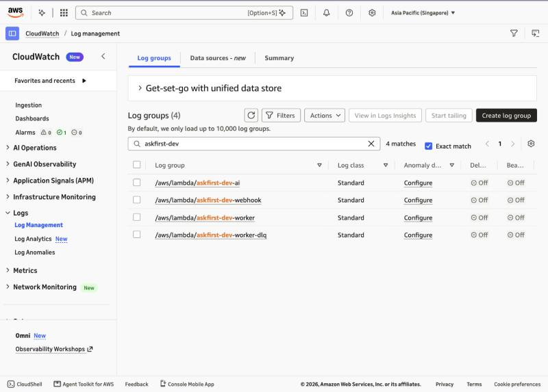
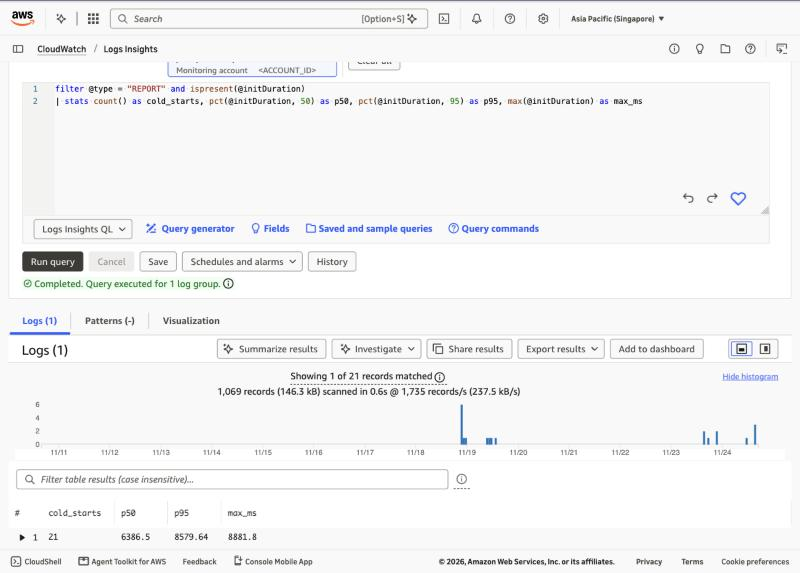
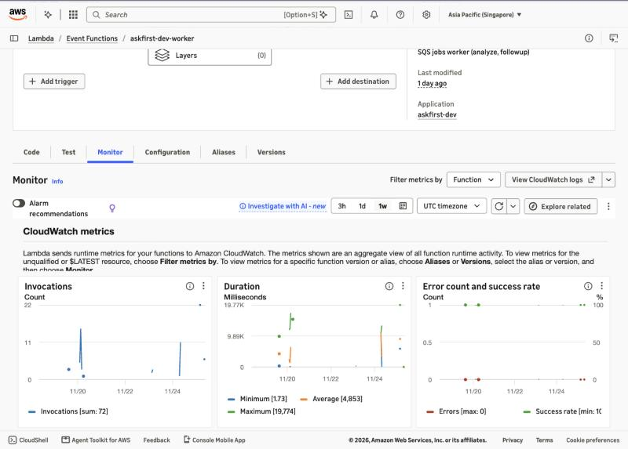
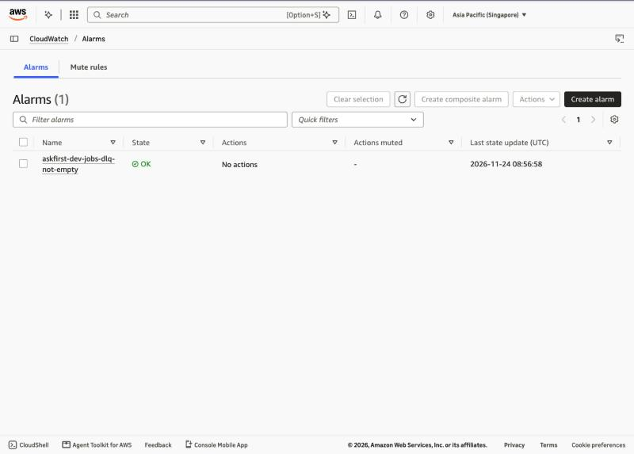

This page shows the monitoring that the stack actually has today and how to look at it. It is deliberately small: CloudWatch Logs, the built-in Lambda and SQS metrics, one alarm on the DLQ, an optional SNS email for that alarm, and AWS Budgets on the account.

| What | Exists in the stack? | Where it is defined |
|---|---|---|
| Lambda log groups (`webhook`, `worker`, `worker-dlq`, `ai`) | Yes, created by Lambda on first run | automatic |
| Log retention | **No**, logs are kept forever | not set in `infra/template.yaml` |
| Built-in metrics (`AWS/Lambda`, `AWS/SQS`, `AWS/DynamoDB`) | Yes | automatic |
| Custom metrics | **No** | the code does not publish any yet |
| Alarm `askfirst-<stage>-jobs-dlq-not-empty` | Yes | `JobsDlqAlarm` in `infra/template.yaml` |
| SNS email for the alarm | Optional | parameter `AlarmTopicArn`; the topic is not created by the stack |
| CloudWatch dashboard | **No** | |
| AWS Budgets (10, 25, 50 USD) | Yes, on the account | created by hand (task BE-01), see `infra/README.md` |

#### 5.7.1 CloudWatch Logs

Each function writes to `/aws/lambda/askfirst-<stage>-<function>`. Useful log lines:

| Function | Line | Meaning |
|---|---|---|
| `worker` | `ai_invoke op=<op> trace=<id> ms=<ms> outcome=<outcome>` | one call from the worker to `ai` |
| `worker` | `job_failed type=<job> job=<id> ... error=<code>` | a job failed; SQS will retry it |
| `ai` | JSON line with `trace_id`, `op`, `ms`, `result` | one call handled by `ai` |
| all | `REPORT ... Duration ... Init Duration` | written by Lambda; `Init Duration` appears only on a cold start |

Tail a log group from the CLI:

```bash
aws logs tail /aws/lambda/askfirst-dev-worker --since 1h --follow
```

In the console: **CloudWatch → Logs → Log groups → `/aws/lambda/askfirst-dev-worker` → Search log group**.



#### 5.7.2 CloudWatch Logs Insights queries

Open **CloudWatch → Logs → Logs Insights**, choose the log groups, set the time range, and paste a query. These are the queries the team used for `docs/results/lambda-p95.md` and the blog draft on the INIT limit.

Cold starts (run on `/aws/lambda/askfirst-dev-ai` and `/aws/lambda/askfirst-dev-worker`):

```sql
filter @type = "REPORT" and ispresent(@initDuration)
| stats count() as cold_starts,
        pct(@initDuration, 50) as p50,
        pct(@initDuration, 95) as p95,
        max(@initDuration) as max_ms
```

INIT phases that hit the 10-second limit (see 5.10):

```sql
filter @message like /INIT_REPORT/ and @message like /timeout/
| fields @timestamp, @message
| sort @timestamp desc
```

Failed jobs in the worker:

```sql
filter @message like /job_failed/
| fields @timestamp, @message
| sort @timestamp desc
| limit 50
```

Calls from the worker to `ai`:

```sql
filter @message like /ai_invoke/
| fields @timestamp, @message
| sort @timestamp desc
| limit 50
```



#### 5.7.3 Built-in metrics

Lambda and SQS publish metrics without any code. In **CloudWatch → Metrics → All metrics**:

- `Lambda → By Function Name`: `Invocations`, `Errors`, `Duration`, `Throttles`, `ConcurrentExecutions` for each `askfirst-dev-*` function.
- `SQS → Queue Metrics`: `ApproximateNumberOfMessagesVisible` and `ApproximateAgeOfOldestMessage` for `askfirst-dev-jobs` and `askfirst-dev-jobs-dlq`.

The Lambda console also shows these under **Lambda → Functions → `askfirst-dev-worker` → Monitor**.



#### 5.7.4 The DLQ alarm

The only alarm in the template is `askfirst-<stage>-jobs-dlq-not-empty`. It uses metric math `MAX([visible, received])` on the DLQ (`ApproximateNumberOfMessagesVisible` and `NumberOfMessagesReceived`, period 60 s) and goes to `ALARM` when the value is ≥ 1, meaning at least one job failed 5 times. Missing data counts as OK. SQS metrics arrive a few minutes late.

```bash
aws cloudwatch describe-alarms --alarm-names askfirst-dev-jobs-dlq-not-empty \
  --query "MetricAlarms[0].[AlarmName,StateValue,StateReason]" --output table
```

To see it fire, use the DLQ test in 5.6.4.



#### 5.7.5 Optional: email notification through SNS

Without `AlarmTopicArn` the alarm still changes state but notifies nobody. The stack does not create the topic, so create it yourself and pass its ARN at deploy time:

```bash
TOPIC_ARN=$(aws sns create-topic --name askfirst-dev-alarms --query TopicArn --output text)
aws sns subscribe --topic-arn "$TOPIC_ARN" --protocol email --notification-endpoint <your-email>
# confirm the subscription from the email AWS sends you, then:
sam deploy --parameter-overrides Stage=dev AlarmTopicArn="$TOPIC_ARN" ...   # keep your other overrides
```

The team's dev stack is currently deployed with an empty `AlarmTopicArn`, so the DLQ alarm has no actions (checked 25/11/2026). Follow the steps above to get email alerts.

#### 5.7.6 Gaps you should know about

- **No log retention.** Log groups never expire. The cost estimate recommends `RetentionInDays: 7` for the three functions (`docs/results/cost-estimate.md`, section 5).
- **No custom metrics, no dashboard, one alarm.** The cost estimate budgets for 5 custom metrics, 5 alarms and 1 dashboard, but these are planned work, not deployed.
- **No alarm on the kill switch or on cost.** Cost is watched only through AWS Budgets on the account.
