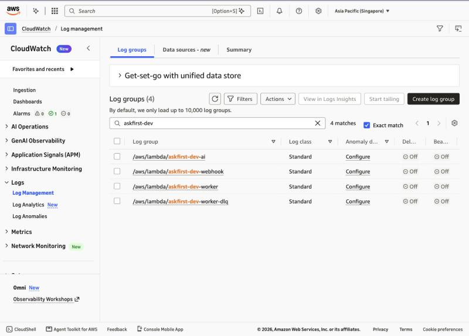
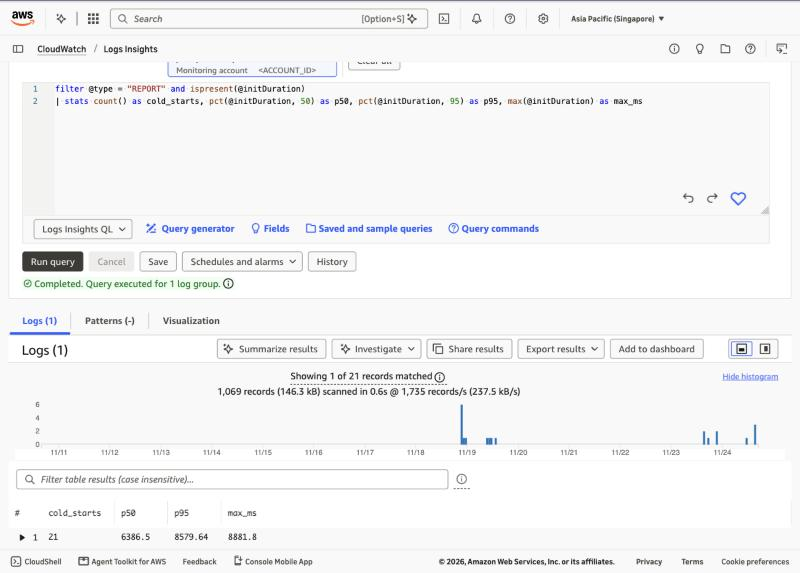
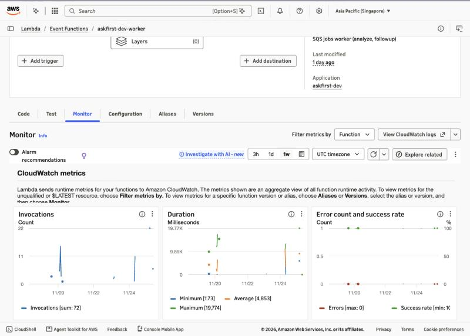
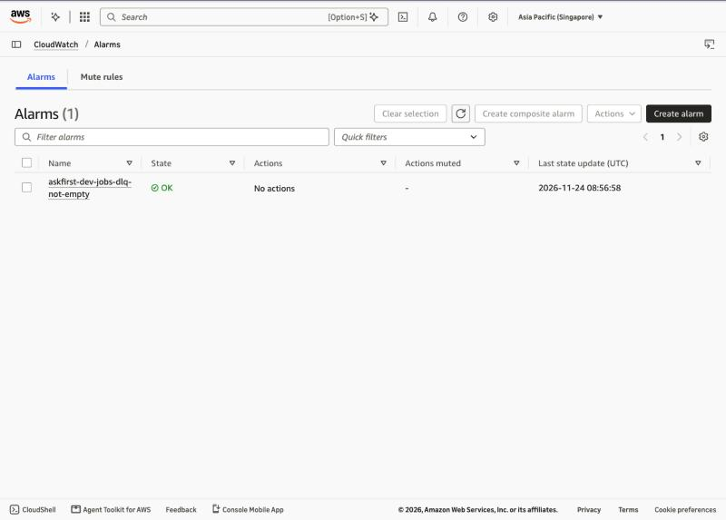

Trang này mô tả đúng phần giám sát stack đang có và cách xem. Phần này cố ý giữ nhỏ: CloudWatch Logs, metric có sẵn của Lambda và SQS, một alarm trên DLQ, email SNS tuỳ chọn cho alarm đó, và AWS Budgets ở mức tài khoản.

| Thành phần | Stack có chưa? | Định nghĩa ở đâu |
|---|---|---|
| Log group của Lambda (`webhook`, `worker`, `worker-dlq`, `ai`) | Có, Lambda tự tạo ở lần chạy đầu | tự động |
| Thời gian giữ log | **Chưa**, log giữ vĩnh viễn | `infra/template.yaml` chưa đặt |
| Metric có sẵn (`AWS/Lambda`, `AWS/SQS`, `AWS/DynamoDB`) | Có | tự động |
| Custom metric | **Chưa** | code chưa gửi metric nào |
| Alarm `askfirst-<stage>-jobs-dlq-not-empty` | Có | `JobsDlqAlarm` trong `infra/template.yaml` |
| Email SNS cho alarm | Tuỳ chọn | tham số `AlarmTopicArn`; stack không tạo topic |
| CloudWatch dashboard | **Chưa** | |
| AWS Budgets (10, 25, 50 USD) | Có, ở mức tài khoản | tạo tay (task BE-01), xem `infra/README.md` |

#### 5.7.1 CloudWatch Logs

Mỗi function ghi vào `/aws/lambda/askfirst-<stage>-<function>`. Các dòng log đáng chú ý:

| Function | Dòng log | Ý nghĩa |
|---|---|---|
| `worker` | `ai_invoke op=<op> trace=<id> ms=<ms> outcome=<outcome>` | một lần worker gọi `ai` |
| `worker` | `job_failed type=<job> job=<id> ... error=<code>` | job lỗi; SQS sẽ giao lại |
| `ai` | dòng JSON có `trace_id`, `op`, `ms`, `result` | một lần `ai` xử lý |
| tất cả | `REPORT ... Duration ... Init Duration` | Lambda tự ghi; `Init Duration` chỉ có khi cold start |

Xem log bằng CLI:

```bash
aws logs tail /aws/lambda/askfirst-dev-worker --since 1h --follow
```

Trên console: **CloudWatch → Logs → Log groups → `/aws/lambda/askfirst-dev-worker` → Search log group**.



#### 5.7.2 Truy vấn CloudWatch Logs Insights

Mở **CloudWatch → Logs → Logs Insights**, chọn log group, đặt khoảng thời gian rồi dán câu truy vấn. Đây là các câu team đã dùng cho `docs/results/lambda-p95.md` và bài viết nháp về giới hạn INIT.

Cold start (chạy trên `/aws/lambda/askfirst-dev-ai` và `/aws/lambda/askfirst-dev-worker`):

```sql
filter @type = "REPORT" and ispresent(@initDuration)
| stats count() as cold_starts,
        pct(@initDuration, 50) as p50,
        pct(@initDuration, 95) as p95,
        max(@initDuration) as max_ms
```

Pha INIT chạm giới hạn 10 giây (xem 5.10):

```sql
filter @message like /INIT_REPORT/ and @message like /timeout/
| fields @timestamp, @message
| sort @timestamp desc
```

Job lỗi trong worker:

```sql
filter @message like /job_failed/
| fields @timestamp, @message
| sort @timestamp desc
| limit 50
```

Các lần worker gọi `ai`:

```sql
filter @message like /ai_invoke/
| fields @timestamp, @message
| sort @timestamp desc
| limit 50
```



#### 5.7.3 Metric có sẵn

Lambda và SQS tự gửi metric, không cần code. Vào **CloudWatch → Metrics → All metrics**:

- `Lambda → By Function Name`: `Invocations`, `Errors`, `Duration`, `Throttles`, `ConcurrentExecutions` của từng function `askfirst-dev-*`.
- `SQS → Queue Metrics`: `ApproximateNumberOfMessagesVisible` và `ApproximateAgeOfOldestMessage` của `askfirst-dev-jobs` và `askfirst-dev-jobs-dlq`.

Console Lambda cũng hiện các metric này ở **Lambda → Functions → `askfirst-dev-worker` → Monitor**.



#### 5.7.4 Alarm DLQ

Alarm duy nhất trong template là `askfirst-<stage>-jobs-dlq-not-empty`. Alarm dùng metric math `MAX([visible, received])` trên DLQ (`ApproximateNumberOfMessagesVisible` và `NumberOfMessagesReceived`, chu kỳ 60 s) và chuyển sang `ALARM` khi giá trị ≥ 1, tức có ít nhất một job đã lỗi 5 lần. Thiếu dữ liệu được tính là OK. Metric SQS về trễ vài phút.

```bash
aws cloudwatch describe-alarms --alarm-names askfirst-dev-jobs-dlq-not-empty \
  --query "MetricAlarms[0].[AlarmName,StateValue,StateReason]" --output table
```

Muốn thấy alarm bật, chạy bài kiểm tra DLQ ở 5.6.4.



#### 5.7.5 Tuỳ chọn: email qua SNS

Không truyền `AlarmTopicArn` thì alarm vẫn đổi trạng thái nhưng không báo cho ai. Stack không tạo topic, nên bạn tự tạo rồi truyền ARN lúc deploy:

```bash
TOPIC_ARN=$(aws sns create-topic --name askfirst-dev-alarms --query TopicArn --output text)
aws sns subscribe --topic-arn "$TOPIC_ARN" --protocol email --notification-endpoint <your-email>
# xác nhận subscription trong email AWS gửi, rồi:
sam deploy --parameter-overrides Stage=dev AlarmTopicArn="$TOPIC_ARN" ...   # giữ các override khác
```

Stack dev của nhóm hiện deploy với `AlarmTopicArn` rỗng, nên alarm DLQ không có action nào (kiểm 25/11/2026). Muốn nhận email thì làm các bước trên.

#### 5.7.6 Các điểm còn thiếu

- **Chưa đặt thời gian giữ log.** Log group không bao giờ hết hạn. Dự toán chi phí đề xuất `RetentionInDays: 7` cho 3 function (`docs/results/cost-estimate.md`, mục 5).
- **Chưa có custom metric, chưa có dashboard, chỉ một alarm.** Dự toán chi phí có dự trù 5 custom metric, 5 alarm và 1 dashboard, nhưng đó là việc đã lên kế hoạch, chưa deploy.
- **Chưa có alarm cho kill switch hay chi phí.** Chi phí chỉ được theo dõi qua AWS Budgets của tài khoản.
