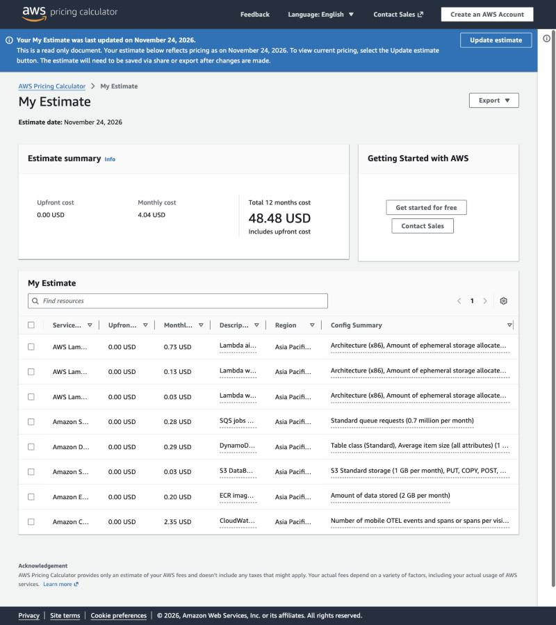

This page gives the monthly cost of running Ask First for the target load, how the number was built, and the cost measures the design already uses. All numbers come from `docs/results/cost-estimate.md` in the project repository (dated 24/11/2026).

#### 5.8.1 Result: 3,000 checks per month

| Service | How it was priced | Without Free Tier (USD/month) | With always-free tiers (USD/month) |
|---|---|---|---|
| Bedrock LLM (Qwen3 32B, backup gpt-oss-120b, `ap-southeast-2`) | by hand: 2,250 LLM calls × 0.000792 USD | 1.78 | 1.78 |
| Bedrock Guardrails | by hand: 2,250 × 0.15 USD / 1,000 text units | 0.34 | 0.34 |
| Lambda `ai` (3008 MB) | Pricing Calculator | 0.73 | 0 |
| Lambda `worker` (512 MB) | Pricing Calculator | 0.13 | 0 |
| Lambda `webhook` (512 MB) | Pricing Calculator | 0.03 | 0 |
| SQS (jobs + DLQ) | Pricing Calculator | 0.28 | 0 |
| DynamoDB on-demand | Pricing Calculator | 0.29 | < 0.05 |
| S3 data bucket | Pricing Calculator | 0.03 | 0.03 |
| ECR (`ai` image) | Pricing Calculator | 0.20 | 0.20 |
| CloudWatch (logs, metrics, alarms, dashboard) | Pricing Calculator | 2.35 | 0 |
| SNS, SSM Parameter Store (standard) | not entered | ≈ 0 | 0 |
| **Total** | | **≈ 6.16** | **≈ 2.4** |

- **AWS Pricing Calculator estimate:** <https://calculator.aws/#/estimate?id=073f413f6ac370de48bf3bff0ba10a7b870ae807> (created 24/11/2026, services in `ap-southeast-1`; Calculator total 4.04 USD/month without Bedrock).
- Bedrock is priced by hand because the Calculator does not let you select the Qwen provider in the Sydney Region.
- The "with always-free" column assumes the account still gets the always-free Lambda, SQS, CloudWatch and DynamoDB tiers. <!-- TODO(not verified): whether the team account still has these always-free tiers (Billing > Free Tier). -->
- The largest items are Bedrock (≈ 2.1 USD) and CloudWatch (2.35 USD without Free Tier).

#### 5.8.2 Assumptions

**Traffic scenario.** 3,000 checks per month (about 100 per day): 2,000 text and 1,000 image messages. Voice and the VLM fallback are not included. 25% of checks are assumed to end on the fast path or in the cache, so only 2,250 call the LLM. <!-- TODO(not verified): the 25% fast-path/cache rate; the eval set is almost all scam or tricky messages, so only 1 of 134 text samples took the fast path. -->

**Bedrock tokens (measured).** `eval/measure_cost.py` runs the real pipeline on the eval set and counts tokens per check (184 samples, 17/11/2026):

| Per check that calls the LLM | Text (133 checks) | Image (50 checks) |
|---|---|---|
| LLM calls | avg 1.2 | avg 1.1 |
| Input tokens | avg 3,685, p95 6,357 | avg 3,558, p95 6,707 |
| Output tokens | avg 297, p95 628 | avg 355, p95 591 |
| Escalated to backup model | 17% | 4% |

Unit price (AWS Price List API, `ap-southeast-2`, 17/11/2026): Qwen3 32B input 0.1545 USD and output 0.618 USD per 1M tokens. The final prompt `judge_v3` costs 0.000792 USD per check (`docs/eval-report-final.md`). If every check called the LLM at p95 token counts, Bedrock would be about 4.6 USD/month instead of 2.1.

**Other services (Calculator input, `ap-southeast-1`).**

| Item | Input | Basis |
|---|---|---|
| Lambda `ai` | 3,000 requests, 5,000 ms, 3008 MB | average ≈ 3.6 s per check, rounded up for cold starts |
| Lambda `worker` | 3,000 requests, 5,000 ms, 512 MB | waits for `ai` (assumption) |
| Lambda `webhook` | 6,000 requests, 500 ms, 512 MB | updates plus commands and buttons (assumption) |
| SQS | 0.7 million requests | mostly empty long polls by the Lambda pollers (estimate) |
| DynamoDB | 1 GB, 15,000 writes, 15,000 reads | ≈ 5 reads and 5 writes per check (assumption) |
| S3 | 1 GB, 1,000 PUT, 10,000 GET | models, KB, donated samples (assumption) |
| ECR | 2 GB | `ai` image ≤ 2 GB |
| CloudWatch | 0.5 GB logs, 5 metrics, 5 alarms, 1 dashboard | headroom for planned monitoring; only 1 alarm exists today |

Lambda durations in this table come from dev-machine runs and assumptions, made before the `ai` function was measured on Lambda. The Lambda measurements in 5.6.5 (text p95 3.5 s, image inside `ai` p95 12.2 s) are in the same range. Actual spend should be read from Cost Explorer after a week of real use. <!-- TODO(not verified): real monthly cost from Cost Explorer. -->

#### 5.8.3 Cost optimizations used in the design

| Measure | Where | Effect |
|---|---|---|
| No VPC, no NAT Gateway | `infra/README.md` (rule D1) | avoids a fixed ≈ 32 USD/month NAT cost; Lambda reaches DynamoDB, SQS, S3 and the Internet directly |
| Lambda Function URL instead of API Gateway | `WebhookFunction` in `infra/template.yaml` | no API Gateway charge |
| DynamoDB on-demand (`PAY_PER_REQUEST`) with TTL | `AskFirstTable` | pay per request at low traffic; expired items (dedup, rate limit, checks) are removed for free |
| S3 lifecycle: delete `donated/` after 30 days | `DataBucket` | storage does not grow with donated samples |
| ECR lifecycle: keep the 5 newest images, `EmptyOnDelete` | `infra/github-oidc.yaml` | old images do not accumulate; clean-up deletes images with the stack |
| Low-cost model with a backup only when needed | `ai/config/models.yaml`, ADR-001 | Qwen3 32B on demand; the bigger backup model is called only on escalation (17% of text checks) |
| Fast path and verdict cache | `ai` pipeline, `CACHE#` items | a check that skips the LLM saves ≈ 0.00094 USD (tokens + Guardrail) |
| Kill switch `llm_enabled` | `CONFIG#global / FLAGS` in DynamoDB | switches the LLM off without a deploy if the bot is spammed or the budget is at risk |
| Worker concurrency cap | `ScalingConfig.MaximumConcurrency: 5` | at most 5 jobs (and so 5 LLM calls) run in parallel |
| No provisioned concurrency | `infra/template.yaml` | no idle charge; cold starts handled by INIT warm-up instead (see 5.10) |
| AWS Budgets at 10, 25, 50 USD | account level (BE-01) | early warning on spend |

**Not done yet (recommended in `docs/results/cost-estimate.md`):**

- Set CloudWatch log retention to 7 days for the three functions. Today logs are kept forever.
- Confirm which Guardrail price line AWS bills (`ContentPolicyUnitsConsumed` at 0.15 USD/1,000 or `PromptAttackCheckUnitsConsumed` at 0.08 USD/1,000). The estimate uses the higher one. <!-- TODO(not verified): Guardrail billing line, check in Cost Explorer. -->

{}
The biggest cost risk is not the steady state but a stack left running after the workshop, or someone flooding the bot. Use the kill switch if traffic spikes, and run the clean-up in 5.9 when you are done.
{}
