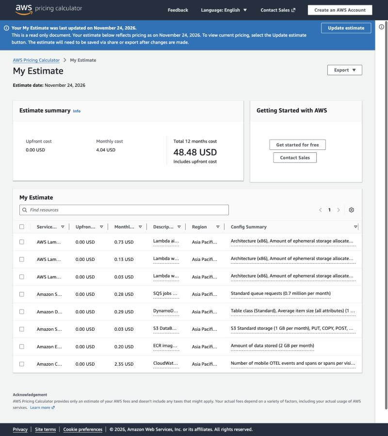

Trang này đưa ra chi phí hằng tháng để chạy Ask First ở mức tải mục tiêu, cách tính ra con số đó, và các biện pháp tiết kiệm chi phí thiết kế đang dùng. Mọi số liệu lấy từ `docs/results/cost-estimate.md` trong repo dự án (ngày 24/11/2026).

#### 5.8.1 Kết quả: 3.000 lượt kiểm tra mỗi tháng

| Dịch vụ | Cách tính | Không Free Tier (USD/tháng) | Có always-free (USD/tháng) |
|---|---|---|---|
| Bedrock LLM (Qwen3 32B, dự phòng gpt-oss-120b, `ap-southeast-2`) | tính tay: 2.250 lượt gọi LLM × 0,000792 USD | 1,78 | 1,78 |
| Bedrock Guardrails | tính tay: 2.250 × 0,15 USD / 1.000 text unit | 0,34 | 0,34 |
| Lambda `ai` (3008 MB) | Pricing Calculator | 0,73 | 0 |
| Lambda `worker` (512 MB) | Pricing Calculator | 0,13 | 0 |
| Lambda `webhook` (512 MB) | Pricing Calculator | 0,03 | 0 |
| SQS (jobs + DLQ) | Pricing Calculator | 0,28 | 0 |
| DynamoDB on-demand | Pricing Calculator | 0,29 | < 0,05 |
| S3 data bucket | Pricing Calculator | 0,03 | 0,03 |
| ECR (image `ai`) | Pricing Calculator | 0,20 | 0,20 |
| CloudWatch (log, metric, alarm, dashboard) | Pricing Calculator | 2,35 | 0 |
| SNS, SSM Parameter Store (standard) | không đưa vào | ≈ 0 | 0 |
| **Tổng** | | **≈ 6,16** | **≈ 2,4** |

- **Dự toán AWS Pricing Calculator:** <https://calculator.aws/#/estimate?id=073f413f6ac370de48bf3bff0ba10a7b870ae807> (tạo 24/11/2026, dịch vụ ở `ap-southeast-1`; tổng Calculator 4,04 USD/tháng, chưa có Bedrock).
- Bedrock tính tay vì Calculator không cho chọn nhà cung cấp Qwen ở Region Sydney.
- Cột "Có always-free" giả định tài khoản vẫn hưởng mức always-free của Lambda, SQS, CloudWatch và DynamoDB. Đã kiểm ngày 25/11/2026: tài khoản team vẫn hưởng (tháng 11 Lambda dùng ≈ 8.200/400.000 GB-giây, SQS ≈ 178.000/1 triệu request).
- Khoản lớn nhất là Bedrock (≈ 2,1 USD) và CloudWatch (2,35 USD khi không có Free Tier).

#### 5.8.2 Giả định

**Kịch bản tải.** 3.000 lượt kiểm tra mỗi tháng (khoảng 100 lượt/ngày): 2.000 tin văn bản và 1.000 tin ảnh. Chưa tính voice và VLM fallback. Giả định 25% lượt kết thúc ở fast path hoặc cache, nên chỉ 2.250 lượt gọi LLM. <!-- TODO(not verified): tỉ lệ fast path/cache 25%; bộ eval gần như toàn tin lừa đảo hoặc tin khó nên chỉ 1/134 mẫu văn bản đi fast path. -->

**Token Bedrock (đo thật).** `eval/measure_cost.py` chạy pipeline thật trên bộ eval và đếm token của từng lượt (184 mẫu, 17/11/2026):

| Mỗi lượt có gọi LLM | Văn bản (133 lượt) | Ảnh (50 lượt) |
|---|---|---|
| Số lần gọi LLM | TB 1,2 | TB 1,1 |
| Token input | TB 3.685, p95 6.357 | TB 3.558, p95 6.707 |
| Token output | TB 297, p95 628 | TB 355, p95 591 |
| Leo thang sang model dự phòng | 17% | 4% |

Đơn giá (AWS Price List API, `ap-southeast-2`, 17/11/2026): Qwen3 32B input 0,1545 USD và output 0,618 USD cho 1 triệu token. Prompt cuối `judge_v3` tốn 0,000792 USD mỗi lượt (`docs/eval-report-final.md`). Nếu mọi lượt đều gọi LLM với số token ở mức p95, Bedrock khoảng 4,6 USD/tháng thay vì 2,1.

**Các dịch vụ còn lại (số nhập vào Calculator, `ap-southeast-1`).**

| Mục | Nhập | Căn cứ |
|---|---|---|
| Lambda `ai` | 3.000 request, 5.000 ms, 3008 MB | TB ≈ 3,6 s mỗi lượt, làm tròn lên để có chỗ cho cold start |
| Lambda `worker` | 3.000 request, 5.000 ms, 512 MB | chờ `ai` trả về (giả định) |
| Lambda `webhook` | 6.000 request, 500 ms, 512 MB | update cộng lệnh và nút bấm (giả định) |
| SQS | 0,7 triệu request | phần lớn là long poll rỗng của Lambda (ước tính) |
| DynamoDB | 1 GB, 15.000 ghi, 15.000 đọc | ≈ 5 đọc và 5 ghi mỗi lượt (giả định) |
| S3 | 1 GB, 1.000 PUT, 10.000 GET | model, KB, mẫu hiến tặng (giả định) |
| ECR | 2 GB | image `ai` ≤ 2 GB |
| CloudWatch | 0,5 GB log, 5 metric, 5 alarm, 1 dashboard | dự trù cho giám sát đã lên kế hoạch; hiện chỉ có 1 alarm |

Thời gian chạy Lambda trong bảng lấy từ số đo trên máy dev và giả định, làm trước khi đo function `ai` trên Lambda. Số đo trên Lambda ở 5.6.5 (văn bản p95 3,5 s, ảnh trong `ai` p95 12,2 s) nằm cùng khoảng. CloudWatch `Duration` 14 ngày đến 25/11 (traffic test): `ai` TB 2,7 s và `worker` TB 4,6 s, đều dưới mức 5 s đã nhập; `webhook` TB 1,0 s, gấp đôi mức giả định 0,5 s, nên dòng `webhook` lên khoảng 0,06 USD.

**Chi phí thật (Cost Explorer và AWS Budgets, 01–25/11/2026).** Tải trong kỳ chủ yếu là các lần chạy eval và test của nhóm, không phải 3.000 lượt thật, nên con số dùng để đối chiếu đơn giá chứ không thay cho dự toán.

| Tài khoản | Khoản | USD |
|---|---|---|
| Tài khoản chạy Bedrock | Qwen3 32B (11,8 triệu token vào, 0,94 triệu ra) | 2,40 |
| | gpt-oss-120b (2,5 triệu token vào, 0,44 triệu ra) | 0,66 |
| | Guardrails, dòng `ContentPolicyUnitsConsumed` (3.266 text unit × 0,15 USD / 1.000) | 0,49 |
| | Gemma 3 12B (benchmark G1) | 0,02 |
| | Thuế (≈ 10%) | 0,36 |
| | **Tổng** | **3,93** |
| Tài khoản dev (Lambda, SQS, DynamoDB, S3, ECR, CloudWatch) | theo AWS Budgets, dự báo cả tháng ≈ 0,10 | 0,09 |

- AWS tính Guardrail theo dòng `ContentPolicyUnitsConsumed` (0,15 USD / 1.000), đúng mức dự toán đang dùng.
- Hoá đơn có thêm ≈ 10% thuế; bảng 5.8.1 và Pricing Calculator đều chưa tính thuế.

#### 5.8.3 Các biện pháp tối ưu chi phí đã dùng

| Biện pháp | Ở đâu | Tác dụng |
|---|---|---|
| Không VPC, không NAT Gateway | `infra/README.md` (quy tắc D1) | tránh khoản cố định ≈ 32 USD/tháng của NAT; Lambda gọi thẳng DynamoDB, SQS, S3 và Internet |
| Lambda Function URL thay cho API Gateway | `WebhookFunction` trong `infra/template.yaml` | không tốn phí API Gateway |
| DynamoDB on-demand (`PAY_PER_REQUEST`) có TTL | `AskFirstTable` | tải thấp thì trả theo request; item hết hạn (dedup, rate limit, lượt kiểm tra) được xoá miễn phí |
| S3 lifecycle: xoá `donated/` sau 30 ngày | `DataBucket` | dung lượng không phình theo mẫu hiến tặng |
| ECR lifecycle: giữ 5 image mới nhất, `EmptyOnDelete` | `infra/github-oidc.yaml` | image cũ không tích lại; dọn stack là xoá luôn image |
| Model rẻ, chỉ gọi model dự phòng khi cần | `ai/config/models.yaml`, ADR-001 | Qwen3 32B on-demand; model dự phòng lớn hơn chỉ gọi khi leo thang (17% lượt văn bản) |
| Fast path và cache kết quả | pipeline `ai`, item `CACHE#` | mỗi lượt bỏ qua LLM tiết kiệm ≈ 0,00094 USD (token + Guardrail) |
| Kill switch `llm_enabled` | `CONFIG#global / FLAGS` trong DynamoDB | tắt LLM không cần deploy khi bot bị spam hoặc sắp vượt ngân sách |
| Giới hạn song song của worker | `ScalingConfig.MaximumConcurrency: 5` | tối đa 5 job (tức 5 lần gọi LLM) chạy cùng lúc |
| Không dùng provisioned concurrency | `infra/template.yaml` | không trả tiền lúc rảnh; cold start xử lý bằng warm-up ở pha INIT (xem 5.10) |
| AWS Budgets ở 10, 25, 50 USD | budget `Monthly` 50 USD của tài khoản (BE-01; mức 10 và 25 USD thêm ngày 25/11/2026) | cảnh báo sớm về chi tiêu |

**Chưa làm (đề xuất trong `docs/results/cost-estimate.md`):**

- Đặt thời gian giữ log CloudWatch 7 ngày cho 3 function. Hiện log giữ vĩnh viễn.
- Gắn lifecycle policy cho repo ECR `askfirst-dev-ai` mà stack dev đang dùng. Policy giữ 5 image trong `infra/github-oidc.yaml` chỉ áp cho repo `askfirst-ai`; repo dev chưa có policy (kiểm 25/11/2026).

{}
Rủi ro chi phí lớn nhất không nằm ở mức chạy ổn định mà ở stack bị bỏ quên sau workshop, hoặc bot bị gửi tin ồ ạt. Dùng kill switch khi lưu lượng tăng đột biến, và chạy phần dọn dẹp ở 5.9 khi làm xong.
{}
